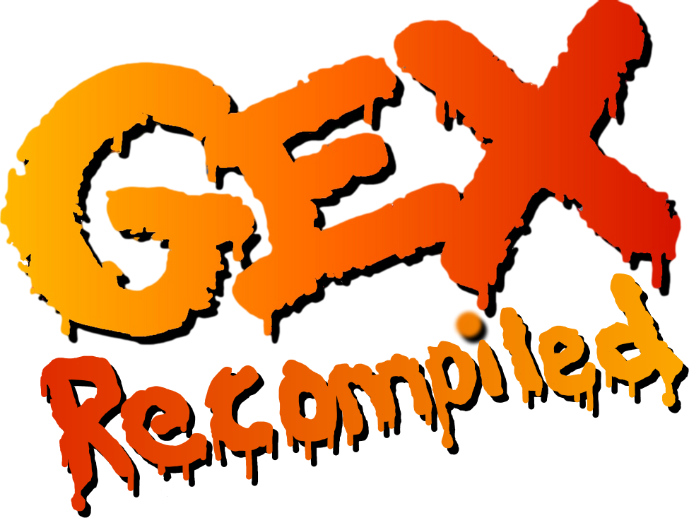

**Disclaimer:** This project and its coordinator are not affiliated with Crystal Dynamics, Microsoft or Square Enix. Gex is a registered trademark of Crystal Dynamics and later Square Enix, and the rights to the PC version belong to Microsoft. The trademark is used only to indicate compatibility with their software. No original game assets or code is being distributed through this project.

## What is this?

A work-in-progress AI-led static recompilation of the [Windows release of Gex (1995) from GOG](https://www.gog.com/en/game/gex) for Linux, macOS, Windows, Android and Dreamcast, using [pcrecomp](https://github.com/sp00nznet/pcrecomp) by sp00nznet and a version of the [Claude Code skill](https://github.com/DohmBoy64Bit/pcrecomp-skill) by DohmBoy64Bit adapted for GitHub Copilot. Huge thanks to the creators of those repositories.

## Usage

Place the release binary beside the Gex installation folder and launch it.

For Dreamcast, build a disc image using the [Google Collab notebook](https://colab.research.google.com/drive/1iSmvVwsAUM3AcrhQpQ6I9beYAy6lBi0H?usp=sharing) and run it through your preferred method of launching homebrew.

## Why GOG? Can I use another version?

The GOG version was chosen due to accessibility. The physical PC release is untested; if you have it, I would greatly appreciate it if you could test it and report whether it works.
The 5th-gen console or Gex Trilogy releases are unsupported.

## Should I actually use this?

Not right now, as there's a substantial amount of work left to make this a worthwhile version of the game.

## AI-led?

As in entirely vibecoded and only vaguely steered due to a lack of necessary knowledge and the output being adequate. You may have concerns regarding this, but I've made my choice. However, if you do have the necessary knowledge to produce a human-led project with the same goal, I urge you to proceed, as this would be the better outcome for the preservation of Gex.

## Features

- Native bgfx rendering, bypassing the original software rasteriser and DirectDraw presentation.
- Native OpenAL and DirectSound backends for audio.
- Custom resolution support (widescreen 427x240 works fine minus the occasional odd texture tiling; usage of higher resolutions is not recommended).
- Password saving.

## Controls

Remapping accessible in the game settings.

Keyboard:

Movement - arrow keys
Jump - X
Tail whip - Z
Tongue - C
Run - V
Fullscreen - F11

Gamepads:

Movement - D-pad/left joystick
Jump - A
Tail whip - X
Tongue - B
Run - Right shoulder button

## Planned features

- Ingame settings
- Remapping
- Texture pack support
- UWP (Xbox One/Series) support, feel free to contact if you're able to test on Xbox One

## Contributing

See [CONTRIBUTING.md](CONTRIBUTING.md).
