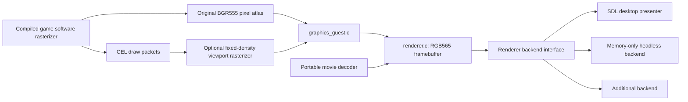

# Development guide

This guide covers source generation, runtime and rendering internals, backend
contracts, regression checks, and porting constraints. For installation,
controls, and player-facing features, see the [README](../README.md).
All commands below run from the project root.

## Project background

A work-in-progress native recompilation of the DRM-free GOG PC release of
Gex, using [sp00nznet/pcrecomp](https://github.com/sp00nznet/pcrecomp).
The original executable is loaded as data; on Linux, macOS and Android, its recovered functions
execute as compiled C, not x86 machine code. These targets do not use Wine;
Wine is used to test the cross-compiled Windows executable.

**This is a prototype, not a finished replacement for the original game.**

## Status

| Target | Current state |
| --- | --- |
| Linux x86-64 | Built and run: both startup AVIs finish, animated title menu, world and cemetery maps, first graveyard level, movement/jump input, and normal guest exit. No complete playthrough yet. |
| Windows x86-64 | MinGW-w64 HLE/SDL/FFmpeg build exercised headlessly under Wine. No physical Windows installation or complete playthrough validated. |
| Windows x86 | MSVC/native32 launcher and CMake path provided; not built or run on Windows. |
| macOS ARM64 | Linux OSXCross build run headlessly on an M1 with macOS 15.7.7: software and bgfx/Metal first-level gameplay, complete startup AVIs, native audio through the silent null device, and normal guest exit. No visible-window testing or complete playthrough yet. |
| macOS x86-64 | Separate Intel-only OSXCross build exercised headlessly through Rosetta 2 on the M1: 32 target checks, software/Metal first-level gameplay, both complete startup AVIs and normal guest exit. Physical Intel Macs and their GPUs remain untested. |
| Android ARM64/x86-64 | Both debug APKs bundle Vulkan and OpenGL ES 3.1. Both APIs run on an Android 15 x86-64 emulator and a Pixel 9a running Android 17. Physical native-window gameplay captures confirm the compute-only swap flicker fix on both APIs. No full playthrough or physical audio/controller validation yet. |
| Dreamcast | Experimental KallistiOS/SH4 backend renders and completes both original intro AVIs under headless Flycast with 16 MiB RAM. Physical hardware, a complete playthrough and VMU persistence remain unverified or unfinished. |

The lift contains 1,988 discovered function entries, including overlapping
bodies and possible data misidentifications. This count is not proof of
complete recovery. Twelve unsupported instruction sites abort with an address
if reached, rather than silently continuing.

## Reverse-engineering reference

[Hydroloxed/gexdecomp](https://github.com/Hydroloxed/gexdecomp) is an unfinished
decompilation of the 1996 Windows release, used as a supplementary reference.
At revision `8ba8078060b0c224dfc5291447cb3e6ed2fe8784`, its
[`GXObject` layout](https://github.com/Hydroloxed/gexdecomp/blob/8ba8078060b0c224dfc5291447cb3e6ed2fe8784/src/game/ob.h)
agrees with the recovered position offsets (`gob_xpos` at `0x78`, `gob_ypos`
at `0x7C`). Its function labels also identify `PlayerInit` at `0x00417780`
and `MapPlayerDoIt` at `0x0042B7F0`, matching this executable's code.
These checks support the gameplay observations below, but do not establish
complete binary equivalence. Many reference functions, including those two,
are still `UNIMPLEMENTED`; they are not replacements for the lifted bodies.
The supplied executable and observed runtime behavior remain authoritative.

## Required original installation

Supply your own authorized GOG installation in `Gex/`, including `GEX.exe`,
`AVI/`, `IDL/`, `LEV/`, `MUS/`, `SFX/`, and `VFX/`. Alternatively pass
`--data /path/to/Gex` when running. The original executable must have this
SHA-256:

```text
e1fd63ecb09fca29d63286e22447752dcb120d7e682f8759d1021776f7698b86
```

Other releases require separate analysis and generation. Both the generator
and launcher reject an incompatible executable. Do not redistribute the
original installation, game assets, or mechanically recovered game code.

Desktop releases can import this installation at first launch. Windows uses
the native COM folder dialog, Linux runs `zenity` (or `kdialog` if unavailable)
without a shell, and macOS uses AppKit. Windows/Linux copy into the default
working-directory `Gex`; the macOS `.app` imports into its own Resources, as
described below. Android uses its system document-tree picker and private
app storage. Setup is separate from the original title and Options menus.

Desktop and Android importers use the pinned `config/game-assets.sha256`
manifest: 661 required files covering `GEX.exe` and every supported AVI, IDL,
LEV, MUS, SFX and VFX asset. Before any copying or staging-directory creation,
each file must be present and readable and match both its exact byte count and
SHA-256. Missing, truncated, modified and corrupted files are rejected with
the failing relative path. The manifest contains metadata only, not retail data;
ordinary builds never derive trusted checksums from a user-selected installation.
`tools/game_asset_manifest.py` generates the C table for desktop builds and
the Java table during Android packaging from the same manifest.

The desktop importer copies all regular files and
directories through an exclusive sibling staging folder, rejects links and
special files, validates the copy, and atomically promotes it without replacing
an existing destination. Errors are shown explicitly; failure removes the
current staging folder and allows another selection. All required staged files
are rehashed before promotion, detecting source changes during copying.
Original files are never
modified. An existing incomplete destination must be moved aside by the user,
not silently merged or deleted. `--data PATH` remains a direct-use override;
headless, check-only, dummy-video and smoke runs never invoke the desktop UI.

## Generate the C sources

Requirements: Git and Python 3.10 or later. Run from this project's root:

```sh
git clone https://github.com/sp00nznet/pcrecomp.git pcrecomp
git -C pcrecomp checkout 12dd9642cd3675024161bfc567b5b42ada0134d2
python3 -m venv .venv
.venv/bin/python -m pip install -r requirements.txt
.venv/bin/python tools/generate.py
```

On Windows, use `py -3 -m venv .venv` and `.venv\Scripts\python.exe`
instead. Use `tools/generate.py --exe /path/to/GEX.exe` for another installation
path. For a toolchain outside `pcrecomp/`, also pass `--toolchain /path/to/pcrecomp`.

The wrapper invokes `python -m tools ... --all -o ... --split 100` from the
pinned toolchain checkout. It writes `recomp_*.c`, `recomp_dispatch.c`, and
`recomp_funcs.h` under `src/recomp/gen/`, plus analysis and a lift manifest
under `config/`. It rejects failed lift bodies, turns unsupported instructions
into explicit traps, and adds cooperative scheduling points to backward
branches. Those points are necessary for the game's guest threads.

## Build and run on Linux

Build outputs live under `build/<platform>/`. Linux configurations use
`build/linux/debug`, `build/linux/release`, and `build/linux/clang`;
Windows uses `build/windows/mingw` (or `build/windows/msvc`), and Dreamcast
uses `build/dreamcast`. Keep compiler/configuration variants in separate
directories. After relocating a configured build, regenerate its CMake
metadata with `cmake --fresh -S . -B <new-path>` and the original toolchain
and configuration options; generated build files contain absolute paths.

Requirements: a C11 compiler, CMake 3.20+, Ninja (or another CMake generator),
pkg-config, SDL2, SDL2_ttf, OpenAL, and FFmpeg development libraries
(`libavformat`, `libavcodec`, `libavutil`, `libswscale`). The FFmpeg build must
include the Indeo 3 decoder for the original startup movies.
The default SDL build also includes bgfx; its build helper prepares the pinned
dependencies and host shader compiler. Linux native Wayland presentation
requires the Wayland EGL development library.

```sh
tools/build-bgfx.sh build/linux/release \
  -DPython3_EXECUTABLE="$PWD/.venv/bin/python"
build/linux/release/gex_recomp --check
build/linux/release/gex_recomp
```

For a build without bgfx, configure directly with
`-DGEX_ENABLE_BGFX_RENDERER=OFF`; this also avoids its dependency setup.

CMake applies the checked-in fixes in `patches/` to the toolchain's portable
runtime. Application is idempotent and fails on conflicting source changes.
The consolidated `patches/pcrecomp-runtime.patch` implements the
pressed-since-query bit of `GetAsyncKeyState`, which the world-map navigation
needs, paused audio streams, backpressure for movie/WAV playback, and atomic
settings saves. It preserves flags, SIMD and segment state as well as
integer/x87 registers across guest-thread handoffs and native-to-guest callbacks.
The desktop presentation backend keeps SDL rendering and event polling on the
thread that created the renderer. Guest workers may update framebuffers but
cannot present them or consume pending presentation state.

## Platform boundaries

The guest's Windows API names and calling conventions remain compatibility
contracts, not dependencies on a Windows host. Do not remove those contracts
or rewrite generated game code to port the game.

Shared project sources under `src/` use C11, the guest compatibility contracts,
and the interfaces below. Linux/POSIX primitives live under `src/platform/linux/`,
Windows primitives under `src/platform/windows/`, and shared SDL/FFmpeg services
under `src/platform/desktop/`. `src/platform/hle/` holds shared guest-memory
adapters. The Linux directory also retains the validated macOS POSIX branches;
macOS uses these shared implementations rather than a separate backend.
Executable identity checking uses portable streaming SHA-256, with no crypto
library or movie-decoder dependency.

| Interface | Responsibilities |
| --- | --- |
| `src/platform/host.h` | Guest-addressable allocation, launcher paths/diagnostics, clock/delay, screensaver, screenshots, WAV loading. |
| `src/platform/input.h` | Standardized pad snapshots and guest key publication; mapping, keyboard merging and analog hysteresis stay in `src/gamepad.c`. |
| `src/platform/runtime.h` | Machine/mutex locks, once initialization, threads/processes, clocks/calendar, virtual memory and file views. |
| `src/platform/filesystem.h` | File tokens, directories, metadata/timestamps, paths, disk information and atomic settings replacement. |
| `src/platform/audio.h` | Independent PCM voices, native cursors, gain/pan, frequency, pause/shutdown and bounded movie/WAV streams; no shared sample mixer. |
| `src/platform/font.h` | Opaque fonts, metrics and malloc-owned coverage masks; guest GDI layout and compositing stay portable. |
| `src/renderer.h` | Framebuffer ownership, size/format selection and presentation. |
| `src/movie_decoder.h` | Streaming movie events, decode buffers and rewind. |
| `win32hle.h`, upstream `host.h` | Guest API semantics, callbacks, memory, audio streams, messages and settings. |

`cmake/runtime-core.cmake` lists the active guest compatibility sources explicitly.
They retain Windows API semantics, register/callback state, guest allocation
policy, file/path/registry rules, events, waits, DirectSound object semantics, and GDI
layout without SDL/POSIX headers or calls. `gex_hle` is their separate static
library; desktop SDK compile dependencies belong to `gex_runtime_platform`,
not to that core. Portable C11 atomics/TLS and standard C library I/O remain.
`runtime_core.c` supplies platform-independent once/string helpers.

The desktop backend implements the primitive interfaces, plus the existing
`hle_screen_*` and `hle_present_*` display/input contracts in its own `screen.c`
and `present.c`. Guest millisecond clocks and performance counters share the
same monotonic clock. The PE loader uses the descriptor filesystem interface. Gex does not
import Winsock or Miles: their registration, network polling, and source files
are excluded, rather than replaced with networking or MP3 backends.

The register-machine lock is nonrecursive; the compatibility layer owns nesting.
A blocking guest shim must keep `hle_block_begin/end` around its wait, so another
guest thread can run. Starting a worker must not synchronously execute its entry
function; successful workers are detached, and their argument storage must outlive
them. Timer cancellation still waits for callbacks in progress except when called
by the callback itself. Do not replace these operations with no-op locks or a
busy-wait on a single-threaded port.

Allocation must supply both a host pointer and a valid guest VA. WAV loading
returns native-endian interleaved S16 samples allocated with `malloc`; the
portable player owns and frees them. The input backend polls only on its owner
thread and reports focus/disconnection; `reset` releases the previous pad before
an immediately available replacement is consumed. These rules preserve held keys,
fresh-press edges, and keyboard-plus-pad merging.

### Selecting a host

`GEX_PLATFORM_FILE` selects the backend manifest; it defaults to
`cmake/platforms/desktop.cmake` on non-Windows hosts,
`cmake/platforms/mingw.cmake` for MinGW, and
`cmake/platforms/windows.cmake` for MSVC:

```sh
cmake -S . -B build/linux/custom \
  -DCMAKE_TOOLCHAIN_FILE=/absolute/path/to/target-toolchain.cmake \
  -DGEX_PLATFORM_FILE=/absolute/path/to/target-platform.cmake
```

The Dreamcast toolchain selects `cmake/platforms/dreamcast.cmake`, which supplies
native KallistiOS implementations under `src/platform/dreamcast/`.
Each manifest owns dependency discovery, backend source selection and libraries.
Required variables are `GEX_PLATFORM_RUNTIME` (`hle` or `native32`),
`GEX_HOST_SOURCES`, `GEX_LAUNCHER_SOURCES`, and `GEX_DEFAULT_RENDERER`.
An HLE manifest also defines `GEX_DEFAULT_MOVIE_DECODER` and these explicit
source lists: `GEX_RUNTIME_MACHINE_SOURCES`, `GEX_RUNTIME_MEMORY_SOURCES`,
`GEX_RUNTIME_SYSTEM_SOURCES`, `GEX_RUNTIME_STORAGE_SOURCES`,
`GEX_RUNTIME_DISPLAY_SOURCES`, `GEX_RUNTIME_AUDIO_SOURCES`,
`GEX_RUNTIME_COMPAT_SOURCES`. Include `cmake/runtime-core.cmake` to reuse all
guest compatibility groups unchanged, then provide `GEX_RUNTIME_PLATFORM_SOURCES`
implementing the primitive and display/input contracts for the new host.
All groups must be nonempty. The desktop manifest is the working example.
Source paths are absolute or relative to the project root.
Optional `GEX_HOST_LIBRARIES` and `GEX_PLATFORM_LIBRARIES` supply dependencies;
`gex_configure_movie_decoder(target, source)` configures codec-specific libraries.
Set `GEX_PLATFORM_DESKTOP_TESTS` for backends implementing the SDL desktop
contracts, including MinGW.
Generic renderer, SHA-256 and input-mapping tests do not link SDL or FFmpeg.

The existing `GEX_RENDERER_BACKEND_SOURCE` and `GEX_MOVIE_DECODER_SOURCE`
overrides still work. Selecting a custom decoder avoids all FFmpeg discovery
and linkage; the desktop manifest still requires SDL for its other services.
Use a new build directory when changing platforms to avoid cached source overrides.
No wildcard adds new upstream HLE implementations to a backend.

**Remaining target porting work:** implement the backend interfaces and a manifest
for the target; no guest compatibility source-group rewrite is required for host
operations. Linux, macOS ARM64, macOS x86-64 through Rosetta and the MinGW executable under Wine have been exercised. The desktop sources
are not a WebAssembly backend; no browser backend is supplied. The Dreamcast
manifest reuses the same guest compatibility sources with a different memory
backend and compact stack/table limits. Desktop defaults remain a 4 GiB virtual
reservation and a 4 MiB guest stack per thread.
The native32 backend deliberately retains its own Windows launcher and real
Windows guest imports; it currently supplies only allocation from `host.h`,
not the complete desktop launcher-service interface.

## Modular renderer

The active game no longer calls DirectDraw or links its emulation. The
generation pipeline replaces the verified original display-management entry
points and frame flush with `src/graphics_guest.c`, and removes the two movie
cooperative-mode sequences. This is a replacement at the original game-code
boundary, not a new wrapper around DirectDraw.

The original sprite/tile rasterizer still writes its BGR555 software atlas.
`gex_graphics_flush` uploads its active 320x224 picture (atlas rows 8 through 231)
through `src/renderer.h`; the core
converts it to RGB565 little-endian and scales it to the selected logical size.
This intentionally fills the logical 320x240 or 640x480 output instead of
showing the original fullscreen mode's unused eight-row borders.
The portable movie player decodes directly into the same renderer framebuffer,
without this gameplay crop.

### Custom level viewport

The original approximately 30 FPS cadence is preserved, but the frame limiter
blocks for the remaining time until its existing 33 ms deadline instead of
busy-polling `Sleep(0)` and the clock. It rechecks the clock after waking and
retains the original late-frame handling. Other synchronization yields and the
separate 17 ms timer callback are unchanged. This does not enable 60 FPS.

Select the level's internal rendering size, independently of the original
320x240/640x480 game setting. One world pixel occupies one render pixel:

```sh
build/linux/release/gex_recomp --render-size 426x224
build/linux/release/gex_recomp --render-size 640x360
build/linux/release/gex_recomp --render-size 1237x701
```

The same option is available in the Windows launcher. Dimensions must be
positive decimal integers separated by a lowercase `x`, at most 8192 per axis
and 16,777,216 pixels in total. The requested size survives original game-mode
changes. Without the option, the existing legacy rasterization path is unchanged.

This changes **visible world area, not pixel density**. A 640x448 target covers
twice the width and height of the original active 320x224 picture. An eight-pixel
sprite remains eight pixels wide; larger targets do not enlarge sprites or
recover additional texture detail. The desktop presenter can still scale the
finished frame to the window.
On the SDL desktop backend, the initial window fits this aspect ratio within
the default 1280x960 window bounds instead of always opening at 4:3.
Subsequent manual window resizing is preserved.

The rendering camera expands around the original view and clamps against map
dimensions and the authored camera barriers on the current side of the level.
Boundary records remain available outside the native object-activation range;
live barrier callbacks supply any moved or disabled positions for that update.
The renderer's half-frame motion offsets use the same clamp, avoiding a backward
nudge as the original camera starts following Gex away from an edge.
Views larger than the bounded area leave the excess space black rather than
showing scenery beyond those limits; HUD anchors still use the full target.
Dimension-aware chunk traversal, tile-edge limits, parallax
submission, and object drawing bounds submit real scenery beyond the original
viewport. The simulation camera, scripted camera barriers, object activation,
physics, and password progress retain their original behavior. Late player/effect
draws, including portal shrinking and reappearance, use the same render camera as
the scenery, scoped to drawing without shifting the gameplay state. A larger view can expose
inactive objects, unfinished scenery, empty map cells, or the boundaries of
background art designed for the original screen. It does not create missing
level content. The gameplay HUD uses screen-space anchors: score stays at the
upper left; lives and the firefly-coin counter receive one third and two thirds
of the extra horizontal space, respectively; health and inventory stay at the
upper right; bonus counters stay at the bottom. This distributes the added width
evenly between groups while keeping each icon and its digits together.
HUD sprites and spacing use the largest whole-number scale that fits the
original 320x224 active picture into the target, with pixel-snapped placement.
Targets smaller than that picture still use fractional downscaling to fit.
HUD CELs are rasterized at their original size before pixel replication, so
integer enlargement does not change texture sampling or multipart alignment.
Original HUD animation transforms are preserved. For example,
`--render-size 427x240` keeps the HUD at 1x and `854x480` uses 2x, widening the world while
keeping the HUD near the screen edges without stretching its artwork. Title,
level-name, level-select map, game-over and level-finish/results artwork uses a centered,
uniformly fitted 320x224 composition.
CELs are sampled on the native pixel grid before fitting their coverage, so
fractional sizes such as 427x240 cannot independently distort narrow shadow
pieces relative to the foreground. Software and GPU packet rendering use the
same fitted grid; full-viewport clears and fades retain their expanded coverage.
Their static backdrops tile at the original pixel size across the whole viewport
instead of stretching. Game-over's room backdrop stays fitted with its foreground,
including outside the death/TV-off scope and during outgoing scene changes.
The results screen's reused gameplay HUD uses the same
screen-edge anchors and whole-number pixel replication as during gameplay;
only the results artwork and bonus counters remain in the fitted composition.
All seven level-select
maps keep their original camera and navigation coordinates inside the fitted view.
Both expanded draw planes start on black when a different fitted scene/map begins,
so uncovered map borders cannot retain the preceding death screen's static.
This reset follows the displayed scene/map identity, not the destination level ID,
and does not repeat during incremental redraws or outgoing fades.
The death/TV-off routine has its own fitted-layout scope, including its static
backdrop and fade; backdrop packet tags do not tile during that scope. Its
vertical and horizontal collapse loops call the existing 33 ms guest frame
limiter once per animation step instead of running at software-rasterizer speed.
The original collapse steps, skip-input checks, and ordinary gameplay cadence
remain unchanged.
The outgoing scene retains that layout and its cached
backdrop classification during fades, even after the destination level changes.
Backdrop tags follow packet allocation lifetimes: recycling arena memory retires
its old tags, so foreground artwork never inherits tiling from an earlier static
packet at the same address.
These layouts
derive from the target dimensions, including higher resolutions and ultrawide
sizes such as 1920x1080, 2560x1080 and 3440x1440. Other menu scenes retain their
original world-space layouts. Modest sizes such as 427x240 or 640x360 remain more
practical for gameplay than showing thousands of world pixels at once.
Movies preserve their source aspect ratio, fit within the target and are
centered with black padding instead of being stretched.

The generated CEL packet dispatcher submits draws to `src/raster.c`, a
platform-independent C software rasterizer supporting textured quads, indexed
and direct-color sprites, rectangles, clipping, palette modulation, masking,
and half-transparency. Two independent BGR555 planes keep extended pixels out of
the guest texture atlas, which is never enlarged or repurposed. The renderer
retains the original integer/fixed-point sampling and mirrored-axis
texel correction for axis-aligned CEL quads, keeping multipart sprites aligned.
The packet arena grows with the viewport so extra tiles do not overwrite queued draws.
The original rasterizer still runs for game code that reads its framebuffer.
Raw framebuffer edits are imported one-for-one within the original 320x224
picture; full-picture solid clears and fades cover the full target.
Pause presentation dims the complete expanded viewport and centers/scales the
original pause banner, retaining the original second-plane copy behavior.

The packet rasterizer does not depend on SDL, FFmpeg, or a particular backend.
The Dreamcast backend presents its output using native video memory; a complete
console playthrough is not validated. CPU work
and memory increase with pixel count: the output and two draw targets alone use
six bytes per output pixel (about 47.5 MiB at 3840x2160), plus legacy snapshots
and backend storage. A memory-constrained port should choose a modest internal
resolution or replace packet rasterization with a hardware implementation.

The generated display-list entry also calls `gex_graphics_begin_frame`.
The original level-name/loading scene starts each legacy active picture on black:
its masked static-background tiles otherwise leave black texels untouched,
retaining fragments of earlier Gex animation poses. The compatibility target's
CPU history is reset to that same black picture before drawing: stale exported
history must not cause later synchronization to erase newly drawn tiles.
Other scenes keep their
existing legacy framebuffer contents for fades and incremental drawing.
Custom world targets start each submitted scene on black as well: background
art need not cover the enlarged area, and masked scenery must not retain old
Gex poses there. Texture pages and palettes are not cleared, and movie-owned
display is not rasterized.



### Hardware-renderer hook map

This inventory records the original integration boundaries. The exclusive
desktop OpenGL and Dreamcast PVR consumers described below now implement them.
Addresses below belong to the supported GOG executable identified above. The
packet opcode and sprite dispatch tables were checked against that executable,
not inferred from a generic PlayStation GPU API. Source references describe the
current generated lift and portable adapters; generated line numbers can change
on regeneration.

The main insertion point is **`gex_graphics_draw_packet` at original entry
`0x00444DC0`**, before the original dispatcher performs pixel work. It already
collects the atlas, inherited texture page, clipping, draw plane and layout
metadata into `gex_raster_state`. Software can retain the observation/second
rasterization path; hardware selection bypasses the original pixel dispatcher.
Dreamcast allocates its native 320x240 targets automatically, including without
`--render-size`. Neither replacing `gex_raster_packet` alone nor changing the
RGB565 upload callback would have eliminated the original CPU rasterizer.

#### Submission, ordering and presentation

| Boundary | Current location / original address | Hardware integration responsibility |
| --- | --- | --- |
| Individual primitive and state command | `src/graphics_guest.c`: `gex_graphics_draw_packet`; `recomp_0017.c`: `sub_00444DC0`, `0x00444DC0` | Decode/snapshot the packet and current state here. Hardware selection bypasses the original pixel branches while preserving state commands and the guest ABI. |
| Display-list traversal | `sub_00445140`, `0x00445140`; entry/return hooks in `tools/graphics_rewrite.py` | `gex_graphics_begin_frame` and `gex_graphics_end_frame` bracket one linked-list traversal. Preserve link order; the first word is the next guest pointer, with low-24-bit `0xFFFFFF` termination. Do not treat list completion as a guaranteed display flip or clear. |
| Deferred texture transfers before lists | `sub_0043DB70`, `0x0043DB70` | Drains upload records at `0x464E48` through `sub_004451E0` before optionally traversing a draw list. Preserve upload-before-draw ordering. Its alternating list heads and producer flags are game-owned. |
| Cached-list fades | `sub_0043F580`, `0x0043F580` | Changes existing packet RGB bytes in place and repeatedly calls `sub_00445140`. Cache identity cannot be just packet address; capture colors at submission and preserve incremental drawing. |
| Actual gameplay presentation | `gex_graphics_flush`, replacement of `0x00406C30` | Keep the movie gate, `0x487A90` frame-counter increment, pause-plane selection/copy and guest return behavior. Finish/publish GPU work here rather than uploading the stale legacy picture over it. This remains distinct from list begin/end. |
| Presentation wrappers | `sub_00445240`, `0x00445240`; `sub_0043F290`, `0x0043F290`; `sub_0043F2D0`, `0x0043F2D0` | Reset palette-cache bookkeeping and invoke flush before switching game descriptors. `sub_00445270` merely returns its descriptor argument in this binary; it is not a hardware drawing-environment implementation. Preserve existing order and return values. |
| Packet storage reuse | `gex_graphics_packet_arena` at return `0x0044114B` of `sub_00441130`; `gex_graphics_packet_allocated` | Invalidate cached commands/layout tags when the arena resets or allocations overwrite ranges. Allocation hooks run before writes to cursor `0x4A2AE4`, excluding initialization. Do not retain guest packet pointers until asynchronous GPU completion. |

The common list entry has one direct packet-dispatch call. Its callers are
`0x0043DB70` and `0x0043F580`; the latter is especially important for fades and
death screens. Direct flush callers include `0x00403960`, `0x004051A0`,
`0x0043F2F0` and `0x00445240`. All of these already converge on the replacement
flush. A list may be reused, submitted without immediately presenting, or absent
when a CPU-generated screen is flushed.

#### Packet formats and state capture

| Opcode byte at packet `+7` | Payload | Required semantics |
| --- | --- | --- |
| `0x2C`, `0x2E` | 40-byte textured quad | Four signed 16-bit XY pairs at `+8/+16/+24/+32`, UV bytes after each pair, CLUT word at `+14`, page word at `+22`. The page also updates the inherited sprite page in the original dispatcher. |
| `0x64`, `0x66` | 20-byte textured sprite | XY at `+8/+10`, UV at `+12/+13`, CLUT at `+14`, signed dimensions at `+16/+18`; inherits page rather than carrying a quad page. |
| `0x60`, `0x62` | 16-byte solid rectangle | XY at `+8/+10`, signed dimensions at `+12/+14`; full-picture rectangles also implement clears/fades. |
| `0x68/0x6A`, `0x70/0x72`, `0x78/0x7A` | 12-byte solid fixed-size primitives | Respectively 1x1, 8x8 and 16x16; same color/position conventions. |
| `0xE1` | 8-byte page-state command | Updates texture pointer `0x4A2F78`, format byte `0x4A2F90`, and legacy flag `0x4A33A0`. The current portable packet rasterizer ignores it, relying on the original dispatcher to update state for subsequent sprites. |
| Other byte values | No supported primitive | The original table routes these to its no-draw return. Do not assume unsupported generic GPU commands are implemented by this PC game. |

Packet `+4/+5/+6` contains RGB bytes. Opcode bit 1 selects the half-transparency
variant; it is not permission to reorder primitives. Initial clip globals are
`0x450008=0`, `0x45000C=320`, `0x450010=8`, `0x450014=232`; the bridge snapshots
them per draw and derives an origin of 0 or 240 from the top bound. These are
initial binary values, not a newly introduced clipping API.

`src/raster.c` is the behavioral reference for texture lookup, palette
modulation, zero-texel masking, bit-15-conditioned textured blending, solid
blending, clipping and sampling. RGB bytes use the original 32x32 multiplication
table at `0x4A2B50`, not arbitrary floating-point color modulation. The current
axis-aligned quad path has fixed-point integer sampling and a one-texel
mirrored-axis correction; zero UV far-edge markers represent 256. General quads
use scanline edge/span interpolation. A GPU triangle split, ordinary alpha
blending or linear filtering is not automatically pixel-equivalent.

The original quad pixel entries are `0x00448710` (4-bit indexed),
`0x00446890` (8-bit indexed) and `0x00447850` (direct color).
Sprite dispatch tables at `0x4610D8` and `0x4610E8` contain respectively
`0x00445390/0x004457B0/0x004459E0` and
`0x00445CA0/0x004461C0/0x00446430`, with null fourth entries.
Solid dispatch calls `0x004466A0`. These are bypass/fallback targets, not
additional game-logic hooks. Internal spans such as `0x00447680`,
`0x00448560` and `0x00449500` read destination pixels for half blending.
Overlapping lifted aliases must not be mistaken for independent render APIs.

#### Texture and palette lifecycle

| Boundary / data | Current evidence | Required handling |
| --- | --- | --- |
| Guest atlas allocation/rebinding | `sub_004066D0`, `0x004066D0`; DIB allocation calls at `0x00406A09`, `0x00406B26`, `0x00406B84` | Observe the resulting `0x487F70` pointer and assignments to atlas pointer `0x4A33AC`. The 8/555/565 DIB views share mapped storage. Do not cache resources by bitmap handle alone or replace the guest allocation with inaccessible GPU memory. |
| Whole-atlas reset | `sub_00444C90`, `0x00444C90`, called by `0x0043EF30` | Clears all 1 MiB of atlas memory and initializes multiplication/palette-cache state. Invalidate texture and palette versions and both GPU draw planes here. |
| Rectangle upload | `sub_004451E0`, `0x004451E0` | Arguments are a four-int16 `(x,y,width,height)` rectangle and packed source words. Copies into the atlas with 2048-byte destination pitch. This is the principal dirty-region notification for textures and CLUTs; a packet-only hook misses it. |
| Direct rectangle fill | `sub_00444D10`, `0x00444D10`, called by `0x0043F000` | Rectangle plus RGB arguments fill atlas storage without any packet. Update/invalidate intersecting textures and draw planes; do not suppress texture-region fills as though every fill were a display clear. |
| Atlas-region reuse | `sub_0043EC20`, `0x0043EC20`; `sub_0043EB50`, `0x0043EB50` | Allocates/recycles atlas rectangles and retires overlapping texture records. A location is not a permanent asset identity. Rectangle upload/fill versions must survive scene changes and detect reuse. |
| Palette materialization/cache | `sub_00402400`, `0x00402400`; cache at `0x4A2FA0`, keys at `0x4A2F70/74/7C/80` | Reads atlas CLUT colors and generates modulated CPU palette entries. A hardware path can decode from original CLUT plus packet RGB instead, but must preserve the same table/quantization and invalidate on CLUT writes. |
| Guest bitmap/mapping destruction | `sub_004064D0`; `pcrecomp/runtime/win32hle/gdi32.c`: `hle_gdi_dib_delete`; `gdidc.c`: `g_DeleteObject` | Deselect/delete DIBs and release mapping references. Retire GPU resources before the last shared allocation is released or rebound, not on deletion of the first alias. Actual toolkit changes belong in `patches/pcrecomp-runtime.patch`. |

The atlas is 1024x512 16-bit-word storage (1 MiB), also interpreted as packed
4-bit/8-bit indices. Texture-page addressing is `(page & 15)*128` bytes plus
`0x80000` for bit 4; row pitch is 2048 bytes. Format bits 7-8 select 4-bit,
8-bit or direct BGR555. UV addresses wrap within 256 texels; CLUT address is its
word times 32 bytes, with 16 or 256 entries. The portable sampler masks addresses
within the original atlas. Texture decoding/cache uploads must preserve these
interpretations and BGR ordering, not treat the atlas as one RGB565 texture.

The allocation paths were also inspected beyond the deferred upload queue.
`0x0043E350` initializes image-cache slots at word x320..1008 (step 16),
y0..448 (step 32), 16-color CLUT slots at x320..496 (step 16), y480..511,
and 256-color CLUT slots at x512/x768, y480..511. The variable image allocator
`0x0043EC20` starts at x320/y0, handles the y256 boundary, wraps vertical
capacity at y480 and aligns horizontal page placement to 64 words.
Immediate upload callsites `0x004406DA` and `0x00440F93` use that allocator;
`0x0043F773` instead uses fixed x1008/y384. Together these explain the normal
separation of loaded art/CLUTs from the picture columns. They are not permission
to ignore upload bounds: the transfer function accepts arbitrary rectangles,
and caches recycle atlas locations.

Atlas regions overlap the legacy render planes. Consequently a page can
depend on framebuffer writes, not only immutable loaded art. Dirty tracking
must include draws/fills/copies into sampled regions; GPU sampling of a target
being written needs a completed snapshot or an explicit dependency barrier.
Invalidating the entire atlas every primitive would preserve neither the
intended upload cost nor the benefit of replacing the CPU rasterizer.

#### CPU framebuffer access and special screens

The authoritative guest atlas remains readable/writable RAM. Primary active
picture: atlas `+0x4000` (rows 8..231, 320x224, pitch `0x800`). Pause active
picture: atlas `+0x7C000`; its 240-row plane starts at `+0x78000`.
The two portable `targets[]` are independent extended BGR555 pictures, not
enlarged texture atlases.

| Boundary | Current location / original address | Synchronization or screen operation |
| --- | --- | --- |
| Before a list / before flush | `synchronize(0)` in `src/graphics_guest.c`; `gex_raster_sync` in `src/raster.c` | Imports CPU edits by comparing the legacy active picture with a saved snapshot. After a list `synchronize(1)` remembers the original software result. This is a dual-software-renderer reconciliation mechanism, not sufficient coherence after removing the original pixel work. |
| Pause capture/dim/banner | `gex_graphics_pause_begin/end`, bracketing `0x004053A0` through return `0x00405442` | Original code copies plane 0 to plane 1, halves each BGR555 component and adds the keyed 138x27 banner at `0x4517F0`. A GPU-only plane must be materialized before the CPU read, or the complete operation must be reproduced without that read. The extended viewport version is `gex_raster_pause`. |
| Pause presentation copy | `gex_graphics_flush`; `MEM32(0x4A294C)==2` | Copies active plane 1 back into plane 0 before showing it, including the legacy RAM copy. Maintain retained plane content for later draws and texture use. |
| Loading/CPU-generated screen | `sub_00405450`, `0x00405450`; callers `0x004051A0`, `0x0043F2F0` | Clears the first 240-row plane and composites keyed artwork from `0x453510` directly into RAM, then callers flush without requiring a draw list. Import/publish this screen through a CPU-image path. |
| Other direct clears | `sub_00405240` (loop at `0x00405282`), `sub_00409FE0`, and `sub_00406C00` | Clear legacy plane storage without packet submission. The original `sub_00406C00` was called by the now-replaced flush; it is not an active automatic post-flush hook. Map actual CPU writes/active callers, rather than restoring obsolete display behavior. |
| Level-name masked background | `gex_graphics_begin_frame` | Clears only active plane 0 for the original level-name/loading scene under the existing movie/pause guards. Do not clear texture pages or every incremental list. |
| Death/TV-off and outgoing fades | `gex_graphics_transition_begin/end` at `0x00440850` and its two returns; `sub_00440930`, `sub_00440A30` | Retain fitted composition, non-tiled transition backdrops, multiple submissions and the existing per-step 33 ms limiter. Capture changed mask rectangles, sprites and colors when each list is submitted. |

No single explicit GPU readback hook currently exists. CPU reads are embedded
in pause code, palette/texture sampling, blend spans and the compatibility
layer's general RAM access. Suppressing CPU draws requires either completing
these dependent operations on the GPU or coherent readback at their boundaries.
Retaining all original pixel work is useful as a reference/fallback, but does
not remove its dominant CPU cost.

The TV-collapse mask producer `sub_00444800` (`0x00444800`), used by both
collapse routines, emits solid `0x60/0x62` rectangles plus an `0xE1` state
packet and duplicates them into the alternating lists. It does not sample a
captured framebuffer texture. The collapse also redraws the backdrop, and the
second phase calls the normal sprite producer `0x00441150`. The mask itself
therefore needs no separate screen-capture hook; general atlas/framebuffer
feedback remains a distinct issue to validate.

#### Layout, host integration and lifetime

| Hook family | Current source | Preserve |
| --- | --- | --- |
| World camera and tile generation | `gex_graphics_camera_begin/barrier`, `gex_graphics_scene_begin/end`, `gex_graphics_draw_tiles`, `gex_graphics_draw_player_sprite`; `VIEW_HOOKS/VIEW_BOUNDS/TILE_EDGES/PLAYER_DRAWS` in `tools/graphics_rewrite.py` | Drawing-only camera expansion/clamp, world clip, tile/parallax bounds and late player/effect draws. These produce packets; replacing the GPU consumer must not move the simulation camera or discard extended scenery. Scene begin also clears the expanded primary target. |
| Fitted screens and static backdrops | `fixed_screen`, `gex_graphics_backdrop_begin/end`, scene/map identities and backdrop arena ranges | Centered UI versus tiled backdrops versus world layout; retained outgoing-screen identity and reset only on the correct scene/map change. Existing producer scopes are `0x0043F080` and `0x0040E570`. |
| HUD | `gex_graphics_hud_begin/end`; `HUD_DRAWS` in `tools/graphics_rewrite.py` | Anchors, packet-range tags, whole-number pixel replication and original sampling/animation. Queueing untagged geometry before these ranges are classified loses the layout metadata. |
| Display/device lifecycle | Replacements `0x00401000/0x004010A0/0x004010E0/0x00401100`; `gex_graphics_set_render_size/shutdown`; `gex_renderer_init/resize/shutdown` | Native resource allocation/reconfiguration and guest mode/format return values. Resize failure must retain the old configuration; no live viewport-resize API is presently exposed. |
| Dreamcast GPU ownership and selection | `src/platform/dreamcast/renderer.c`, `packet_gpu.c`; `cmake/platforms/dreamcast.cmake` | PVR owns packet targets and GPU scanout through `src/packet_gpu.h`; the store-queue presenter is software-only. Native GPU pictures have no CPU pixel/history storage and forbid readback. |
| Movies and direct RGB565/GDI frames | `src/movie.c`: `gex_movie_pump`; `gex_renderer_frame/commit`; `hle_gdi_window_surface` | Keep the RGB565 RAM-image path for desktop/software and movie ownership gate `0x451040`. PVR uploads native decoder output through its staging texture and GPU aspect-fit composition; it does not overwrite live RTT textures from the CPU. |
| Observers/screenshots | `gex_renderer_observe`, commit sequence in `src/renderer.c`; `observe_frame/monitor` in `src/main.c` | Supply the actual CPU image for desktop/software, or `pixels = NULL` with a presentation sequence for GPU-owned PVR. Never label stale RAM as displayed pixels. PVR refuses CPU screenshots and pixel-based gameplay verification. |
| Submission synchronization | Shared guest-machine lock; renderer backend callback contract | Snapshot packet/state/texture versions before returning to guest code. GPU lifetime can extend beyond the lock; fence before reusing command buffers, textures or targets. Desktop GPU APIs remain owner-thread-affine even though Dreamcast VRAM writes need no desktop context. |

The shared RGB565 framebuffer must not be mapped directly to Dreamcast VRAM:
VRAM rejects 8-bit writes, including `memset` byte tails. GPU target memory,
guest atlas RAM and the byte-writable movie/GDI frame are separate ownership
domains. The current fused `upload_bgr555` callback avoids duplicate CPU-image
presentation; it is not a substitute for packet submission or frame coherence.

Any future exclusive path must preserve the lifted global-register ABI,
callee-saved state, stack/return-address accounting and necessary dispatcher
state effects. Implement reproducible callsite/entry changes in
`tools/graphics_rewrite.py` and verification in `tools/generate.py`, never by
editing `src/recomp/gen/`. Existing pixel-reference coverage lives in
`tests/graphics_guest.c` and `tests/raster.c`; renderer/movie contracts and
`tests/dreamcast_video.c` cover the independent CPU-image path.

#### Runtime memory-dependency audit

An isolated GCC diagnostic build instruments compiled pointer loads/stores,
including accesses through aliases, and wraps bulk `memcpy/memmove/memset`.
It watches the actual shared 1 MiB DIB allocation, records guest function,
scene and packet opcode, and classifies overlaps against each active picture
row rather than the entire rectangular address span. Three DIB acquisitions
bound the same storage. Its startup check exercised real instrumented aliased
loads/stores; this is access tracing, not an AddressSanitizer safety result.
External libraries are not instrumented, and observed paths are not an
exhaustive complete-playthrough guarantee.

The route covers the title, menus, world map and first cemetery. A separate
run injected the real Pause key, observed original pause state 2, resumed, and
exited normally. The existing graphics guest suite was also run under the
probe; its deliberate framebuffer-texture fixtures exercise all three quad
formats, both planes and the real pause routine. Fixture-only CPU reads and
clip changes are not attributed to normal gameplay.

No clip-global writes were observed in the game runs. Normal original
rasterization writes the primary picture; secondary storage is used for
pause capture/dimming, then copied back on pause presentation. Alternating
list heads/descriptors do **not** establish alternating software draw planes.
The replacement must still snapshot clipping/plane state, since the contract
fixtures deliberately exercise the secondary clip and future changes may too.

All observed atlas writes belong to the mapped upload/fill/reset, CPU screen,
pause, rasterizer or graphics-bridge paths. True picture reads include
presentation, pause capture/dimming/copy, and destination reads for blending.
The pointer trace alone also reports opaque source reads that require
instruction-level interpretation:

| Original instruction | Interpretation |
| --- | --- |
| `0x00445C2B` | Loads four bytes at direct-color source minus two, then shifts right 16. Only the upper word is sampled; the preceding word is discarded. Do not read back a framebuffer merely because that discarded word overlaps it. |
| `0x004455D2` | The indexed sprite similarly loads a palette entry minus two and consumes its upper word. This is not the same instruction as the adjacent one-byte texture prefetch. |
| `0x004455CD` | Prefetches the next packed 4-bit byte before finishing a four-pixel group. `0x00445597` consumes it only on another iteration; the final group's prefetch is unused. At page 15, u192, width64, actual data occupies row bytes 2016..2047, but the prefetch reaches byte 0 of the next row, inside picture storage. Sampling dependencies must exclude this out-of-footprint read, not blanket-ignore loads in this function. |

The diagnostic resolves callback PCs against each exact built ELF and keeps
raw overlap counts separate from semantically relevant counts. Prefetch
exclusion is limited to the byte immediately beyond the complete sprite's
source span; clipped or otherwise unproven cases remain conservatively
classified as reads. Wide-load exclusions retain the consumed upper word.
These are diagnostic interpretations, not modifications to the original
instructions or permission to reorder actual texture accesses.

In the final pause/resume route (176,247 packets, 920 flushes, 341 access-record
keys), the prefetch produced 96,185 primary and 35,034 secondary raw overlaps;
none consumed picture data. The direct-color wide load produced 6,048 primary
and 7,830 secondary overlaps exclusively through its discarded word. All
remaining rasterizer picture reads resolved to destination-blend instructions;
the CLUT materializer had no picture overlaps. Thus no framebuffer-to-texture
dependency was observed on this route. The fixture suite still detected genuine
secondary-picture texture reads in the 4-bit, 8-bit and direct-color quad
paths, so the classification does not simply exclude renderer texture reads.
The separate measured gameplay run reached the first cemetery and confirmed
player movement.

#### Exclusive-renderer coherence design

The hook inventory and dependency classification support a complete
replacement design. RAM atlas storage, GPU picture storage and CPU-image
presentation must have explicit, separate ownership; bypassing the software
dispatcher without this contract is insufficient.

| Operation | Required ownership transition |
| --- | --- |
| Packet submission | Snapshot payload, inherited page, CLUT, clip, layout and intersecting texture versions synchronously. Preserve list order and E1/quad state effects, but omit legacy pixel branches only when the selected renderer owns that draw. Mark the affected GPU picture regions newer than their RAM mirrors. |
| Texture/CLUT upload or fill | Keep guest RAM writes and region versions. For a full overwritten region, discard the older GPU content there; for a partial update, first resolve outstanding GPU work and preserve untouched content. Invalidate dependent decoded textures, not the whole atlas per primitive. |
| Whole-atlas reset or destruction | Fence outstanding users, invalidate both picture/texture versions and alias bindings, then perform the original reset or final allocation release. |
| CPU clear/loading artwork | Resolve ordering before overwrite; import the resulting RAM picture for display. Do not read back a fully discarded region. Preserve margins and non-picture atlas columns. |
| CPU pause operation | Finish and materialize the 320x240 primary source before the original copy/dim/banner code, then import secondary changes. Alternatively reproduce the whole operation on the GPU, including keyed banner and integer BGR555 dimming, without running the stale-RAM CPU version. |
| Pause presentation copy | Keep secondary-to-primary content changes coherent in both ownership domains; repeated flushes must not recapture or cumulatively dim the picture. |
| Framebuffer texture/CLUT dependency | Check the actual sampled footprint against GPU-dirty picture regions. Finish earlier draws and obtain a versioned logical BGR555 snapshot before sampling. Never bind a simultaneously written target as an ordinary immutable texture. |
| Presentation | Finish GPU drawing at flush, keep guest counters/return behavior, and publish that result without overwriting it from stale RAM. Movies/GDI/loading retain the independent CPU-image path. |
| Screenshot, observer or CPU fallback | Materialize the completed actual image on demand. A fallback draw requires coherent source and destination first, and its CPU writes must be imported afterward. Report unsupported operations explicitly rather than silently showing old pixels. |

Readback is therefore a dependency operation, not a mandatory per-frame
conversion. Pause and requested observation are concrete readback boundaries;
texture feedback must remain supported even if normal asset placement avoids
it. Keep the original software path as a differential reference during
implementation, and use an access-audited debug configuration to identify
unclassified CPU accesses before enabling exclusive rendering on additional
paths. Snapshot comparison alone cannot recover reads of stale GPU-owned RAM.

Backend feasibility still depends on conformance to the documented integer
sampling, modulation, zero-color masking and bit-15-conditioned half blending.
In particular, Dreamcast PVR list processing must preserve packet order, and
RGB565 presentation data is not a substitute for logical BGR555 texture
feedback or its bit-15 semantics. An ordinary textured-quad/alpha-blend port
does not establish equivalence; any required extra passes, masks or explicit
fallback must be validated against the software reference.

This research establishes the integration boundaries and a coherence strategy,
not a finished or pixel-validated GPU renderer. Full-game scene coverage and
platform-specific rendering equivalence remain implementation acceptance work.
The following opt-in implementation follows these researched boundaries.

### Packet hardware renderer

One desktop executable includes both packet backends; use
`--renderer software` or `--renderer opengl` to select at launch.
`--hardware-renderer` selects bgfx when included, otherwise OpenGL (or GLdc
when included). Dreamcast continues to select PVR.
OpenGL enables exclusive packet rendering on the SDL desktop
hosts (Linux and MinGW Windows). Without bgfx, software is the default when included.
An OpenGL-only build selects OpenGL by default; runtime initialization failures
never silently fall back to software.
OpenGL 4.3 or newer with compute shaders and double-precision shader arithmetic
is required; selecting hardware explicitly fails with a diagnostic when device
creation or shader compilation fails. Native32 Windows and Dreamcast do not
yet provide this backend, and macOS's native OpenGL 4.1 cannot run it.

`GEX_ENABLE_SOFTWARE_RENDERER` and `GEX_ENABLE_OPENGL_RENDERER` are CMake
options. Both default to `ON` on desktop hosts providing packet OpenGL;
platforms without it default the OpenGL option to `OFF` and reject enabling it.
For example, reconfigure the same build directory:

```sh
# Software-only: do not compile the packet OpenGL implementation or shaders.
cmake -S . -B build/linux/release -DGEX_ENABLE_SOFTWARE_RENDERER=ON \
  -DGEX_ENABLE_OPENGL_RENDERER=OFF -DGEX_ENABLE_BGFX_RENDERER=OFF
# OpenGL-only: omit CPU packet palette/texel/blending loops.
cmake -S . -B build/linux/release -DGEX_ENABLE_SOFTWARE_RENDERER=OFF \
  -DGEX_ENABLE_OPENGL_RENDERER=ON -DGEX_ENABLE_BGFX_RENDERER=OFF
# Restore the software/OpenGL dual-backend executable.
cmake -S . -B build/linux/release -DGEX_ENABLE_SOFTWARE_RENDERER=ON \
  -DGEX_ENABLE_OPENGL_RENDERER=ON
cmake --build build/linux/release --parallel 3
```

Disabling every renderer is a configure error. `--help` lists the included backends
and default;
selecting an excluded one is a launcher error before game initialization.
Shared packet coverage, upload/readback, movie, pause and framebuffer helpers
remain compiled. The lifted original renderer remains intact, though the
OpenGL path bypasses its packet dispatcher as before. Tests requiring an
excluded packet backend are not registered; CPU/GPU differential tests require
both.

`src/packet_gpu.h` is the platform-neutral device contract. Coverage preparation
in `raster.c` produces fixed-point scanlines or constant-texel runs without
sampling the atlas, building palettes, mixing colors or writing picture pixels.
Constant runs preserve the reference's floating-point run boundaries rather
than substituting mathematically equivalent interpolation. The implementation
in `src/platform/desktop/packet_gpu.c` samples packed 4/8-bit or direct-color
textures and applies the original lookup-table modulation, zero masking and
bit-15-conditioned integer half blending in a compute shader. Calls are
serialized by the guest machine lock; the hidden context is detached after
each operation and the caller's display context is restored.

The original dispatcher is bypassed only while this backend is enabled. E1 and
quad texture-page state remain visible to inherited sprites. CPU atlas
operations, pause, picture-backed textures, palettes crossing picture rows,
list completion and presentation materialize logical BGR555 storage before
the original CPU code can consume it. Partial CPU edits preserve newer GPU
pixels. Resizing retains hardware selection, and failed two-target activation
rolls back the first target. Movies and ordinary CPU image storage remain RAM
based; presentation still uses the existing framebuffer backend and readback.
This is a correctness-first implementation, not a demonstrated performance
gain or a zero-copy presenter.

The GPU differential test covers 2592 ordered combinations of primitives at
320x240, 427x240, 640x448 and 854x480,
texture formats, blending and layouts, plus worker-thread migration, context
restoration, pause/copy and partial CPU edits. The guest GPU fixture covers
framebuffer texture/CLUT feedback, an 8-bit page crossing a row, both pause
planes, dispatcher ABI and resize. Tests are labelled `gpu`; they create only
hidden contexts. The differential test skips only when its independent
headless OpenGL 4.3 prerequisite probe fails; backend/shader failures after
that probe are failures, not skips. For Linux:

```sh
ctest --test-dir build/linux/release --output-on-failure -L gpu
SDL_VIDEODRIVER=offscreen SDL_AUDIODRIVER=dummy \
  build/linux/release/gex_recomp --headless --renderer opengl --skip-movies \
  --render-size 427x240 --autoplay --verify-gameplay --smoke-seconds 40
```

Use an isolated `XDG_DATA_HOME` and a bounded timeout for automated gameplay.
The no-display Wine baseline script excludes GPU tests; Wine GPU checks need
a private GL-capable display, never visible application windows. Both Wine
workflows must disable Wine's PulseAudio, ALSA and OSS drivers in their
disposable prefix as well as select SDL dummy audio: SDL's setting alone does
not silence DirectSound. Desktop
acceptance includes Linux first-level gameplay at 320x224 and 854x480, MinGW
first-level gameplay at 854x480 under silent Wine, and an exact software/GPU
title-frame comparison, but not a full-game playthrough or physical Windows
GPU validation.
Dreamcast has a separate native PVR packet backend described below. Its blending
and readback deliberately differ from exact integer/bit-15 conformance.

### Default bgfx backend

`GEX_ENABLE_BGFX_RENDERER` defaults to `ON` for SDL desktop and Android builds.
When included, bgfx is the default even if software rendering is also built.
Explicit `--renderer` choices still override it; builds excluding bgfx retain
their other backends, and Dreamcast's PVR default is unchanged.
bgfx chooses its API using its platform preferences and device availability,
not the newest API version. The usual choices are Vulkan on Linux, Direct3D 11
on Windows and Metal on macOS. The selected API is logged, and there is no
software or Noop fallback. Current upstream bgfx documents macOS 13 or newer;
the toolchain's older deployment target alone does not establish compatibility
with older macOS releases.

Prepare the pinned, unmodified bgfx.cmake dependency and its host shader
compiler, then build the Linux executable:

```sh
tools/build-bgfx.sh
build/linux/bgfx/gex_recomp
```

The script pins bgfx.cmake to
`1af3832b87ad0588c05f1f0bd7ee17a7b14d2315`; that revision pins bgfx, bx and
bimg. Dependencies and host tools stay in ignored `.deps/` directories.
Linux window presentation supports both X11 and native Wayland through SDL's
window/display handles and bgfx's public native-handle type. The game build
enables C++ only for bgfx's implementation and uses its public
C99 API. No bgfx, bx or bimg patches are required. The shader compiler runs on
the build host and produces embedded SPIR-V, Metal, GLSL 4.30 and ESSL 3.10
shaders. Windows targets also include DXBC Shader Model 5 and DXIL Shader
Model 6. Cross builds must use a host-native `GEX_BGFX_SHADERC`, not a target
executable. The official bgfx.cmake user-script hook enables the bundled
D3D4Linux shader compiler support without changing upstream files. On Linux,
DXBC compilation requires Wine and runs silently in disposable prefixes,
using bgfx's bundled native D3DCompiler DLL rather than Wine's incomplete
replacement. DXIL compilation uses bgfx's bundled native Linux DXC.
`GEX_BGFX_CMAKE_DIR` selects the dependency checkout, and `BX_DIR`, `BIMG_DIR`
and `BGFX_DIR` can select existing source trees.

Set `GEX_BGFX_API` to `auto` (the default), `vulkan`, `metal`, `opengl`,
`opengles`, `direct3d11` or `direct3d12` to select an API. Explicit choices
disable API fallback and fail if unavailable; they never run another renderer
and report success. Direct3D profiles are included for Windows targets.
The compute pipeline needs OpenGL 4.3, OpenGL ES 3.1 or Direct3D 11/12;
Direct3D 9 and macOS's OpenGL 4.1 cannot run it.

Upstream bgfx does not allow desktop OpenGL and OpenGL ES in the same library.
The default `GEX_BGFX_GL_FLAVOUR=desktop` builds OpenGL; select `es` in a
separate build directory for OpenGL ES. These are supported bgfx compile-time
options, not dependency patches:

```sh
tools/build-bgfx.sh build/linux/bgfx-es -DGEX_BGFX_GL_FLAVOUR=es
GEX_BGFX_API=opengles build/linux/bgfx-es/gex_recomp --renderer bgfx
```

All GPU resource creation, shader execution, synchronisation, readback and
presentation are performed through bgfx. SDL supplies only a window, its
native handle and input/events. There are no direct Vulkan, Metal or OpenGL
calls, native-device overrides or bgfx internal API dependencies in the new
backend. Window integration currently handles X11, Cocoa and Windows; native
Wayland window handles are rejected explicitly. Presentation uses nearest
sampling and black borders; SDL scaling filters and CPU popup-menu overlays
are not available with this external GPU presenter.

Coverage preparation preserves double-precision CPU interpolation and supplies
integer texel coordinates to portable compute shaders. The GPU samples packed
4/8-bit and direct-colour textures, performs palette lookup/modulation and
implements the original zero masking and conditional integer half-blending.
Immutable material and coverage buffers preserve ordering across bgfx's
deferred submissions. Each compute invocation owns one destination pixel and
walks its ordered packet chain, including overlaps and conditional blending.
Batches split at target/material-snapshot changes, readbacks/uploads, and
bounded coverage/material/overdraw limits; dense overlap cannot create an
unbounded shader loop. Page and palette byte comparisons validate the immutable
atlas snapshot without scanning its entire megabyte for every sprite.
Double-precision coverage preparation runs on the calling thread under the
shared serialization lock; only actual API work crosses to the dedicated bgfx
worker. Guest worker migration never migrates the graphics API context.

Picture compatibility operations still
use bgfx readback and RAM mirrors, and presentation uploads the resulting
RGB565 frame through bgfx. Ordered batching removes per-sprite dispatch/barrier
and thread-handoff costs, but this is not a zero-copy replacement.
The earlier 854x480 Vulkan gameplay smoke check did not pass: frame
delivery is substantially slower than software, and automated menu navigation
returned to the world map. Packet comparisons at that size do pass; the
Android performance measurements below use the default internal resolution,
not an acceptance claim for higher resolutions. Keep the existing backends
available.
Movies use the same presentation path. Headless runs create no
window and render presentation into a real bgfx offscreen target, rather than
substituting bgfx's Noop renderer.

```sh
ctest --test-dir build/linux/bgfx --output-on-failure -R 'bgfx'
```

The differential fixture checks 2592 individually resolved packets plus 7360
batched packets at four resolutions,
palette/atlas changes, clipping, blending, thread migration, copy/pause and
partial CPU edits against the software reference. Batched cases cross coverage,
material and per-pixel overlap limits, mutate palette/modulation data and
switch targets without intermediate readbacks. The presentation fixture
reads the actual offscreen GPU target and checks RGB565 conversion, orientation,
odd pitches and resizing. The guest fixture exercises picture/CLUT feedback
and HUD submission, including repeated level-name clears followed by new draws
and picture synchronization. Device/shader errors fail these tests rather than
skip them.
API-specific tests force the selected API and run both the packet differential
and the real presentation readback fixture. OpenGL and OpenGL ES are exercised
headlessly through bgfx's EGL context. Windows Direct3D 11 and 12 fixtures have
also run under isolated Wine: Direct3D 11 uses unmodified DXVK 3.1.1 because the
built-in Wine renderer lacks the required R32U image capabilities; Direct3D 12
uses Wine's vkd3d path. These checks do not replace testing on native Windows.
The ARM64 macOS build has also passed these real Metal fixtures on an M1,
including all 2592 packet cases and the presentation readback checks. Its
headless game reaches the first graveyard, completes both startup movies and
exits normally through the same bgfx backend. Visible Cocoa presentation and
physical controller/audio-device behaviour have not been tested on the Mac.

### Framebuffer backend contract

`renderer.h` has no SDL, Win32, DirectDraw, or guest-register types.

A backend exports `gex_renderer_backend_get()` and implements five callbacks:
`open`, `configure`, `present`, `pump`, and `shutdown`. Each fallible callback
returns zero on success or nonzero with a diagnostic. The core owns framebuffer
storage, with a four-byte-aligned pitch. Backends must respect pitch, keep
platform calls on their owning thread, and copy pixels if retaining them
asynchronously. Failed configuration must leave the previous target usable.
Observers and screenshots read the core framebuffer independently of a backend.

The default desktop backend is `src/platform/desktop/renderer.c`. It uses the existing
SDL scaling/input presenter through its framebuffer transport; this transport
also serves legacy GDI window drawing, but has no DirectDraw calls. The
memory-only backend, `src/renderer_headless.c`, needs no graphics API. For
example:

```sh
cmake -S . -B build/linux/memory -G Ninja -DCMAKE_BUILD_TYPE=Release \
  -DGEX_RENDERER_BACKEND_SOURCE="$PWD/src/renderer_headless.c" \
  -DGEX_ENABLE_BGFX_RENDERER=OFF
cmake --build build/linux/memory --parallel 2
SDL_VIDEODRIVER=dummy SDL_AUDIODRIVER=dummy \
  build/linux/memory/gex_recomp --headless --skip-movies --autoplay \
  --verify-gameplay --smoke-seconds 24
```

An additional backend can be selected with the same CMake option and an
absolute path to its implementation. Link any extra platform libraries in
the platform manifest. Replacing the backend does not require changing gameplay or movie
scheduling. It is a framebuffer-level API, not a GPU sprite-command API:
the existing software rasterizer, atlas layout, and host services remain.
The full desktop host still uses SDL for input and other Win32 HLE
services, even when the memory renderer is selected.

The native32 Windows path has a separate `src/platform/windows/renderer.c` presenter using
GDI, not DirectDraw; its original native MCI movie path is unchanged. Windows
execution of the MSVC/native32 build remains unverified. Dreamcast has its own
KallistiOS presenter rather than reusing either desktop backend.

The original executable's import table still names `DirectDrawCreate`, since
the executable is preserved unchanged as data. The loader binds this unused
slot to an explicit failure guard. Reaching it is a bug, not an emulated
DirectDraw fallback; the Windows binder also avoids loading `DDRAW.dll`.
The portable build excludes `ddraw.c` and the unused Bink adapter that depends
on its surface API. Linkage and generation checks enforce this boundary.

`--check` verifies the executable, maps its image and binds imports; it does
not execute or prove gameplay. `--skip-movies` explicitly bypasses the intro
movies. `--trace` enables verbose runtime import diagnostics;
`HLE_FILETRACE=1` traces asset paths.

Controls follow the original game: arrows move, **X** jumps/enters a TV,
**Z** tail-whips, **C** lashes the tongue, **V** runs, and **Esc** exits.
At the world map, select the cemetery TV. At its entry node, press **Down**
to reach the first TV, then **X** to enter the level.

### Gamepads (portable Linux/macOS host)

SDL-recognized game controllers are detected automatically, including when
plugged in after launch. The first recognized controller is used; disconnecting
it releases its inputs and allows another controller to take over.

| Controller input | Default action / keyboard equivalent |
| --- | --- |
| D-pad or left stick | Move / arrow keys |
| South face button (Xbox A / PlayStation Cross) | Jump, select, enter TV / X |
| Start / Options | Pause during gameplay |
| West face button (Xbox X / PlayStation Square) | Tail-whip / Z |
| East face button (Xbox B / PlayStation Circle) | Tongue / C |
| North face button (Xbox Y / PlayStation Triangle) | Run / V |
| East face button in menus | Back / Esc |

These are action bindings, not the original WinMM joystick configuration.
Options > Controls captures independent keyboard and gamepad bindings for
gameplay and menus. Tongue Lash and Hurl have separate binding fields but send
the same context-sensitive retail action. Escape and Enter/Space remain
emergency menu navigation keys. There is no rumble yet.
SDL's controller mappings apply; an unrecognized device needs an
SDL mapping (for example through `SDL_GAMECONTROLLERCONFIG`).
The analog stick has a deadzone and hysteresis to prevent drift and chatter.
Keyboard and controller holds combine without releasing each other's inputs.
Input is released when the game loses focus; controller input resumes on
focus return. Headless game runs ignore physical controllers so automated
checks cannot be affected by a connected device.

On the portable Linux/macOS/MinGW host, preferences are stored in the per-user
directory returned by SDL, not in the original installation. On Linux this is
normally `$XDG_DATA_HOME/gex-recomp/Gex/settings.reg`, or
`~/.local/share/gex-recomp/Gex/settings.reg`; on macOS it is under
`~/Library/Application Support/gex-recomp/Gex/`. MinGW uses
`%APPDATA%\gex-recomp\Gex\settings.reg`. The file contains the game's
registry-backed options, volume, controls, and window preferences, not gameplay
progress. Writes use a temporary file and atomic replacement.
On macOS, an explicit `XDG_DATA_HOME` overrides SDL's native preference location
with the same layout as Linux, so automated tests do not touch normal settings.
Unreadable or malformed existing settings stop startup with a diagnostic;
write failures are reported and returned to the guest. The Windows native32
host continues to use the real Windows registry.

### Three-deck password saves

The title dispatcher can open the modal menu from the guest worker rather than
the SDL owner thread. Its wait releases the guest-machine lock through
`hle_block_begin/end`, preserving the worker's registers while the main thread
presents frames and polls input and guest audio timers run. Menu state and
framebuffer updates remain protected by the machine lock.

Linux, macOS, MinGW Windows and Android require selecting one of three **Video
Decks** before starting a game. The title **Options** entry opens the separate
settings screen described below. PLAY restores an occupied deck through the retail initializer
and decoder, or starts a fresh game in an empty deck. An occupied deck must be
erased before starting fresh there. The selected deck is the session's autosave
target; no other slot is chosen implicitly or overwritten by a normal New Game.
Opening the deck menu fades the last title frame to black over 250 ms, then
fades the cabinet in over 250 ms. Navigation activates only once the cabinet
is fully visible. Back and EXIT fade the cabinet out and the original title
frame back in with the same timing. Window-close requests skip the return
animation and remain responsive during either transition. The retained title
frame stays on-device with GPU-owned renderers.
PLAY and manual-entry confirmation fade the cabinet to black without returning
to the title. Outgoing retail frames remain black until the existing outgoing
transition completes at `0x40A882`, preventing the cached title from flashing
during loading without changing the retail initializer or fade cleanup.

The cabinet, three rows, PLAY/ERASE/COPY controls, indicator lamps and EXIT
selection are extracted from the supplied save-menu screenshots. The extracted
pack is compiled into the binary/APK, not loaded from the retail installation.
LCD counts show completed normal levels encoded by the original password.
`tools/save_menu_assets.py` reproduces extraction; see `assets/README.md`.
Keyboard/controller directions navigate, X/A/Start confirms, C/B/Escape/Back
cancels. Mouse/touch works on the cabinet controls. Destructive ERASE, COPY
overwrites and manual-password replacement require explicit confirmation;
CANCEL is initially selected. V/Y/shoulder opens the original manual password
entry for that deck. A valid manually entered password is saved there too.

`src/save_store.c` owns the portable three-slot record independently of the
menu and writable-directory selection. `passwords.sav` lives next to the user's
`settings.reg`, including Android's private files directory. Version 1 is 39
bytes: eight-byte `GEXDECK1` magic, three nine-byte NUL-terminated password
records (all zero for empty), and a little-endian CRC32 of the preceding 35
bytes. Exact length, version, checksum, alphabet, password checksum and retail
table-index bounds are checked before loading. Unreadable/corrupt files stop
startup with a diagnostic and are not overwritten. Writes use the existing
same-directory atomic replacement helper; failed commits leave both the old
disk file and in-memory decks intact. An autosave failure is logged and shown
in the menu, can be acknowledged without ending gameplay, and is retryable.

`tools/save_rewrite.py` inserts address-scoped hooks into the reproducible lift.
The title dispatcher at `0x40E1CD` selects a deck for New Game and routes Options
to the native settings screen. Manual password entry remains accessible from
the deck menu before the retail reset/restore flow. Cancellation returns without initializing
a new game. The password-TV encoder call at `0x42AAF1` captures the authentic
earned password; the validated manual-entry path at `0x40E971` also persists
its password. Loading is not a guessed snapshot of progress flags: the selected
code is passed to the existing `0x429940` initializer / `0x429390` decoder.
The menu suspends guest execution, uses the portable presentation boundary,
and consumes input until held confirmation buttons have been released.

### Native Options

SDL desktop and Android share `src/options_menu.c` and the existing safe modal
presentation/input loop, including the same 250 ms fade-out and fade-in through
black when entering Options and returning to the title. Guest frames are shaded
before presentation so the animated background and text do not flash at full
brightness during a fade. Closing the game from Options saves pending settings,
releases the menu resources, and exits directly without resuming the title scene
or its return fade. The initial Options screen contains only the Options
heading, Controls, Audio, Video and Exit. Submenu Exit/Back returns to categories;
category Exit/Back returns to the title.
The title-initialization hook replaces only the
Password string with Options; the original widget, font, positions, animations,
Start and Exit remain intact. The original password initializer/decoder is
still used for manual entry from the three-deck menu.

Options uses the original title's animated TV-static object and its green
sprite font, drawn through the original text routine (`0x40BC70`) and the
game's scaled CEL renderer (`0x4432C0`). A
guest-stack copy preserves the title widget and its font model; the original
palette and character advance are retained. Screen headings use the title font
at full size, and menu entries now use the same full-size glyphs and character
advance. Controls places keyboard/gamepad fields beneath each action, Audio
places sliders beneath their labels, and Video wraps long labels and values.
Submenus smoothly scroll as the selection moves, keeping the complete selected
entry visible. The heading, full-size "Restart to apply" notice, and smaller
error/capture notices stay fixed.
Video reserves a taller footer so the full-size restart notice, including
descenders and shadows, stays inside the authored picture's bottom edge.
Scoped packet clipping prevents partially visible rows and the selection hand
from drawing over them; slider rectangles use the same viewport. Pointer/touch
hit testing follows the displayed scroll position, including slider dragging.
Entering or returning from a category resets its viewport, and selection
wraparound scrolls back to the corresponding end of the list.
The size is
independent of the guest pause state. Only the
selected row wobbles, using the main menu's actual selection code and phase
step. The three text-only sprite-call hooks select
scaled CELs only while drawing Options; ordinary title drawing is unchanged.
The native static backdrop fills the viewport without an Options border or
CPU-framebuffer fit. Pointer input follows the native active-picture transform.
The original packet upload/draw/present path handles software and hardware
rendering. There is no Options screenshot pack, captured glyph atlas or
CPU-resized font. The three-deck menu keeps its separate artwork and framebuffer
presentation path.

The selection marker is the original HUD's filled health hand (animation 2,
frame 1), read from the data chunk in `LEV/GEX125.LEV`. A private single-frame
model relocates only that CEL's texture and palette; no level initialization or
title-model replacement is performed. The original sprite and texture-cache
routines draw it and release its resources when Options closes.

A window-close sentinel ends the modal and records a one-shot close request.
The quit prelude at `0x4052D1` consumes it to skip the retail pause handshake
before the normal quit confirmation and shutdown. Without that scoped bypass,
closing Options briefly re-enters the title's pause renderer. Ordinary pause,
quit outside a modal, and modal Exit/back retain their original paths.

Controls groups Tongue Lash, Hurl, Tailwhip, Jump, Run and Pause under Gameplay,
then Confirm and Back under Menus. Left/right selects the keyboard or gamepad
column; confirm waits for a new physical key/button. Pointer input selects the
column directly. Conflicting bindings for different actions in the same context
are rejected, rather than silently orphaning an action. Captured input is
consumed until release. Movement remains on arrows/D-pad/left stick.

Audio provides 0-100 Sound/Voice/Music sliders, adjusted in five-point steps
or by clicking/dragging their rails. They call the original volume setters and
update an already-playing music buffer's attenuation. Rails and knobs are
native raster rectangles, drawn before fade shading on CPU and GPU-owned output.
Music Test retains the original installed-track sequence and title-track
restoration without restarting music on an ordinary visit.

Video lists every compiled packet renderer and each supported bgfx graphics
API. Renderer/API selection takes effect on restart. Desktop display mode
switches immediately between Windowed, Borderless fullscreen and Exclusive
fullscreen; Android exposes only its fullscreen mode. Render resolution defaults
to the display aspect ratio at 240 vertical pixels (427x240 on a 1920x1080
display). Resolution choices include higher standard heights and the native
display size; they apply after closing Options, once the retained-title fades
have released their old-size resources. Explicit `--renderer` and
`--render-size` arguments take precedence over saved preferences at startup.
Live resizing keeps the retail packet arena and cached CEL pointers intact;
desktop/mobile builds reserve a four-megabyte arena covering the supported
16-megapixel viewport limit rather than relocating it during a title callback.
Vsync stays enabled. Triple buffering requests three swapchain images on bgfx
Vulkan/Metal/Direct3D 11/12 (Metal uses the public frame-latency setting to
control its drawable count); other active backends explicitly report that it is
unavailable instead of pretending to enable it.

Versioned DWORD preferences live under `Software\\GexRecomp\\Options` in the
existing atomic `settings.reg` store. Existing retail audio switches and keyboard
bindings are migrated on first use; the retail guest keeps canonical action keys,
while the host applies the independent physical bindings. Exit/back from
categories flushes pending settings. A failed flush leaves the menu open with
an error and allows retry.

The `password-decks` test uses the real lifted encoder, writes a checkpoint,
restarts in a separate process, and restores through the retail initializer.
It checks three-slot isolation, copy/erase and cancel/overwrite behavior,
manual entry routing, repeat/held input, touch EXIT, malformed/truncated and
CRC-valid invalid records, and transactional replacement failure/retry.
The threaded case requires another machine-owning thread to select a deck and
checks that the waiting worker's guest registers survive the handoff.
Additional cases reject checksum-valid passwords with out-of-range retail
fields. This is a controlled progress fixture, not a full playthrough to earn
every password TV. Arbitrary position/health save states are not implemented.
Options cases check category navigation, slider limits, music-track restoration,
independent keyboard/gamepad capture, conflicts, canonical retail input,
separate-process reload, persistence failure/retry and submenu Exit.
`options-screens` enters Options through the real title callback on software and
bgfx, captures every category, exercises a dragged slider, and returns through
the title fades. Input tests cover remapping, Pause versus Jump, context changes,
and releasing the key that opened binding capture.

The legacy MSVC native32 host and Dreamcast retain their original menu/password
flow. The new hooks are compile-gated out on both; Dreamcast currently has no
VMU persistence. Its future backend can reuse the three-slot password format
without coupling VMU storage to SDL or cabinet rendering.

## Other targets

### Android

For an agent-oriented test checklist, including device selection and runner
side effects, see [Android testing](android-testing.md).

The development APK uses the same SDL2/POSIX runtime and unmodified bgfx as the
desktop port. Every APK bundles **both Vulkan and OpenGL ES 3.1**, including
SPIR-V and ESSL compute/presentation shaders. The platform window comes from
SDL; all graphics device, shader, resource and presentation operations remain
inside bgfx. There are no native Vulkan/EGL/GLES calls in the game and no bgfx
patches. The original desktop-only OpenGL 4.3 backend is excluded.

Packet compute views use a private 1x1 offscreen framebuffer. bgfx binds a
view's framebuffer even for compute-only work: leaving the default binding
would acquire and present an undrawn native backbuffer during packet/readback
flushes. Mobile drivers can discard its contents, causing flicker that software
emulator graphics may hide. Every flush restores the offscreen binding,
including after swapchain resets; only completed image presentations use the
native backbuffer. Movie playback and packet ordering are unchanged.
Packet batches retain ordered per-pixel work rather than creating a compute
dispatch and worker-thread round trip for every sprite. Atlas validation checks
the current texture page and palette, including wrapped ranges, instead of
comparing the entire atlas on each draw. All device submissions still run on
the bgfx API worker.

Android 8.0/API 26 or newer and a 64-bit ABI are required. ARM64 is the default;
x86-64 is also available for emulator testing. ES 3.1 compute and R32U image
read/write are required; Vulkan additionally needs a compatible device driver.
Both APIs are compiled in, but this does not add unsupported GPU capabilities.
No on-screen controls, virtual joystick, touch-to-mouse input or soft keyboard
are added. Connect a physical controller or keyboard; Android Back maps to
Escape. The launcher, import dialogs, and game stay in landscape (allowing
either landscape direction); SDL cannot switch gameplay to portrait.
Letterboxing preserves the game's aspect. The system folder picker controls
its own orientation.

Generate the guest sources first. On Linux, install CMake, Ninja, pkg-config,
Make, curl, tar, Python 3.10+ and a JDK. The tested SDK layout uses platform
`android-36`, build-tools `36.1.0` and NDK `27.2.12479018`:

```sh
export ANDROID_HOME="$HOME/Android/Sdk"
# Optional when the NDK is installed elsewhere:
export ANDROID_NDK_HOME="$ANDROID_HOME/ndk/27.2.12479018"
tools/build-android.sh
GEX_ANDROID_ABI=x86_64 tools/build-android.sh
```

The helper verifies the same pinned SDL2, SDL_ttf/FreeType, OpenAL Soft and
FFmpeg archives as the macOS build. Target sources, prefixes and build caches
stay under `.deps/android-*`; host shaderc is shared with the desktop builds.
OpenAL uses OpenSL ES; minimal shared FFmpeg libraries decode AVI/Indeo3/PCM.
APK packaging uses the SDK's aapt2, D8, zipalign and apksigner directly, with
matching upstream SDL Java sources and the SDK's lambda stubs. Gradle and
third-party Java dependencies are not needed.

Outputs are `build/android/arm64-v8a/gex-recomp-debug.apk` and
`build/android/x86_64/gex-recomp-debug.apk`. An optional first helper argument
overrides the build directory; subsequent arguments go to game CMake.
Each is a separate ABI package containing both renderers, native dependencies
and licence notices, but **no original game files**. ELF load segments and APK
alignment support 16 KiB pages. These are development/debuggable APKs, signed
with a local debug key in ignored `.deps/`, not store-ready releases.

Install on your explicitly selected adb device, then open the import launcher:

```sh
adb -s DEVICE install -r build/android/arm64-v8a/gex-recomp-debug.apk
adb -s DEVICE shell am start -n org.gexrecomp.app/.LauncherActivity
```

When private `files/Gex` is missing, the launcher opens Android's standard
directory picker after the same introductory popup as desktop setup. Choose your own
GOG installation folder. The importer inventories the selected document tree
and reads every required file through the content resolver to verify its
size and SHA-256 before copying anything. It copies the entire folder through
a unique staging directory, then verifies every required copied file again before
making it launchable. This uses actual stream lengths, not document-provider
size metadata. Existing-install startup retains lightweight layout/executable
validation rather than rehashing all 200 MB on the UI thread.
It does not alter source files, overwrite an existing
destination, or require broad storage permissions. Invalid selections show
an error with a **Choose folder** retry; cancellation closes setup. Failed
imports clean up their own staging folder. Headless/validation intents never
open setup dialogs, and directly launching `GexActivity` without data routes
ordinary users through setup rather than leaving them at a dead end.
On modern Android, directly pushing shell-owned folders under
`Android/data/` can leave them unreadable by the app.

For developer deployment without the picker, stream the files as the app's
own UID instead (available because this APK is debuggable). This can overwrite
or merge with existing private files: use it only on an authorized disposable
installation, not the user's existing game data.

```sh
adb -s DEVICE shell run-as org.gexrecomp.app mkdir -p files/Gex
tar -C Gex -cf - . | adb -s DEVICE exec-in run-as org.gexrecomp.app \
    tar -xf - -C files/Gex
```

Settings live in private app storage, separately from the imported assets;
native diagnostics are in private `files/last-run.log`. No broad storage
permissions are required. Automatic API selection follows bgfx preferences.
For explicit selection, stop the old process before starting the chosen API:

```sh
adb -s DEVICE shell am force-stop org.gexrecomp.app
adb -s DEVICE shell am start -n org.gexrecomp.app/.GexActivity --es api vulkan
# Alternatively: --es api opengles
adb -s DEVICE shell run-as org.gexrecomp.app cat files/last-run.log
```

An explicit API disables fallback; the log must identify Vulkan or OpenGL ES,
not merely show that the APK loaded. For automated checks, use an isolated
headless emulator supporting **GLES 3.1 and Vulkan**. For example, emulator
`-no-window -no-audio -gpu swangle -feature Vulkan` provides ANGLE/SwiftShader;
plain `-gpu swiftshader` may expose only ES 3.0. Select its serial explicitly:

```sh
python3 tools/test-android.py --serial emulator-5580 \
    --build build/android/x86_64 --data Gex --full-movies --native-display 0
```

The runner installs the APK, copies your data (or preserves an existing private
installation with `--reuse-data` instead of `--data`), checks guest memory and exact
GPU presentation/2592 ordered packets on **both APIs in the same library**,
and launches the actual SDL activity/game headlessly with dummy audio and
isolated test settings. Its 60-second gameplay budget accommodates software
emulator graphics without reducing the player movement or changed-frame
requirements. The native audio fixture also checks Android lifecycle
pause/resume through the silent OpenAL device.
`--data` can overwrite or merge with an existing private installation.
Even `--reuse-data` replaces the APK, stops the app, and replaces the last-run
log. Use an explicitly authorized dedicated target; see the runbook for the
complete side-effect and cleanup checklist.
Full checks also require both movie completions and
normal guest exit on each API. Temporary remote fixtures/settings are removed
and the app is stopped afterward.

`--native-display ID` additionally exercises the real SDL surface on that Android
display, rather than a dummy video driver. On a windowless emulator this still
opens no host window. It compares the app SurfaceView's submitted buffers with
completed game images: intermediate packet flushes must not swap the screen.
This option resets/enables/disables SurfaceFlinger timing statistics, so use a
dedicated test device/emulator. It does not replace actual scanout pixel
inspection. Native-window diagnostics use the `validation=true` intent extra
for isolated settings and null audio without forcing dummy video; `headless=true`
continues to select offscreen rendering. Both test modes keep their activity's
window awake without changing system power settings; unlock a physical device
before starting. Ordinary launches do not set this flag.

All 16 runner checks passed with an Android 15/API 35 x86-64 AOSP image using
ANGLE/SwiftShader. Both forced APIs pass the exact-pixel presentation and
packet/presentation isolation fixtures, 2592-packet differential fixtures,
first-graveyard movement verification, both complete intro movies and
`ExitProcess(0)`. The final batched build's native-window checks measured 345
displayed buffers for 348 completed Vulkan images and 346 for 348 OpenGL ES
images; before compute-view
isolation, Vulkan submitted 914 buffers for 460 completed images.
The real Android directory
picker/importer was also exercised: all 680 copied files matched the original
SHA-256 hashes, staging was promoted successfully, and the imported executable
passed native boot validation. These emulator checks used no visible host
windows or audible audio.

On a physical ARM64 Pixel 9a running Android 17, silent main-screen gameplay
captures reproduced severe OpenGL ES flicker before compute-view isolation:
packet flushes swapped incomplete backbuffers, rather than an ARM CPU lifting
error. After the fix, Vulkan and OpenGL ES captures show stable graveyard
gameplay. The labeled OpenGL ES comparison contains near-black frames only on
the before side. This physical screen inspection was explicitly authorized;
all 14 headless physical-device checks also passed, including both APIs'
packet/presentation isolation, first-level movement, complete startup movies
and normal guest exit. The runner preserved the existing imported assets and
ordinary settings. Automated fixtures remain headless and silent. These checks
do not establish physical audio fidelity, controller behavior, other devices or
a full playthrough.

A subsequent level-name regression showed that clearing the legacy picture
without clearing its compatibility history caused synchronization to erase
newly rendered lettering. The guest/GPU fixture now covers repeated clears and
interleaved draws/exports; physical Vulkan and OpenGL ES captures show intact
level-name artwork after the history fix. Both forced APIs also pass this
guest/GPU integration fixture on the physical phone, in addition to the 14
runner checks.

On the same Pixel, the graveyard autoplay movement segment was profiled with
silent native screen recording enabled, at the default internal resolution:

| API | Before batching/page validation | After | Compute dispatches per game image |
| --- | --- | --- | --- |
| Vulkan | 150.0 ms median (6.7 fps) | 33.5 ms median (29.8 fps) | 213 to 1 |
| OpenGL ES | 118.5 ms median (8.4 fps) | 34.2 ms median (29.2 fps) | 196 to 1 |

These are median presentation intervals for that measured segment, not a
minimum-framerate or full-game guarantee. Profiling builds use
`-DGEX_PROFILE_RENDERER=ON` to log frame dispatch/upload/readback counts and
per-operation times; the development APKs normally leave diagnostic logging off.
Compatibility framebuffer readback remains one per image in this segment.

### macOS (ARM64 and Intel)

The verified path cross-compiles on Linux using project-local OSXCross and
deploys separate ARM64 or x86-64 executables to a Mac. It requires macOS 13 or newer;
the tested SDK is macOS 15.5 and the runtime is an M1 on macOS 15.7.7. The
original compute OpenGL backend is not available on macOS; bgfx is the
default and normally chooses Metal. Use `--renderer software` for CPU rendering.
No native Metal calls, injected devices or bgfx patches are used.

Generate the guest sources first, as above. Install Linux CMake, Ninja,
pkg-config, Make, curl, tar and LLVM with its Mach-O `ld64.lld` linker. Prepare
an OSXCross checkout under `.deps/osxcross` using an SDK obtained from
your own Mac's Xcode or Command Line Tools. The tested OSXCross revision is
`27d21e4977c9751d01199c7a226a6faf494c3dd9`; its build settings were
`UNATTENDED=1 BUILD_FLAVOR=llvm ENABLE_ARCHS="arm64 x86_64" OSX_VERSION_MIN=11.0 JOBS=3`.
The game and all bundled dependencies explicitly target macOS 13.0. Make
`ld64.lld` available to the wrappers, for example through a symlink in
`.deps/osxcross/target/bin`. Follow OSXCross's SDK packaging/build instructions;
the SDK and compiler tools are private build inputs and must not be committed.

The toolchain also needs Apple's Darwin compiler runtime. An SDK alone does
not supply `__isPlatformVersionAtLeast`, used by SDL's availability checks.
Copy `libclang_rt.osx.a` from the same trusted Mac into the local resource
directory, and use the Linux compiler's matching builtin headers:

```sh
# Replace this SSH target with your own trusted Mac.
mac=user@mac
apple_resources=$(ssh "$mac" 'xcrun clang -print-resource-dir')
resources="$PWD/.deps/osxcross/target/lib/clang/runtime"
mkdir -p "$resources/lib/darwin"
scp "$mac:$apple_resources/lib/darwin/libclang_rt.osx.a" "$resources/lib/darwin/"
# Use the host Clang version selected by your OSXCross wrappers.
ln -s "$(clang -print-resource-dir)/include" "$resources/include"
```

`cmake/toolchains/macos.cmake` discovers the installed wrapper for `GEX_MACOS_ARCH` and
SDK, enforces target-only library/header/pkg-config discovery, and uses that
resource directory. Set `GEX_OSXCROSS_TARGET` or `CMAKE_OSX_SYSROOT` explicitly
when the OSXCross checkout contains multiple versions.
`GEX_MACOS_ARCH` accepts `arm64` (the default) or `x86_64`; mismatched cached
target triples/architectures are rejected. The old `macos-arm64.cmake` remains
a compatibility entry point defaulting to ARM64.

```sh
tools/build-macos.sh
# Separate Intel executable and matching dylibs:
GEX_MACOS_ARCH=x86_64 tools/build-macos.sh
```

The helper verifies pinned source archives and cross-builds SDL 2.32.10,
SDL_ttf 2.24.0 with its vendored FreeType, OpenAL Soft 1.24.3 and minimal FFmpeg
8.0.1 into `.deps/macos-arm64` or `.deps/macos-x86_64`. Dependency build trees
are separate under `.deps/macos-build/<architecture>`; downloaded archives and
unmodified sources are shared. FFmpeg includes AVI, Indeo 3, PCM U8 and
swscale; optional x86 assembly is disabled so NASM is not required.
bgfx and its shader compiler use the same unmodified pinned
dependencies as the optional Linux renderer; shader compilation stays on the
Linux host. No Homebrew libraries or global/Mac package installation is needed.
Interrupted downloads use `.part` files and FFmpeg is marked installed only
after a successful install.

Outputs are in `build/macos/arm64-bgfx` or `build/macos/x86_64-bgfx`; an optional first argument selects
another output directory and subsequent arguments are passed to game CMake.
Do not reuse one architecture's build directory for the other. These are
separate thin Mach-O builds, not a combined Universal 2 package.
The helper produces **Gex Recompiled.app**, containing the executable in
`Contents/MacOS`, dylibs in `Contents/Frameworks`, and licences in
`Contents/Resources/licenses`. No retail executable or game assets are copied
by the build. Finder launch uses the bundle's own
`Contents/Resources/Gex`, independent of the current working directory.
When missing, an AppKit `NSOpenPanel` selects the original installation for a
validated copy into that folder. Move the app to a writable location before
importing; a read-only disk image or app-translocated location cannot accept
the copy. Explicit `--data PATH` bypasses setup and uses that installation
directly without copying it.

The dylibs use `@rpath`; the executable searches
`@executable_path/../Frameworks` and `@executable_path/lib`. The helper retains
the bare `gex_recomp`, `lib/`, and `licenses/` outputs for command-line checks.
No Linux paths or Homebrew installation are needed at runtime.
`tools/package-macos.py` also creates `gex-recomp-macos.zip`, allowlisting only
the app executable, runtime libraries, metadata and licences. Repackaging
preserves any locally imported `Resources/Gex` but never includes it in the
distributable archive.
On the Mac, the development Mach-O binaries can be ad-hoc signed with:

```sh
for binary in ./gex_recomp ./lib/*.dylib; do
  codesign --force --sign - "$binary"
done
./gex_recomp --data /path/to/Gex --check
```

This is a development `.app`, not a Developer ID signed/notarised distribution.
Importing into a bundle changes its contents and would invalidate a sealed
bundle signature; do not promise notarised distribution with this in-bundle
storage policy. Signing individual development Mach-O binaries does not
require disabling Gatekeeper or changing machine security settings. Do not
redistribute an app after importing copyrighted game files into it.

For automated checks, deploy the `gex_*_test` executables alongside `lib/` and
sign them too. For example, from that directory on the Mac:

```sh
SDL_VIDEODRIVER=dummy SDL_AUDIODRIVER=dummy ALSOFT_DRIVERS=null \
  GEX_BGFX_API=metal ./gex_bgfx_test
SDL_VIDEODRIVER=dummy SDL_AUDIODRIVER=dummy ALSOFT_DRIVERS=null \
  GEX_BGFX_API=metal ./gex_bgfx_present_test
```

The Mac validation exercises both automatic selection and explicitly forced
Metal, guest allocation/file views with 16 KiB host pages, fonts, threads,
input, movie decoding/lifecycle, settings isolation and launcher errors.
Generator/patch checks run on the Linux build host. Headless software and
Metal game runs both require `first-graveyard=PASS`; Metal additionally
completes both full intro movies and reaches `ExitProcess(0)` before its smoke
deadline. These checks do not prove visible-window presentation, audible
CoreAudio output, a physical Mac controller, Intel Macs or a full playthrough.

The Intel executable and every bundled dylib are verified to contain only an
`x86_64` slice. Rosetta availability is checked with
`arch -x86_64 /usr/sbin/sysctl -in sysctl.proc_translated` (expected `1`).
On the M1, the Intel fixtures and game are then run through Rosetta, with
native fixture/game launches explicitly prefixed by `arch -x86_64`.
All 32 target checks pass, including automatic/forced Metal and the 2592-case
packet comparison. Software and Metal both reach the first graveyard; Metal
completes both full startup movies and exits through `ExitProcess(0)`.
This validates the translated CPU build against the M1's
Metal GPU, not an Intel or AMD GPU.

For a headless Intel gameplay check on an Apple Silicon Mac, from its deployment:

```sh
settings=$(mktemp -d)
SDL_VIDEODRIVER=dummy SDL_AUDIODRIVER=dummy ALSOFT_DRIVERS=null \
  XDG_DATA_HOME="$settings" GEX_BGFX_API=metal \
  arch -x86_64 ./gex_recomp --renderer bgfx --headless --skip-movies \
    --autoplay --verify-gameplay --smoke-seconds 24
# Require exit zero and first-graveyard=PASS.
```

Use a temporary settings directory for each automated run and remove it after
collecting the result. The ordinary `lib/` layout and ad-hoc signing steps above
apply to both builds; the Intel package never loads the ARM64 dependency prefix.

### MinGW-w64 and Wine

Generate sources once, then run `bash tools/build-mingw.sh` on Linux. Requirements
are the x86-64 MinGW-w64 GCC toolchain with winpthreads, Make, curl, tar, xz,
CMake, Ninja, pkg-config, and the project's Python environment. Downloads have
pinned SHA-256 checksums. SDL2 and SDL2_ttf use official MinGW development
archives; FFmpeg is cross-built with AVI, Indeo 3, PCM U8, file I/O, and scaling,
without network support or external codec dependencies. Sources and installed
SDKs remain in `.deps/mingw-sources/` and `.deps/mingw64/`.

The script selects `cmake/toolchains/mingw64.cmake` and the MinGW manifest.
For a manually supplied SDK, set `CMAKE_PREFIX_PATH`, `CMAKE_FIND_ROOT_PATH`,
and `PKG_CONFIG_LIBDIR` to target libraries, not Linux libraries.
`GEX_PLATFORM_FILE` and the existing renderer/decoder overrides still apply.
The result uses the same launcher, lifted game, rendering, input, and movie
code as Linux. It does not use the MSVC-only native32 assembly bridge.

Windows SRW locks and `_beginthreadex` implement the runtime primitives.
The 4 GiB guest space is reserved with Windows placeholders; `VirtualAlloc2`,
`MapViewOfFile3`, and `UnmapViewOfFile2` preserve its addresses through commits,
releases, and shared/copy-on-write file views. This requires Windows 10 version
1803 or newer. Files use binary CRT descriptors and 64-bit seeks; metadata,
directory iteration, timestamps, font registration, and atomic replacement
use Windows APIs. Guest path translation preserves Windows drive roots as
well as explicit guest-drive mappings.

PE/COFF does not merge GCC weak variable definitions like ELF does.
The checked-in runtime patch uses initialized `selectany` data on MinGW so
condition flags, alias dispatch, x87 integer shadows, and backedge/yield state
have one shared instance across translation units.

For an agent-oriented platform checklist and evidence limits, see
[platform builds and tests](platform-build-testing.md). With Wine installed, run:

```sh
bash tools/test-mingw.sh
```

The script creates a disposable Wine prefix, disables graphical drivers, sets
both SDL drivers to `dummy` inside that prefix, and runs non-GPU CTest cases
(`-LE gpu`),
first-level gameplay verification, complete intro playback, and normal exit.
It never uses the user's normal Wine prefix or settings. CMake prepends Wine
to cross-compiled C tests; Python launcher/settings tests receive the same
runner explicitly. These checks do not establish native Windows presentation,
physical-controller behavior, audio-device compatibility, or full-game fidelity.

Keep `build/windows/mingw/gex_recomp.exe`, its seven runtime DLLs, and `licenses/`
together when copying the build. Original game assets are not included.
After checks finish, remove generated build metadata, test executables and
intermediate libraries, retaining that runnable set. The helper reconfigures
the build directory when invoked again.

### Experimental MSVC native32

This older backend remains separate and unvalidated. Generate sources first,
then use an **x86 MSVC developer environment**:

```powershell
cmake -S . -B build/windows/msvc -G "Visual Studio 17 2022" -A Win32
cmake --build build/windows/msvc --config Release
.\build\windows\msvc\Release\gex_recomp.exe --data C:\Games\Gex
```

The Windows host uses real Win32 APIs through `runtime/native32`, not the
SDL/FFmpeg portable host. CMake sets `/DYNAMICBASE:NO` and an alternate host
image base so the original guest image can occupy its expected addresses.
The launcher reserves/maps the image before calling lifted code.
It does not enable native execution of the original game module.
Windows API compatibility and availability of an AVI decoder remain untested.

For dispatch failures, inspect `RECOMP_ICALL` and the `g_icall_trace` ring.
The portable launcher (Linux and MinGW) prints that ring on fatal signals;
MSVC/native32 uses its VEH callback/exception machinery. Upstream's generic
`runtime/recomp32/main.c` documents the VEH debugging model, but is not this
project's launcher.

## Checks and reproducibility

```sh
cmake -S . -B build/linux/debug -G Ninja -DCMAKE_BUILD_TYPE=Debug
cmake --build build/linux/debug --parallel 3
ctest --test-dir build/linux/debug --output-on-failure
SDL_VIDEODRIVER=dummy SDL_AUDIODRIVER=dummy \
  build/linux/debug/gex_recomp --headless --skip-movies --autoplay --verify-gameplay \
  --smoke-seconds 24 --screenshot build/linux/debug/gameplay.bmp
```

The twenty-six CTest cases (with both original AVIs and a symbol inspection tool present)
cover the renderer contract, pixel conversion/scaling, backend failures,
memory-only presentation, and absence of linked DirectDraw implementations;
active-picture cropping at both logical resolutions, paused and suppressed
uploads, scaled masked sprites, and loading-scene redraws without sprite trails;
unchanged sprite pixel size across viewport dimensions, expanded tile submission
through 1920x1080, render-only camera restoration, full-target clears, 4K targets,
texture formats, palette modulation, and custom-size persistence across original
mode changes;
exact gameplay assertion thresholds;
virtual SDL controller actions, deadzone, hotplug, focus loss and mixed keyboard input;
windowless SDL rendering and presentation-thread ownership;
scene-aware autoplay and delayed transitions;
guest register isolation across threads/callbacks;
held/edge/quick-tap input; audio pause and partial
writes; WAVs larger than the stream ring, looping and cancellation; settings
roundtrips across processes and load/save errors; headless AVI lifecycle on
the shared renderer, including resize and frame-sequence behavior;
complete AVI decode totals, event ownership and rewind; a replacement movie
backend without FFmpeg, with deterministic clock and audio-backpressure checks;
launcher errors and option ordering; portable SHA-256 known-answer vectors,
platform-independent input mapping, periodic/one-shot/self-cancelling timers;
and primitive-level memory, threads, events, file views and fonts;
generator/runtime patch replay, host-SDK-free C11 core compilation, platform-boundary checks and custom-manifest
validation before desktop dependency discovery.
The movie test requires the original AVI to be present at configure time.
These checks do not constitute a game playthrough.

The autoplay script confirms Start, enters the cemetery map, navigates
to the first level, and sends movement/jump input. Each navigation step waits
for the expected recovered scene index instead of blindly using time since
launch. The cemetery step also waits for rendered frames and a settling delay
because the scene index changes before its transition finishes. Timings still
depend on host performance. After the movement sequence and at least 30 seconds
it also sends Esc, exercising
the original exit path. The current headless message-box implementation
automatically confirms that exit.

Without a normal game exit, smoke mode captures at its deadline and terminates
the process without teardown. By default its success criterion is changing
frames, which alone is not proof that a level loaded. `--verify-gameplay`
additionally requires the recovered first-graveyard level index (3) at the
deadline, at least 120 rendered frames in that level, and 60 changes between
those frames. It also checks the player object registered by the original
initialization routine (`0x00417780`, global `0x004A27FC`): its 16.16 position
fields at offsets `0x78`/`0x7C` must span at least 16 horizontal pixels and
8 vertical pixels after movement input starts. Position bounds reset if the
player object changes, and scene metrics reset when leaving the level.
It requires headless autoplay and a deadline below 30 seconds
so the scripted exit cannot bypass the check. This checks level entry and
basic player motion, not collision accuracy, jump physics, or full-level completion.
An early guest exit is a failure in this mode. Timed input can still miss a
transition; the stricter check reports that as failure instead of accepting
animation in the wrong scene.

To check complete startup movie transitions, omit `--skip-movies` and
`--autoplay` and use `--smoke-seconds 95`. This covers the approximately
30-second and 58-second startup AVIs.

## Known limitations

- Full-level progression, all enemy/collision behaviors, every audiovisual
  effect, and full-playthrough password acquisition have not been comprehensively checked.
- The legacy `PropertySheetA` settings dialog reports that it is unsupported;
  SDL desktop and Android use the separate native Options screen instead.
- Message boxes currently print to stderr and use the upstream automatic
  response; an interactive desktop confirmation UI is not implemented.
- Forced termination of a still-running guest thread reports
  `ERROR_CALL_NOT_IMPLEMENTED`. The observed normal exit path does not require
  this operation.
- Movie pause now suspends the audio queue and video timeline. Movie and WAV
  feeders retain unconsumed samples when the runtime stream ring is full.
  Async WAV looping is supported, but full-game audio fidelity remains unverified.
- Unsupported imports and unresolved guest transfers fail explicitly.

## FMV backend and the Dreamcast path

Movie decoding is behind `src/movie_decoder.h`, a C interface with no SDL,
Win32, FFmpeg types, clock, worker thread, or audio-device dependency.
`src/platform/desktop/movie_decoder.c` is the desktop implementation, built separately
as `gex_movie_decoder`. `src/movie.c` retains the game's MCI commands,
millisecond scheduling, pause/resume, partial audio writes, EOF drain, and
completion notifications. It uses the host clock rather than calling SDL
directly. Its video target is the modular renderer, not a DirectDraw surface.

The interface streams one borrowed event at a time; the consumer releases it
only after presenting a video frame or accepting all its audio samples.
Audio is interleaved signed 16-bit PCM, mono/stereo, at most 4,096 frames per
event (16 KiB for stereo). A pending event is retained under audio backpressure
instead of decoding ahead into an unbounded queue. Video targets
a caller-owned, pitched RGB565 little-endian or BGRA32 surface; a Dreamcast
decoder can use RGB565 without a mandatory 32-bit intermediate image. Decoder
buffering, texture alignment, and DMA ownership remain backend responsibilities.
The desktop FFmpeg backend converts into a reusable, aligned, padded AVFrame
and copies only the requested row bytes into that surface. Swscale's SIMD
stores may extend into padding; writing directly into the caller's fitted
rectangle polluted the right-hand black border at non-aligned widths such as
the default 298x224 movie picture inside a 320x224 viewport. Per-row guard tests
cover both output formats and the default movie resize.
Audio playback is separate from the decoder and guest API. Linux uses OpenAL
voices, Windows HLE uses native DirectSound buffers (MSVC native32 already
forwards DirectSound to Windows), and Dreamcast uses AICA PCM channels.
The host audio implementation, not Gex's CPU code, performs mixing and rate
conversion. OpenAL and modern Windows may implement those operations in software
inside their audio systems; only Dreamcast is guaranteed hardware voice mixing.
The original startup soundtracks are 8-bit PCM: 11,025 Hz stereo for GEX000
and 22,050 Hz mono for GEX001. Decoding expands those samples to signed 16-bit
without denoising or removing the source's DC bias. The native loopback test
compares movie streaming against uninterrupted, single-buffer OpenAL playback
at both rates, including repeated ring wraps.

`src/platform/audio.c` owns synchronized voice copies, the service worker and
four bounded 16,384-frame movie/WAV rings. Guest `Lock` still returns guest
memory; `Unlock` publishes changed ranges to every duplicate's native voice.
Duplicates share guest samples but retain independent playback state.
The frontend retains the original game's sound selection and music-refill
logic. It does not sum or resample samples. Format conversion/deinterleaving
needed for native uploads is not mixing.

Linux queues eight five-millisecond PCM packets per channel in OpenAL (about
40 ms). The former 15 ms reserve could drain between mixer updates even with
the service worker waking every 2 ms, causing repeated playback restarts and
crackling. Guest write cursors include the native queue reservation plus two
packets of safety, normally 50 ms; `Lock` from the write cursor uses the same
lead. Other platforms retain their existing 20 ms guest write lead. This keeps
music refills ahead of immutable OpenAL packets instead of overwriting PCM
already submitted to playback. Updates take effect after the queued duration.
Pitch changes no longer stop and re-prime a playing source, and identical
frequency requests do nothing. Actual queue starvation is diagnosed with
rate-limited messages.
Two native mono sources preserve independent stereo balance. The context
enables `ALC_SOFT_output_limiter` when available. OpenAL Soft
normally disables this limiter for floating-point output: individually valid
SFX can sum above full scale and distort at the final output conversion.
The native limiter controls combined peaks without lowering every voice's
gain or adding a shared-code mixer; unsupported implementations report that
protection is unavailable. A loopback regression verifies unchanged single-SFX
levels, overlapping float peaks above full scale without the limiter, bounded
peaks with it, and limiter activation on the production context.
The device is explicitly silent under `SDL_AUDIODRIVER=dummy` for headless tests; failure to
open a normal device is reported rather than silently switching devices.
Windows writes unlocked ranges directly into native DirectSound buffers.
Dreamcast uploads signed PCM8 or PCM16 to sound RAM, using one hardware channel
for mono and two for stereo. Buffers longer than AICA's 65,535-frame addressing
limit use a serviced 32,768-frame hardware window. Pause/seek preserves the
source position by re-priming that window; no SH4 sample mixer is retained.
Resource failures are explicit, not voice stealing or a software-mixer fallback.

Audio regressions use a deterministic voice double for guest-buffer, movie and
WAV contract checks, plus actual OpenAL Soft loopback sample output and native
device lifecycle tests. The Windows device path is exercised through Wine;
this is not physical Windows audio validation. A separate Dreamcast
`gex_aica_test` target is available with `BUILD_TESTING=ON`: it reads actual
sound RAM and checks long stereo PCM16/mono PCM8 windows, loop wraps,
pause/resume, seek, updates and frequency changes under Flycast. The normal
game disc remains separate from that regression disc. Physical Dreamcast
hardware, full-game sound fidelity and a whole-game performance gain remain
unverified.

Dreamcast audio profiling compares the native backend with a temporary
reconstruction of the former `-O2` SH4 mixer, recovered from the pinned toolkit,
feeding a KOS 44.1 kHz stereo stream. This is not an archived before/after
executable comparison. Both variants run the same cemetery input sequence in
the compatible Flycast, stop after 120 level-3 frame flushes and reach the same
player coordinates. The name-card inputs wait for its update-driven fade;
desktop wall-clock input delays alone dismiss it too early on SH4. Runs use
headless fast-forward and KOS per-thread active CPU counters, not host elapsed
time. Identical repeat runs with the same executable are deterministic.
These results are emulated guest timings, not physical Dreamcast measurements.

The initial native backend did **not** deliver a net audio CPU saving:
the reference stream service costs 309.7 ms over 9.91 emulated seconds
(31.3 ms/s), versus 440.7 ms over 10.07 seconds (43.8 ms/s) for native voice
operations. Native polling itself cost only 6.8 ms; four voice starts cost
232.7 ms and twelve updates cost 201.0 ms. Thus native mixing removes the
sample-summation loop, but PCM uploads erased that saving. Actual-PC sampling
also found the generic upload loop's repeated signed 64-bit modulo/division
helpers. Avoid claiming a hardware-mixing
or whole-game speedup from the disappearance of the old mixer alone.

The same native trace measures 36.2 ms/frame inside the original packet drawing
boundary, about 71% of main-thread active CPU after subtracting the smoke
observer. BGR555 conversion costs 5.2 ms/frame and the actual VRAM presenter
only 0.60 ms/frame. Audio start/update transfers account for another
3.6 ms/frame before the upload optimization; other game/runtime work accounts
for approximately 5.7 ms/frame.
PC samples identify original blitters `0x445390` and `0x4459E0` as substantial
hotspots. Reads total 0.90 MB and 1.59 seconds of wall time across this
10.07-second trace, mostly around level entry; read CPU time is only 10.0 ms.
This separates storage waits from CPU rendering costs. The smoke framebuffer
hash alone costs 15.3 ms/frame and is excluded from the production figures;
do not infer normal-game FPS from the raw profiling run's frame rate.

The upload optimization in `src/platform/dreamcast/audio.c` normalizes the source
position once per transfer and walks contiguous runs up to the source boundary.
Mono PCM16 uses `memcpy`; PCM8 signed conversion and stereo deinterleaving use
strided byte reads without per-sample division. Rounded four-byte G2 transfers
still reconstruct adjacent samples, wrap looping data and zero non-looping
padding. It remains a hardware-voice backend, not a restored software mixer.

An actual-AICA regression benchmarks identical starts and eight repeated
updates before/after: 22,050-frame mono PCM8 start CPU falls from 48.77 to
6.28 ms and eight updates from 346.46 to 6.72 ms; 100,000-frame stereo PCM16
window start falls from 132.17 to 4.30 ms and eight updates from 1,059.75 to
34.39 ms. The same 120-frame scripted cemetery route measures poll/play/update
CPU falling from 467.35 to 16.45 ms (96.5%), or 46.5 to 1.73 ms per emulated
second. These timings cover those three operations, not every shared audio
service operation. Repeated post-fix runs match exactly; wall-clock input
timing allows a slightly different final player X coordinate between versions,
so this is not a frame-identical whole-game speedup claim. All figures remain
Flycast guest measurements. The sound-RAM regression covers mono/stereo PCM8
and PCM16, unaligned source pointers, rounded partial updates, repeated wraps,
large source offsets, non-looping silence and untouched destination guards,
in addition to the existing long-window, cursor and playback checks.

A custom codec/container implementation can replace just the decoder source
without pulling FFmpeg into that target:

```sh
cmake -S . -B build/linux/custom \
  -DGEX_MOVIE_DECODER_SOURCE=/absolute/path/to/movie_decoder_kos.c
```

This selects a real implementation of **all** functions in `movie_decoder.h`.
The Dreamcast default now uses the shared FFmpeg decoder with native disc-I/O
and pixel-conversion hooks rather than the old metadata-only stub.
FFmpeg discovery/linking is conditional on
selecting the default source. With the default platform manifest the rest of the
project remains a desktop host, not a KallistiOS implementation. The Dreamcast manifest supplies the runtime services described above,
including rendering, audio, filesystem, clocks and memory. Keep the existing MCI/player behavior
when doing that work; only decoder internals should know the replacement
codec/container or translate the original movie path to a converted asset.

The backend-contract test deliberately links the MCI player to a small test
decoder with **no FFmpeg dependency**. It verifies timestamp scheduling,
pause/resume, partial writes across a full audio ring, EOF waiting for audio,
stop, close, and rewind. A separate build regression selects a temporary,
test-only backend through the CMake option and compiles the decoder library
with a `pkg-config` wrapper that rejects FFmpeg queries. The desktop decoder
tests separately decode each original AVI twice: all 457 video frames and
335,899 stereo audio frames in the first movie, and all 867 video frames and
1,274,490 mono audio frames in the second, must survive rewind with identical
decoded hashes. Dreamcast-specific checks additionally compare complete
RGB565/PCM hashes against the scalar host reference and exercise disc seeks,
cache boundaries and EOF. Host synthetic-color tests compare the compact
converter byte-for-byte against scalar FFmpeg, including BGRA32, extremes,
random chroma, odd pitches and untouched padding.

## Dreamcast backend

The experimental backend uses KallistiOS, not Wine or SDL, with a minimal
static FFmpeg build for the original AVI/Indeo 3 movies. All
Dreamcast-specific implementations live in `src/platform/dreamcast/`; the
launcher, game logic, software rasterizer, input mapping, MCI scheduling and
guest compatibility groups remain shared. It builds native SH4 code and uses
the original PC executable only as data.

### Flycast compatibility

For agent execution, start with [Flycast testing](flycast-testing.md).
That short runbook prioritizes the user-supplied local emulator, provides
isolated manual-test commands, and defines the startup evidence to check.
Use the source-build instructions below only when a replacement is needed;
do not rebuild Flycast for each game change.

Use a Flycast development build with automatic full-MMU detection for
non-Windows-CE software. **Flycast 2.4 is incompatible with this port.**
The locally tested debug build is based on upstream commit
[`2ac5c772f04d070ce733dce5575156b35cc21954`](https://github.com/flyinghead/flycast/commit/2ac5c772f04d070ce733dce5575156b35cc21954)
with local modifications; an earliest compatible release has not been
established. Do not assume every version newer than 2.4 has the required support.

Long PVR runs additionally require a fix for the development emulator's
fast-MMU remap cache: repeated mappings of the same virtual page must update
the existing cache entry, not consume another slot in its 65,536-entry table.
Otherwise the table fills, subsequent SQ remaps are ignored, and scanout pixels
can be delivered to the TA instead of VRAM. The reproduced symptom is a PVR
registration timeout during first-level loading, with unrelated list-completion
interrupts despite a correct guest SQ TLB mapping. This is a test-emulator
defect, not a game-side fallback or a reason to remove hardware fences.

That emulator also rounded RGB565 render-to-texture feedback incorrectly:
5-bit channel 16 became 17, then continued brightening on subsequent copies.
Normalized quantization fixes the cumulative drift; all 32 grayscale levels
remain stable over 16 feedback scenes in the PVR fixture. This is distinct
from the intentional native blending approximation.

`tools/flycast-pvr.patch` preserves both corrections plus the hidden-window
and transient fast-forward options used by the headless runner. Apply it to
a separate clean checkout of the pinned Flycast commit above (not to
`pcrecomp/`), then build with the emulator's normal dependencies installed:

```sh
git -C /absolute/path/to/flycast checkout 2ac5c772f04d070ce733dce5575156b35cc21954
git -C /absolute/path/to/flycast submodule update --init --recursive
git -C /absolute/path/to/flycast apply --check /absolute/path/to/gex-recomp/tools/flycast-pvr.patch
git -C /absolute/path/to/flycast apply /absolute/path/to/gex-recomp/tools/flycast-pvr.patch
cmake -S /absolute/path/to/flycast -B /absolute/path/to/flycast/build \
  -DCMAKE_BUILD_TYPE=Release -DENABLE_GDB_SERVER=ON -DUSE_VULKAN=ON \
  -DCMAKE_C_COMPILER_LAUNCHER= -DCMAKE_CXX_COMPILER_LAUNCHER= -DSDL_CCACHE=OFF
cmake --build /absolute/path/to/flycast/build --parallel 3
```

The default fast-MMU configuration is the tested path; do not inject
`-DNO_MMU` or change to strict MMU for these comparisons. The preserved patch
does not include the local emulator's optional screenshot extension.

The port uses KOS MMU mappings to preserve the original executable's fixed
guest addresses. Flycast 2.4 only enables full MMU translation after detecting
a Windows CE kernel, so it ignores these mappings for this KallistiOS program.
The reproduced failure reports `bound 0 imports` and an unresolved transfer
from `0x00449BD0` to `0x00000000`, then aborts with
`Fatal: SH4 exception when blocked`. This is an emulator compatibility failure,
not evidence of an unsupported instruction in the game.

With serial logging enabled (`config:Debug.SerialConsoleEnabled=yes`), the
tested development build reports `Enabling Full MMU support` and
`bound 180 imports, 0 unresolved`, then reaches the first framebuffer using
the same CDI. No Flycast 2.4 workaround or software-address-translation
fallback is implemented. Physical Dreamcast hardware remains unverified.

### Build and smoke check

With an installed KOS toolchain and the normal generated sources:

```sh
source /absolute/path/to/kos/environ.sh
bash tools/build-dreamcast.sh
```

Outputs are `build/dreamcast/gex_recomp.elf` (including debug symbols) and
`gex_recomp.bin`. To package the owner's unmodified `Gex/` assets and run a
bounded headless Vulkan smoke check:

```sh
FLYCAST=/absolute/path/to/flycast \
MKDCDISC=/absolute/path/to/mkdcdisc \
TEST_SECONDS=60 bash tools/test-dreamcast.sh
```

`AUTOPLAY=1` includes unattended test arguments and, for software, additionally
requires the measured `first-graveyard=PASS` result. With `RENDERER=pvr`, it
checks GPU presentation and error-free execution only: the GPU-owned output
has no CPU pixels to hash and cannot provide a pixel-based gameplay verdict.
Use an external emulator scanout capture for visual evidence. `SMOKE_SECONDS` controls the guest's
verification deadline (default 180); `TEST_SECONDS` bounds host execution.
Verification suppresses the autoplay Escape/quit step so slower backends can
keep collecting first-level observations, and exits successfully as soon as
all existing frame/change/player-position thresholds are met. The deadline is
an upper bound, not a requirement to survive idle until it expires.
Autoplay waits for title/map frames
before navigating and holds short presses across two rendered updates,
preventing commands from disappearing during loading or between slow updates.
World navigation is released before waiting for its selection animation and
confirming, rather than holding a direction through the transition.
Neither a first frame nor changing checksums proves gameplay.
The helper rejects memory errors, exceptions, failure exits, and repeated
boots, and stops its own emulator when the guest exits, before REIOS can
automatically reload the disc. It never changes persistent Flycast settings.

The locally built CDI contains copyrighted installation data: do not
redistribute it. The disc mounts assets at `/cd/Gex`. Default launch arguments
play the original movies; `--skip-movies` remains an explicit option. No
converted or replacement movie assets are supplied.

### Original intro movies

`tools/build-dreamcast.sh` first runs `tools/build-dreamcast-ffmpeg.sh`, which
verifies and builds the pinned, unmodified FFmpeg 8.0.1 archive for SH4. Only
AVI, Indeo 3 and PCM U8 are enabled; there are no programs, networking, threads,
assembly optimizations or general-purpose scaler. The target installation is
`.deps/dreamcast-ffmpeg`; its LGPL notice is copied to
`build/dreamcast/licenses/FFmpeg.txt`.

The shared decoder uses public FFmpeg custom AVIO with a 64 KiB, 32-byte-aligned
sector cache. KOS needs both sector-aligned file offsets and aligned buffers
for multi-sector DMA, including after arbitrary AVI seeks. Ordinary FFmpeg
file reads made complete first/second-movie decoding take about 56/128 emulated
seconds before pixel conversion; aligned read-ahead reduced those figures to
about 8/19 seconds. The native converter preserves scalar FFmpeg's BT.601
matrix, bilinear 4:1:0 chroma interpolation and RGB565 ordered dithering without
linking `libswscale`. It supports the original 320x240 YUV410P frames as RGB565
or BGRA32, not arbitrary video resizing or replacement pixel formats.

PVR uploads RGB565 through its CPU-written staging texture, then composes and
presents through the normal GPU path without readback. Direct CPU replacement
of an RTT texture retained stale black GPU data under Flycast; full-size frames
must use the staging path too. The original shared
MCI scheduling, pause/stop/rewind and AICA PCM streaming remain in use; no
video frames or audio samples are deliberately dropped to meet deadlines.

For a complete headless check:

```sh
FLYCAST=/absolute/path/to/compatible/headless/flycast \
MKDCDISC=/absolute/path/to/mkdcdisc \
MOVIES=1 RENDERER=pvr SMOKE_SECONDS=110 TEST_SECONDS=180 \
  bash tools/test-dreamcast.sh
```

Use isolated `XDG_CONFIG_HOME`/`XDG_DATA_HOME` and dummy host audio as for other
automated Flycast runs. Do not select SDL's dummy video driver: the emulator
still needs a hidden Vulkan-capable surface. The runner explicitly mutes AICA
output. `MOVIES=1` is mutually exclusive with `AUTOPLAY=1` and requires both
completion messages, a return to title scene 63, one boot and no memory errors.
The verified PVR run completed all 457/867 video frames and 335,899/1,274,490
audio frames, reached the title at about 90.8 emulated seconds and exited
normally. This is emulator evidence, not physical-console or audible-fidelity
validation.

Complete intro playback currently requires PVR. The reference software path
misses the second movie's original game deadline and exceeds main RAM at the
title transition, even in a software-only binary. With the default movie
decoder, non-PVR launches must explicitly use `--skip-movies`; unsupported
movie/renderer combinations fail at startup rather than cancelling midway or
running out of memory. Combining the PVR and software renderers with this decoder
also leaves insufficient RAM for software title loading, even when movies are
skipped. The reference renderer requires a separate software-only build with
`-DGEX_ENABLE_PVR_RENDERER=OFF`
`-DGEX_MOVIE_DECODER_SOURCE="$PWD/src/platform/dreamcast/movie_metadata.c"`
and `--skip-movies`. This retains the former lightweight AVI metadata reader
and `-O2` guest compilation for software diagnostics; decoding fails explicitly
rather than faking playback.
The software profile is currently validated for title/menu rendering, not
first-level gameplay: the timed Flycast autoplay check stalls in scene 55.
Native PVR autoplay reaches scene 3 and exits normally.

### Memory and native services

The console has 16 MiB of main RAM. KOS basic MMU static entries map the
original image at guest address `0x400000` onto a 64 KiB-aligned RAM allocation.
Guest heap addresses are native 32-bit pointers; there is no 4 GiB reservation.
Packed guest-memory accessors preserve unaligned x86 scalar accesses on SH4.
Direct typed casts in other lifted/HLE paths still need investigation if an
alignment exception is encountered; the current runs do not cover every path.
The manifest uses 128 KiB guest stacks, 64 KiB native worker stacks, and smaller
window/menu/DC/font/bitmap tables without changing desktop defaults.
The AICA transfer scratch buffer is 16 KiB, not a retained 128 KiB maximum-size
voice buffer. Large PCM uploads are split at store-queue boundaries, with
four-byte-aligned prefixes copied separately before the aligned bulk transfer.
This preserves all sample data while leaving room for movie-to-title loading.

Generation outlines byte-identical overlapping entry bodies into
`recomp_shared.c`, preserving each dispatch entry, original entry label, flags,
and register setup. The resulting SH4 static footprint is about 4.5 MiB including movie decoding, rather
than the initial 9 MiB text alone. Anonymous mapped DIBs share one retained
pixel allocation, including when their format views differ, instead of
allocating three copies of the game's 1 MiB atlas/framebuffer mapping.

### Native 240p and PVR packets

The Dreamcast launcher defaults to and requires 320x240 gameplay, regardless
of the original PC resolution settings. Each world pixel maps to one output
pixel; the viewport reveals 240 rows rather than stretching 224-row artwork.
Authored title/maps/results/cutscene layouts remain fitted separately: the
320x224 canvas has eight native rows above and below it. KOS `DM_320x240`
provides TV/RGB 240p; VGA necessarily line-doubles the same native framebuffer.
Physical cable/output behavior has not been verified.

`--renderer pvr` selects the experimental `src/platform/dreamcast/packet_gpu.c`.
`--renderer software` selects the reference packet renderer. Dreamcast now
defaults to PVR when it is included, so ordinary movie playback follows the
validated hardware path. `--hardware-renderer` selects the
platform's included hardware backend. Configure
`-DGEX_ENABLE_PVR_RENDERER=OFF` with the metadata-only decoder described above
for software-only, or
`-DGEX_ENABLE_SOFTWARE_RENDERER=OFF` for PVR-only. PVR cannot be enabled on
desktop platforms or together with packet OpenGL.

The backend uses presorted PVR translucent lists to preserve packet order,
nearest-filtered twiddled PAL4/PAL8 textures, immutable ARGB8888 palette banks,
and source-alpha/inverse-source-alpha blending. Zero texels are transparent;
mask-bit translucent texels use native half alpha. Direct colors use separate
ARGB1555 alpha-mask textures. Native blending/packing are intentionally
approximate: RGB565 device storage drops original bit-15 metadata, shading uses
native vertex-color modulation, and a channel can round by one 5-bit level.
Framebuffer dithering is disabled.

Two ping-pong 512x256 textures per target hold the active 320x240 rectangle.
VRAM also owns raw texture snapshots, the 64 KiB command buffer, an asset/movie
upload texture and lazily allocated framebuffer-feedback snapshots. Production
PVR targets have no CPU picture or history allocation. They accept native
four-vertex polygons, including skewed geometry and non-unit vertical sampling,
rather than CPU pixel coverage. The CPU clips geometry and splits texture-wrap
boundaries; PVR performs sampling, shading, rasterization and blending. Native packet
generation reuses the original guest arena instead of reserving another
megabyte. Texture validation and framebuffer-feedback fences use actual sampled
UV bounds, avoiding unrelated wrapped framebuffer bytes at atlas page edges.
The compatibility diagnostic path retains modulation-table snapshots.
The texture cache uses 24 LRU entries with a 4 MiB storage budget, including
raw snapshots and both direct-color alpha masks. Eviction fences queued
references before releasing their storage.

CPU atlas reset/fill/upload hooks report writes before they occur. Tracked
textures retain exact verified byte intervals per row and a constant-time
verified rectangle, invalidating only overlapping proofs. A partial write
retains the larger unchanged side of a row; newly sampled gaps are compared
against the VRAM snapshot rather than assumed unchanged. A full page upload
immediately verifies its complete snapshot. Wrapped atlas writes, atlas changes
and target destruction invalidate the affected proofs. Callers not opting into
write notifications retain exact sampled-byte comparisons. Identical
non-picture asset uploads skip copying and invalidation.

Native direct-color texture keys exclude software modulation tables and share
equivalent alpha layouts across packet opcodes. Compiled headers are cached
per texture/pass/format; vertex tint remains dynamic. Write-tracked CLUT keys
avoid decoding unchanged palettes repeatedly within a list, while immutable
hardware banks preserve the colors of already queued polygons after a CLUT
mutation. PAL4/PAL8 twiddling, BGR555-to-ARGB1555 direct asset conversion and
ARGB8888 palette packing still occur on uploads/cache misses or palette changes,
not as conversions of completed frames.

Native rectangular geometry aligns nearest texture samples with the original
integer grid, including mirroring and fractional scale. Shared packet preparation
stores integral coordinates/UVs directly; general software interpolation retains
its floating-point arithmetic. Ordinary axis-aligned rectangles clip and submit
directly, choosing wrap from covered pixel-center samples. Actual wrap, skew and
picture feedback retain general clipping, with irrelevant clipping edges and
framebuffer-boundary splits skipped. The backend, movie decoder/converter and
raster sources are compiled at `-O2`; lifted guest code uses `-Os` to retain
movie-to-title heap headroom within 16 MiB. The shared scanline,
compact-rectangle, upload/download and history contracts remain available only
for compatibility fixtures and other backends. PVR's production path replaces
the direct clears, keyed loading artwork and complete pause capture/dim/banner
routine instead of running their old CPU pixel loops. Atlas uploads touching
pictures become GPU asset blits; non-picture asset uploads retain the original
CPU copy. Fill/reset still maintain non-picture texture data.

List submission, TA registration and render completion establish resource
lifetimes before storage is reused. Double-buffered TA lists queue RGB565
scanout behind RTT, but TA registration alone does not prove the preceding
RTT's palette reads have completed. CPU preparation can overlap scanout;
changed palette values retire the pending presentation before touching hardware,
while unchanged values need no fence. Texture refresh, subsequent device
submission and target destruction also retain their completion fences.
Other list drains and feedback copies remain synchronous.
Clear, target copy, dimming,
asset composition, direct-color framebuffer-as-texture feedback and final
scanout all execute on PVR. A feedback source is frozen by a GPU-to-GPU RTT
copy before its ping-pong slot can be overwritten. Flush submits a textured
quad directly to the PVR display framebuffer; it never downloads, converts
or reuploads a completed picture.

Production pictures reject upload/download and raster materialization,
sync/export/history calls. The renderer rejects CPU presentation/conversion
and returns `pixels = NULL` for device-owned frames and observations. Sequence
counts represent GPU presentations, not changed-pixel/checksum evidence.
`--screenshot` and pixel-based `--verify-gameplay` are rejected for PVR; emulator
scanout capture does not require a game-side readback. Indexed reinterpretation
of framebuffer pixels, framebuffer-as-CLUT and
CPU-source atlas uploads that reference device-owned pictures are explicitly
unsupported rather than silently consuming stale pixels or reading them back.

The shared movie path decodes the original AVIs to native-size CPU RGB565
asset data and uploads it for GPU presentation. The PVR fixture covers native
320x240 replacement frames, smaller aspect-fitted movies and subsequent
picture copies/draws. Normal console launches play movies by default.
Game logic, asset decoding/transcoding, texture validation and geometry
submission still require CPU work. No physical-hardware performance win or
full-playthrough equivalence has been established.

The follow-up title investigation identified CPU preparation and compatibility
work as the dominant bottleneck, not PVR fill rate. The old scanline interface
expanded about 297 quads into 7,083 spans per frame. About eight asset uploads
per frame also scanned both framebuffer histories unnecessarily, and the
16 KiB command buffer forced two extra fenced RTT scenes per frame.

Before the GPU-owned architecture, comparable steady title intervals
(without serial image dumping) measured:

| Per-frame work | Before | After |
| --- | ---: | ---: |
| CPU coverage spans | 7,083 | about 297 |
| Fenced PVR scenes | 3 | 1 |
| Full CPU-access synchronizations | about 10 | 2 |
| Native packet preparation, including backend draw work | about 110 ms | about 25 ms |
| Fenced scene submission/render time | about 40 ms | about 15 ms |
| Total interval per 30 presented frames | about 8.1 s | about 3.4 s |

Timings are nested, not additive. The larger command buffer adds only 48 KiB
of VRAM and removes measured drains; the 600-quad fixture still exercises
overflow. No resource-lifetime fence was removed. The original atlas copy loop
was also evaluated with a bulk-copy replacement, but its negligible steady
title benefit did not justify retaining that change.

These are instrumented emulator observations, not physical-console FPS or
a claim of playable performance or timings of the new GPU-owned path. The
history/import/export costs have since been removed from production PVR;
texture validation, lifted game execution and fenced PVR submission remain.
Temporary timing instrumentation and serial framebuffer dumps are removed
from the normal executable.

Profiling the subsequent GPU-owned path found that removing readbacks did
not make title rendering fast. A bounded, headless Flycast title run at
native 320x240 measured about 5.3 seconds per 30 steady presentations
(roughly 5.7 presentations per emulated second). Per-thread CPU timers
separated active preparation from elapsed PVR waits:

| GPU-owned steady title work, per 30 presentations | Measured |
| --- | ---: |
| Native polygon calls / emitted quads | about 10,400 / 9,840 |
| Total native polygon active CPU time | about 3.53 s |
| Texture lookup/validation active CPU time, included above | about 1.78 s |
| Texture cache misses | 0 |
| Sampled texture snapshot bytes compared | about 39 MB |
| Palette preparation active CPU time, finer probe | about 0.06 s |
| RTT drains / elapsed time | 30 / about 0.39 s |
| Presentation elapsed time, including its RTT drain | about 0.69 s |

The finer probe attributes almost all steady texture lookup time to
snapshot validation, not decoding, uploading or paletted texture conversion.
The remaining native CPU work includes geometry preparation, clipping,
header construction and command recording; it is not GPU rasterization.
RTT waits were much smaller than CPU preparation, and steady rendering drains
one RTT scene per frame plus scanout. These nested instrumented measurements
describe the baseline, not the subsequently optimized path or physical-console FPS.

Moving all comparison snapshots into cached RAM exhausted the 16 MiB
console heap during title startup. Cached-RAM command storage, direct native
texture bounds and aligned snapshot comparisons did not measurably improve
the repeated steady probe on their own. The RAM experiments were reverted;
native bounds and aligned comparisons remain useful in the optimized path.
Write-driven validation, raw texture keys, direct rectangle/header preparation
and ordered double-buffered RTT/scanout now remove the repeated work without
readbacks or unchecked per-frame cache assumptions. Steady title texture
comparisons dropped from about 39 MB per 30 presentations to zero, with zero
cache misses.

The final interval-only probe measured:

| Headless Flycast guest presentation interval | Result |
| --- | ---: |
| Steady title, eight intervals of 30 presentations | 0.985-0.994 s; mean 0.990 s, about 30.3/s |
| Settled world map 55, 34 intervals of 30 presentations | 0.979-1.006 s; mean 0.990 s, about 30.3/s |

These measure guest presentation timestamps, not the emulator's host FPS
overlay. Startup/cache warmup and transitions are slower: the first 30 title
presentations included about 7.8 s of startup, and the 75-second autoplay probe
still recorded multi-second intervals while moving through scenes 55 and 49.
It returned to map 55 and produced 1,476 presentations with no readback or
CPU-presentation fallback. Thus steady title and settled-map performance meet
the 30/s target under emulation; sustained whole-game 30 FPS, physical hardware
performance and unattended first-level entry remain unverified. An external
headless scanout capture confirmed the title artwork/menu, without a game-side
readback. Temporary interval logging is removed from normal outputs.
The remaining navigation/loading limitation is not a successful gameplay
check. PVR remains opt-in in the normal dual-backend disc.

The subsequent stall investigation kept the original 33 ms frame deadline
and used per-presentation wall intervals, active game-thread CPU time,
disc-read time and texture-preparation/drain time. KOS thread CPU counters
are nanoseconds, whereas wall counters are microseconds. Upload measurements
include their fences; presentation/drain measurements can also overlap.
Sleep counters summed across workers are not main-thread sleep attribution
and cannot be added to a frame budget. No sampling thread was running in
the comparable baseline/final profiles.

Three changes reduce the stalls without changing original assets:

- Cached tracked pages refresh all unverified row portions at one scene
  fence, retaining allocations, compiled headers and verified bytes. Updating
  only each polygon's sampled rectangle was rejected because it caused many
  successive fences for one dirty page. PAL4/PAL8 packing uses a 512-byte
  twiddle lookup; direct asset packing computes each color once and writes its
  two alpha-mask textures in one pass. This is asset preparation, not a
  framebuffer conversion or GPU readback. Feedback-only polygon pieces skip
  atlas texture preparation entirely; mixed pieces still prepare assets.
- Immutable `/cd` files reuse the existing aligned 64 KiB transfer buffer
  for sector-aligned read-ahead instead of issuing separate small transfers.
  Prefetch restores the descriptor's logical offset, and open/close reuse
  invalidates the cache. Mutable RAM files retain ordinary read/write
  visibility. Sequential reads, seeks, duplicates, EOF, short transfers and
  error/offset-restoration paths have regression coverage.
- The three verified audio-completion retry branches in `sub_0040A660`
  release the guest machine and sleep 1 ms only after an unsuccessful poll.
  Generated local registers are published/restored around the blocking
  helper. Completion predicates, audio selection and playback are unchanged;
  audio is neither shortened nor forced complete.

Matched 45-second headless autoplay profiles gave these representative results:

| Measured work or transition | Baseline | Optimized |
| --- | ---: | ---: |
| Initial loading presentation interval | 2.198 s | 1.125 s |
| Disc reads within that interval, same 1,717,156 bytes / 97 calls | 2.050 s | 0.974 s |
| First seven-page title texture preparation, including fences | 246 ms | 110 ms |
| Title-to-map audio-wait interval | 5.612 s | 2.010 s |
| Active game-thread CPU in that audio-wait interval | 5.304 s | 0.027 s |
| Time reaching scene 49 | 24.061 s | 15.723 s |

Settled-map samples use roughly 13-18 ms active game-thread CPU plus 7.6-7.7 ms
presentation, leaving about 7-12 ms of the 33 ms budget. This is processing
headroom, not an uncapped FPS measurement. Cold cache bursts still reach
hundreds of milliseconds; yielding audio polls removes CPU starvation/waste,
not every intentional wait. The optimized autoplay also reaches scene 3 at
about 23.7 seconds, but heavier scene-3 presentation intervals still measure
roughly 45-50 ms. Thus the improvements do **not** establish sustained
whole-game 30 FPS. Scene-number/presentation evidence does not validate
Dreamcast gameplay pixels, collisions or a full playthrough, and physical
hardware performance remains unverified. All temporary profiling is removed
from the packaged game.

`gex_pvr_test` is a real KOS hardware fixture, including PAL4/PAL8, native alpha,
texture/CLUT/modulation mutation, palette and command drains, every native pixel,
skewed shared coverage, clipped/solid/mirrored compact rectangles, vertical
texture wrapping, nonuniform rows, mirrored/fractional UV sampling,
bounded-cache eviction, stable grayscale feedback, native export/CPU-edit
history ownership and repeated MMU SQ remapping. Additional native-operation
cases cover GPU clear/copy/dimming, keyed blits, clipped/mirrored/wrapped and
vertically scaled polygons, GPU vertex tint, movie texture scaling, direct-color
picture feedback and rejection of production upload/readback. Write-tracking
cases cover repeated sampled reads, partial mutation, newly sampled gaps,
full resets, atlas-edge wrap and CLUT mutation between queued polygons.
Presentation followed by copy/readback of a diagnostic target and target
destruction exercises the deferred scanout fence. Readbacks in
this fixture are explicit diagnostic checks of independent test targets, not
the production presentation path.
Packed neighboring-row/high-nibble mutations and queued direct alpha/
transparent mutations cover incremental page packing. `gex_fs_test` is a
real KOS CD/RAM filesystem fixture; its test disc needs the original `Gex/`
assets. The host filesystem fixture also injects read and seek failures.
Mixed PAL4/PAL8 lists additionally exercise palette-bank reuse across frames:
writing a PAL8 bank invalidates source keys for all sixteen overwritten PAL4
banks. Retaining those keys caused unchanged textures to flash the newer
palette's solid colors during transitions.
Indexed-picture ownership checks for rectangles use visible pixel-center
texture samples, including clipping and mirroring, rather than offscreen
vertices or exclusive far edges. This prevents a clipped CEL using asset
rows above a picture from falsely triggering the no-readback abort. The
fixture checks those visible pixels and retains genuine indexed-picture
rejection. Detailed page/CLUT/UV/position diagnostics remain for unsupported
requests. A reported manual midgame abort hit this guard, but extended
headless movement/jumping did not reproduce that exact gameplay occurrence.
Extended 100-second headless scene-3 profiling (with a temporary longer
right-key hold, restored afterward) measured steady intervals around 40-50 ms
and occasional 100 ms gaps without any texture mutation or cold upload.
Roughly 14 ms active CPU prepares 242-243 polygons, including about 3.3 ms
palette work; steady texture lookup is under 1 ms. A hardware-palette-capacity
drain produces two RTT scenes per presentation, rather than command-buffer
overflow, framebuffer feedback or picture copies. These times are nested,
not additive. Extended movement is still not pixel-verified gameplay.
Trials of bounded coordinate rounding, recent/persistent palette lookup,
palette-hole reuse, redundant-clear elimination, millisecond scheduling and
rectangle-geometry caching did not improve the measured frame budget and
were reverted. The stuttering remains unresolved; normal outputs contain
none of those experiments or profiling instrumentation.

The later GPU background-cache implementation learns an exact ordered draw
prefix after a black clear. It verifies that prefix on the next frame before
capturing it into a 512x256 RGB565 GPU texture. Subsequent identical prefixes
compose that texture once instead of preparing every tile again. Geometry,
clip, texture page, CLUT, opcode, tint and source pointers must match. Atlas
writes invalidate overlapping texture/CLUT dependencies; atlas-pointer and
picture-binding changes invalidate the whole proof.
An incomplete or changed prefix replays its deferred draws before any mutation
or copy. Direct-color picture feedback is excluded. Empty catch-up clears
preserve the cache, but never preserve old framebuffer contents. This retains
original packet ordering without assuming a particular tile/HUD/object layer
order, and uses no framebuffer readback or altered asset format.

The cache bounds its CPU records to 384 draws and uses one additional 256 KiB
VRAM image per cached target. Including exact packet/state keys, those records
occupy at most 81 KiB of SH4 system RAM per target, with another 2 KiB for
conservative 64-byte atlas-dependency bits. A tracked decoded-PAL4 cache separately avoids
repeated color decoding, with write/alpha/pointer/wrap invalidation. The generic
polygon fallback is outlined so simple rectangles do not reserve its large
stack frame. PVR selects 1000 Hz KOS scheduling while its targets exist and
restores the previous rate at shutdown; the software backend and original
33 ms guest frame limiter remain unchanged. A second presenter limiter and a
native-only late-frame-policy trial did not remove the remaining hitches and
were rejected. The large experimental geometry cache and CPU command staging
were removed to recover scarce system RAM.

In a repeatable first-Graveyard run at the first ledge, the steady prefix reused
171 of about 242 draws, reducing live palette requests from about 200 to 60-61
and eliminating the steady palette-capacity drain. A 1,301-interval window
(guest presentations 900-2200, with no console logging during measurement)
totalled 43.064581 seconds: about 30.2 presentations/s and 15.7 ms average active
game-thread CPU. However, 22 intervals exceeded 40 ms, six exceeded 66.7 ms,
and the maximum was 82.806 ms. These are all-window measurements, not sampled
best frames. Slow intervals also occurred with cache hits and normal GPU
preparation cost. Thus average throughput now meets the target in this scene,
but frame pacing is **not yet fully stable**. Camera/asset changes must redraw
or rebuild the prefix and can still exceed the frame budget; scrolling chunks,
other levels, physical hardware and whole-game 30 FPS remain unverified.
An external headless scanout capture confirmed intact live Graveyard scenery,
HUD and Gex; that does not establish collision or full-playthrough equivalence.
The hardware fixture checks cache reuse, overlapping moving objects, empty
clears, camera/tint changes, atlas mutation during a deferred prefix, mixed
indexed/direct-color assets, alpha/opcode changes and scheduler restoration.
Temporary profiling and the extended autoplay hold are excluded from normal
outputs.

The subsequent pipeline simplification moves exact packet/state recognition
ahead of raster decoding, clipping and vertex preparation. Packet successor
links are excluded from the key; viewport, origin, layout, HUD scale/offset,
world clipping and source pointers are included. Ignored or empty packets
discard their pending identity, so a later fill cannot accidentally inherit it.
Native decoding is explicitly outlined to keep its large stack frame off cache
hits. Tile generation, ordering and guest-state reconstruction still run:
this is an earlier draw-prefix check, not a cache of game simulation or mutable
tile lists. Unchanged picture bindings no longer dispatch twice per packet.

Command batches starting with an opaque full-target replacement omit the old
framebuffer-preservation draw. A clear, full picture copy or completed cached
background also retires earlier commands in that batch. Partial draws, alpha
fades, palette drains, target switches and feedback retain their preservation
and lifetime fences. Background invalidation uses conservative sampled-UV and
CLUT dependencies rather than every atlas write; rectangle notifications batch
palette/cache scans. Unrelated writes during deferred validation retain the
cache, while overlapping writes replay the prefix before changing its source.

Raw direct-color pages share a source snapshot and opaque image across opaque
and semitransparent draws. The two alpha-pass images are allocated only on first
use, with separate cached headers; an opaque-only page needs 256 KiB, while a
page using both modes needs 512 KiB instead of two independent approximately
384 KiB entries. The software-span path retains its distinct modulation
semantics. Tracked mutations use 16-byte dirty blocks per row, replacing the
old single verified interval without increasing metadata size. One fence
refreshes all dirty runs of the affected page and updates every allocated
variant, preserving neighboring packed rows and untouched blocks. A temporary
fixture counter confirmed that two 2-byte writes in separate direct-color rows
refresh 32 bytes, not the surrounding page. That counter is not shipped.

An extended headless Graveyard window of 1,301 intervals measured 43.130704 s,
or 30.16 presentations/s, with 14.97 ms mean active game-thread CPU versus about
15.7 ms before these changes. About 161 packets per presentation bypassed raster
preparation. There were 1,312 RTT scenes and only 11 old-frame preservation
draws across the whole window; no tracked texture refreshes occurred. However,
21 intervals exceeded 40 ms, eight exceeded 66.7 ms, and the maximum was
89.568 ms. Long intervals still occurred with early cache hits, one RTT scene,
no preservation draw and ordinary active CPU cost. The remaining pacing
problem is not fixed, and the separate scanout scene and guest-machine
synchronization have not been removed without evidence that their fences or
callback work are redundant. Physical hardware and whole-game performance
remain unverified. The fixture additionally covers real raster-hook wiring,
changed world clipping, empty packets followed by live fills, unrelated
rectangle writes, exact opaque/lazy-alpha VRAM allocation and queued
opaque/alpha/transparent mutations of shared pages.
The final uninstrumented autoplay exits normally, and a separately inspected
external scanout capture shows intact live Graveyard scenery, HUD and Gex.
The refreshed normal disc retains software-default boot; the PVR selection is
still explicit. These checks do not establish full-playthrough equivalence.

The following pacing investigation attributed recurring 30--46 ms machine-lock
waits to the original audio-streaming worker (`0x00402C00`). Its ownership spans
were 34--48 ms wall time with only about 0.2--2 ms CPU. Deadline sleeps stayed
near their requested 10--11 ms, and steady-frame PVR waits were ordinary.
Synchronous CD refill was holding the machine. Dreamcast CD reads now pin the
descriptor with a KOS duplicate and read into a private, at-most-64-KiB staging
buffer while releasing guest-machine ownership. They release the disc-buffer
mutex before reacquiring the machine and copying into guest memory, avoiding
lock inversion and exposing no guest-register work during the blocking read.
Read-ahead is keyed by KOS open-file identity, so pinning and duplicate handles
retain cache reuse and shared logical offsets. RAM-file behavior is unchanged.

With the same 1,301-interval measurement window, throughput remained
30.23 presentations/s (43.031412 s), with 14.99 ms mean active CPU. Intervals
over 40 ms fell from 20 to eight, intervals over 66.7 ms from seven to zero,
and the maximum from 85.368 to 57.745 ms. The recurring audio/CD hitches no
longer appeared; the remaining slow frames clustered around a changing
background, with elevated raster CPU and PVR waits rather than machine-lock
stalls. This fixes the measured periodic stall, not all pacing: uniformly
smooth 30 FPS, other levels and physical hardware remain unverified.
Temporary ownership/PVR timing probes and the extended autoplay hold are
removed from normal outputs.

Further bounded cost-attribution runs isolated the remaining burst. The first
failed prefix packet changed RGB from `808080` to `FFFFFF`, then through
`DFDFDF` and other shades back to `808080`. Its clip/layout/page state,
position, texture page and CLUT were unchanged; the first mismatch was in the
packet's color word, not a camera move or a texture upload. Subsequent recovery
mismatches involved sprite page/position and CLUT changes. Frame numbers drift
slightly between runs; the burst occurred around presentations 1518--1537.

These are diagnostic timings, not a new uninstrumented performance baseline:
the per-call timers increased ordinary active CPU to about 15.6--16.2 ms.
Ordinary frames processed 71--72 native polygon draws, early-recognized about
160 packets, and submitted one RTT scene with 61--62 command quads. During the
tint burst, early recognition dropped to zero, native polygon draws rose to
242--243 and command quads to 212--213. Native polygon work excluding measured
PVR waits rose from about 4.0--4.3 ms to 13.4--13.7 ms; those figures include
texture and palette work and must not be added to their nested timings.
Texture lookup remained below 0.9 ms, with zero new textures or dirty refreshes.

Two avoidable cache-policy costs amplify the necessary tint redraw. Losing
the first cached draw clears the previous prefix and alternates recording and
verification of a longer, approximately 242-draw prefix. Recording reconstructs
conservative UV/CLUT dependencies for every draw, normally about 4.5--4.6 ms
in the burst, despite tint not changing those dependencies. Later mismatches
shrink the prefix (for example 242 to 219/231 to 202 to 171), replaying
already-recognized draws and synchronously capturing the intermediate image.
Measured captures cost about 7.7--11.6 ms, almost entirely PVR waits, and some
frames submit three RTT scenes. A useful follow-up is to preserve a validated
prefix through transient changes and make replacement/relearning stability-aware;
exact packet checks, mutation dependencies and ordered replay must remain.
Caching preparation separately from final tint can avoid repeated geometry
work, but simply tinting the already-composited RGB565 background is not proven
equivalent to the original per-draw tint, clamping and transparency.

The full redraw also raises PAL4 lookup calls from about 57--58 to 196--197,
alongside three PAL8 calls. It programs about 1,712--1,792 palette entries
across the frame, versus roughly 768--800 normally, and fills all 1,024 hardware
slots before a mid-list drain. These totals include entries programmed after
the drain; they are not a count of simultaneously distinct colors. The drain
costs about 7.5--8.5 ms and adds an old-frame preservation draw. Palette lookup,
conversion and programming itself costs about 2.8--2.9 ms excluding that wait,
versus about 0.9 ms normally. Removing the retirement fence would reintroduce
palette-bank corruption. Reducing allocation pressure requires a verified
palette-layout/remapping strategy, not assuming that native PAL8 support alone
eliminates bank limits. No palette repacking or cache-policy fix was implemented
in this attribution investigation. All temporary probes and the extended
autoplay hold were removed again before refreshing the normal outputs.

The subsequent processing fix keeps a validated prefix and its image through
exact color-only packet changes. It compares every non-color payload byte,
render-state value and source pointer before reusing geometry. Once a prefix
needs recoloring, earlier deferred draws replay in order and the remaining
matching draws are submitted with their individual current colors; the old
composited image is not tinted or reused for that frame. Axis-aligned,
single-pass rectangles retain eight prepared coordinate/UV floats and four
sample bounds, avoiding raster decode, clipping and vertex calculations during
recolor/replay. Texture checks, current palette selection and per-draw
clamping/alpha behavior still execute. Wrapped, irregular and multi-pass
polygons retain ordinary preparation. The additional bounded record storage is
44 bytes per polygon, about 16.5 KiB at 384 records per target; an earlier full
vertex-copy version exhausted the heap in one extended run and was discarded.

Color redraw does not replace the learned prefix or rebuild its dependencies.
A partial geometric mismatch replays the old prefix but delays recapture until
the shortened prefix is verified on a later frame. Three consecutive
first-draw geometric mismatches discard the obsolete prefix so permanently
changed scenes can relearn; repeated empty clears do not count as mismatches.
Mutation notifications retain their existing pre-write replay and invalidation.
Palette allocation now tracks occupied banks with two native 32-bit masks and
fills free PAL4 gaps left by PAL8 alignment before draining. It does not
reprogram any occupied bank, change texture indices or remove retirement
fences. PAL8 still needs an aligned, contiguous sixteen-bank allocation.

The final lightweight instrumented 1,301-interval window measured 42.929500 s,
30.30 presentations/s, with one interval over 40 ms, none over 66.7 ms and a
46.676 ms maximum. After the CD fix but before these processing changes, there
were eight intervals over 40 ms and a 57.745 ms maximum. In the remaining tint
burst, 122 prepared draws replaced ordinary geometry work, leaving 120 normal
draws; no dependency rebuilds or background captures occurred. Active CPU in
those frames was about 21.4--21.5 ms rather than the earlier approximately
26--33 ms (the earlier deep timers added overhead). Whole-window mean active
CPU was 15.51 ms, not a claimed reduction from the previous 14.99 ms baseline.
The remaining palette drain still produces approximately 36--39 ms intervals
and one longer entry frame: uniformly smooth 30 FPS is not yet established.
Two extended runs after compacting the records exited normally. The real KOS
fixture covers color recovery, tint beginning midway through a deferred prefix,
a subsequent moving draw, mutation and mixed PAL4/PAL8 gap allocation with both
register and pixel assertions. Normal outputs exclude all measurement counters
and the extended autoplay hold. The uninstrumented PVR autoplay exited normally;
an inspected external scanout showed intact live Graveyard scenery, HUD and
Gex. The refreshed ELF, binary, map and normal software-default CDI match.

The remaining palette drain was then investigated without changing rendering.
A bounded snapshot of the first draining gameplay frame, repeated in three
headless runs, showed 92 new allocations totaling 1,712 programmed entries:
91 PAL4 allocations (85 distinct complete 16-entry layouts, six repeated after
the drain) and one distinct PAL8 layout. The first 64 allocations were PAL4
and occupied banks 0--63 with no gaps. The 65th distinct PAL4 layout forced the
drain before any PAL8 allocation; the measured wait was about 7.8 ms. This is
real indexed-layout pressure, not a remaining PAL8 alignment-hole bug or
duplicated equivalent palettes within the live list.

All captured layouts together contained 625 distinct ARGB colors, including
alpha. An offline-style first-fit calculation on the exact captured colors,
performed only after measurement, placed every complete PAL4 layout in two
256-entry groups: 256 colors covering 67 allocations, and 169 colors covering
24 allocations. It dropped no colors and split no individual 16-entry layout.
Together with the original PAL8 palette, three PAL8 banks would occupy 768
hardware entries. This demonstrates a feasible color grouping for this
captured frame, not a working remapped renderer or a whole-game guarantee.
The current PAL8 draw's conservative sampled UV bounds contained 194 distinct
indices, up to index 254, and its complete palette contained 256 distinct
colors; PAL8-to-PAL4 reduction is not a viable shortcut for that asset.

The appropriate follow-up is bounded, cached PAL4-to-PAL8 texture-index
remapping into shared color groups, retaining the original PAL8 path and
palette retirement fences. A remap must be keyed by the exact CLUT/index
mapping and source region, not just texture page: the same page serves many
layouts and potentially overlapping UVs. It must preserve transparency and
opcode semantics, invalidate on relevant atlas/CLUT changes, and account for
the additional VRAM and conversion work. Full 256x256 expansion changes each
PAL4 image from 32 KiB to 64 KiB; duplicating that per CLUT would be inappropriate
under the existing 4 MiB cache budget. No shared remapping was implemented
in this investigation. Temporary palette snapshots, sample scans and the
extended autoplay hold were removed before restoring the normal package.

The subsequent implementation caches twiddled PAL8 regions for PAL4 sources,
rather than expanding a complete page for each CLUT. Regions are square,
power-of-two 8--128 texels, with a 256-entry, 512 KiB LRU limit inside the
existing combined 4 MiB asset budget. Their identity includes atlas, page,
CLUT, alpha mode and covered UV bounds. Nearest sampling, clipping and mirrored
coordinates are translated into the region; wrapped or oversized regions keep
the native path. Exact sampled bounds for rectangles avoid accidentally
expanding a small tile to a whole page because of its exclusive far edge.
Two append-only 256-color groups preserve exact ARGB values, including
transparent and semitransparent colors. This leaves two hardware banks for
native PAL8 and cold PAL4 fallbacks. Existing group indices never move.

Remapping every cold draw immediately caused severe startup stalls and was
discarded. The production policy warms at most one region per target clear, only
when a substantial verified prefix provides headroom; it rotates through the
prefix and remaining native draws without changing their neutral rendering.
Color-redraw frames use resident remaps but never trigger conversion on a miss.
High PAL4 allocation pressure also enables remap lookup on the following frame.
Capacity, unsupported-region and cold-cache misses retain exact native output,
including the existing palette-exhaustion fence. Allocation errors still fail
explicitly. Eviction and palette reuse retain the GPU retirement fences.

Atlas and CLUT writes invalidate affected variants before the source changes.
At an empty, fenced command boundary, unused group indices can be reclaimed
without disturbing any surviving remap. Remap lookup checks its own CLUT and
alpha identity before consulting the small palette decoder cache: collisions
in that direct-mapped cache must not hide an already resident remap. Earlier
versions retained obsolete colors or depended on the decoder's hash slot and
therefore still drained during pressure frames. A compact dedicated region
record also replaced an oversized copy of the full page-cache record after
extended checks exposed insufficient guest heap headroom.

Matched lightweight 1,301-interval windows in headless Flycast measured:

| Metric | Native-layout baseline | Shared regions, run 1 | Shared regions, run 2 |
| --- | --- | --- | --- |
| Total presentation time | 42.934189 s | 42.932525 s | 42.932574 s |
| Palette-exhaustion drains | 5 | 0 | 0 |
| Maximum interval | 46.611 ms | 37.196 ms | 38.222 ms |
| Intervals above 40 ms | 1 | 0 | 0 |
| Intervals above 33.333 ms | 217 | 203 | 210 |
| Mean active CPU | 16.233 ms | 16.201 ms | 16.198 ms |

The warmed tint burst used about 20.4--20.7 ms active CPU and no palette drain;
the native-layout burst used about 21--22 ms and drained five times. Resident
remaps used approximately 231--241 KiB in these windows, with only eight or
nine conversions across the window and no conversion in the tint burst.
Both extended runs exited normally. These are matching presentation-count
windows, not an identical-input full-playthrough benchmark: warming can shift
autoplay transition timing. The result removes the observed palette drain,
not every interval above the 30 FPS budget, and does not establish physical
hardware or other-level performance.

The native fixture covers 288 CLUT/alpha variants sharing overlapping source
UVs, bounded one-region warming, eviction beyond the 256-region limit, exact
colors, transparency, semitransparency, per-draw tint, native fallback, mirrored
clipping, PAL8 coexistence and queued CLUT/texel mutations. Temporary timing
counters and extended autoplay holds are not part of the normal build.
The restored uninstrumented build passed the native fixture, both 31-test
GCC/Clang suites and normal-exit PVR autoplay. An inspected external scanout
showed intact live Graveyard scenery, HUD and Gex. The normal disc still selects
the software backend and contains no automated test configuration.

#### Remaining PVR redundancy audit

The subsequent audit used the normal PVR/software build, GLdc disabled and
lifted game code compiled at `-O2`. Bounded, silent headless Flycast autoplay
reached Graveyard and exited normally, with RTT CPU readback disabled.
The earlier combined PVR/GLdc `-Os` control is not a matched baseline.

Two source-confirmed redundancies are now removed:

- Palette allocation preserves bank ownership and all existing fences, but
  only programs entries whose exact ARGB8888 value differs from the last
  known hardware value. A 1,024-bit validity mask is cleared at PVR
  initialization, not at batch boundaries. Both native and shared palettes
  use the same helper; unknown entries are always programmed.
- Adjacent primitives with identical complete 32-byte headers share that
  header. Vertices, colors, strip endings and submission order are unchanged.
  An empty or replaced command buffer, including one drained for capacity,
  always receives a fresh first header. The retained header and palette
  validity mask add 160 bytes of fixed CPU storage, not another texture cache.

In comparable settled 30-interval windows ending at presentation 720:

| Metric | Low-volume baseline | Optimized, repeated run |
| --- | --- | --- |
| Mean presentation interval | 32.994 ms | 32.985 ms |
| Window p95 | 35.168 ms | 35.800 ms |
| Maximum interval | 55.383 ms | 55.020 ms |
| Intervals above 33.333 ms | 7 | 7 |
| Mean main-thread CPU | 18.472 ms | 18.350 ms |
| Palette-entry requests | 24,096 | 24,144 |
| Known-equal entries | 22,451, still programmed | 22,782, skipped |
| Primitive-header requests | 1,956 | 1,953 |
| Identical adjacent headers | 452, still copied | 450, omitted |

The optimized window eliminated 94.4% of its palette-entry writes and 14,400
bytes of repeated headers, about 4.6% of its primitive command bytes. The
savings are real but small: these runs do not demonstrate a significant FPS
increase, and p95 did not improve. Input and cache-warming timing can shift,
so these are comparable settled windows, not an identical-input full-game
benchmark. A second optimized run reproduced the guest-side measurements.

At this stage, remaining elevated work was concentrated in movement, tint and prefix
relearning rather than the settled cached frame. Representative optimized
30-interval windows averaged 42.9--55.2 ms and 26.9--37.8 ms main-thread CPU,
with 49--72 RTT resolves, 19--42 preservation copies and 3--4 background
captures per window. A tint/relearning window made 671 remap lookup calls and
171,776 record checks: repeated unsuccessful scans of the bounded 256-record
cache were concrete follow-up candidates. The subsequent investigation below
measured their cost before changing lookup. Settled output needs one RTT resolve per frame, no preservation
copy, no feedback snapshot and no page refresh; those previously removed
costs must not be described as missing optimizations.

`GEX_PROFILE_RENDERER=ON` now reports PVR timing and work together as one
`[pvr-work]` line per 30 measured intervals, instead of emitting per-frame
`[gpu-profile]` lines for PVR. `dt_mean`, `dt_p95` and `dt_max` are microseconds;
`cpu_mean_ns` is KOS current-thread CPU time in nanoseconds. P95 uses the
nearest-rank definition, and `over_budget` counts integer-microsecond
intervals exceeding 33.333 ms. The first presentation establishes the clock;
only complete windows are reported, and recreation of the PVR context resets
the measurement. Complete reports are retained in bounded diagnostic-only
storage (128 windows) and emitted at process exit, not during gameplay.
Overflow explicitly reports truncation.

Work fields are window totals: `polygons` counts ordinary preparation calls,
`prepared` counts prepared background draws and `reused` counts early packet
recognition, including ordered recoloring. `headers` counts append requests
and `same_headers` counts suppressed headers. `palette` counts programming
requests and `same_palette` counts skipped known-equal entries. Remap calls
include rejected requests; `remap_checks` counts records examined. `compared`
counts bytes requested for source comparison, not bytes actually traversed
before a mismatch. `page_builds`, `remap_builds` and `refresh` distinguish cold
page allocation, new region conversion and dirty source-copy bytes.
`discarded` records staged bytes retired by full opaque replacement.

Verbose per-frame work logging materially disturbed the diagnostic runs;
reporting was subsequently deferred to avoid those periodic stalls. These
figures include game execution, I/O, pacing and waits and are not isolated
renderer CPU or physical-console FPS. The normal build has profiling
disabled. The real-KOS pixel fixture additionally covers two 600-strip
identical-header sequences crossing the command-buffer limit, per-strip
colors, subsequent clear and context reinitialization, alongside the existing
mixed PAL4/PAL8, shared-palette, tint, blending, mutation and ownership cases.
Bounded normal exit still does not establish a complete playthrough or resolve
the earlier user-observed midgame closure.

#### Ongoing frame-budget investigation

The frame-rate issue remains unresolved. These additional changes retain
ordered blending, fixed cache limits, ownership restrictions and GPU fences:

- Background capture retains the completed prefix's RTT texture by swapping
  its allocation with the spare background allocation, rather than rendering
  another copy. A logical-current-source flag covers preservation, copying,
  scanout, feedback and diagnostic download until the next RTT completes.
  Owned targets still forbid CPU replacement and readback.
- Rectangular preparation reuses its sampled integer UV bounds for page
  selection and background dependencies. General polygon clipping retains
  its existing path.
- Dirty texture refresh copies only requested 16-byte blocks. Per-page
  queued-read rectangles conservatively detect overlap, including neighboring
  packed PAL4/PAL8 rows. Disjoint refreshes retain queued commands, but first
  fence any pending GPU presentation. Reads are recorded after append, because
  a capacity drain retires the previous batch; clear/replacement also retires
  its read rectangles.
- Warming now admits at most four regions and 16 KiB of converted texels per
  target clear. It visits up to four recorded background draws and permits
  draw-selected warming under pressure. A miss blocked by queued references
  is remembered for the next safe clear. Invalid slots are reclaimed before
  live LRU entries; shared-color pruning precedes replacement admission.
  Failed queued admission no longer reserves colors for a nonexistent region.
- Remap origins can shift to contain edge-clipped rectangles without extending
  beyond the 256-texel page. A bounded 256-bucket, 1-based chain index replaces
  repeated full-array lookups; release and context teardown unlink entries.
  Eviction selection remains bounded and occurs only for actual warm attempts.
- Shared PAL4 mapping reserves only colors present in the converted square,
  not all 16 CLUT entries. Its cached index mask distinguishes previously
  unused source indices. Unused map entries alias a live color so pruning does
  not retain unrelated colors. Failed palette admission is memoized until
  pruning or source-key invalidation, because adding occupied colors cannot
  make an already oversized color union fit.
- Cache hits no longer depend on the live frame's palette-pressure flag.
  Retaining a background can lower its live draw count without making its
  remapped textures obsolete. Once warming has a budget, actual misses can
  spend it; the old allocation/draw-count pressure hysteresis is removed.
  Retained, valid backgrounds are not prewarmed again. Deferred requests
  and backgrounds awaiting verification can still warm at the next clear.
  Profiling distinguishes PAL4/PAL8 requests, drain types, eligibility bounds,
  hits, budget exhaustion, color exhaustion and queued-resource rejection.
- Color-full admission can reclaim at most four cold remaps per clear, only
  with no queued commands and after fencing resource use. A previous-clear
  clock cutoff excludes regions used in the preceding frame. Pruning clears
  impossible-admission memos before retrying. Color-full requests, like
  resource-blocked requests, are remembered for a safe clear.
- Shared groups use 512-slot, half-full-or-less color lookup tables instead
  of scanning 256 colors per source index. Pruning rebuilds the tables from
  live indices, and successful admission inserts new colors. The two tables
  consume 2 KiB of main RAM. Pruning visits only actual source-index masks,
  not the unused map entries that alias a live color.
- PAL8 region conversion packs each twiddled 2x2 block into one aligned
  32-bit VRAM write, including odd source origins. Needed-index discovery
  also reads two source texels together. Format, sampling and colors are
  unchanged. The 256 remap records remain 128 bytes each.
- General clipping is kept out of the rectangular preparation function with
  a non-inlining boundary. Its SH-4 code shrank from 9,356 to 4,888 bytes;
  clipping behavior is unchanged. IEEE-754 exponent-bit checks replace
  finiteness helper calls, with NaN/infinity rejection covered by the fixture.
- The 64-KiB, 32-byte-aligned command stream is now allocated in cached main
  RAM rather than uncached VRAM. Non-DMA KOS `pvr_prim` synchronously copies
  it into TA store queues; no DMA cache flush is needed. All failure and
  destruction paths use `free`. This costs 64 KiB of main RAM, and its
  independent steady-frame benefit was not demonstrated in Flycast.
- Common 2,048-byte-stride remap invalidation uses constant-time rectangular
  intersection, including right-edge and 1-MiB wrap. Other pitches retain the
  original overlap path. The replacement matched the old algorithm in 6,000
  deterministic comparisons, and the native fixture covers warmed rectangular
  mutations and newly introduced source indices.

Detailed diagnostic busy windows originally spent up to 9.76 ms/frame inside
atlas invalidation; subsequent busy windows spent about 1.5--1.9 ms there.
These are not identical-input comparisons. Indexed lookup reduced examined
records from roughly 100,000--200,000 per 30-frame window to roughly
1,000--5,000. The complete real-KOS fixture passes, including additional
PAL4/PAL8/direct-color mutation ordering, disjoint rows, neighboring packed
rows and mutation immediately after a 600-strip command-buffer drain.

Timing-only verification temporarily compiled out work counters and per-call
clocks, retaining only presentation timing and deferred reporting. Its extended
Graveyard run exited normally with production RTT readback disabled. Warmed
windows around presentations 1,500--1,620 averaged 32.46--33.07 ms, but movement
windows still averaged about 38--44 ms, and a reload-sized outlier reached
354 ms. Thus neither detailed nor timing-only evidence establishes elimination
of the drops. The temporary extended autoplay hold and disabled profiling
macros were restored; final uninstrumented verification and matching
ELF/BIN/CDI packaging remain prerequisites for a completed handoff.

Subsequent bounded cold-scene coverage fills both shared color groups, changes
the scene without changing its atlas, and exercises odd-origin remaps. Its
final 30-interval window has zero native PAL4 requests, palette drains,
rebuilds, color failures and reclamations. All pixel comparisons pass.
This verifies reclamation and cache stability, not gameplay frame-budget
completion.

An extended timing-only run after cache-hit/warming fixes, word-packed
conversion and indexed color admission still has real movement/tint
slowdowns: ordinary busy windows average approximately 35--41 ms, with
tails around 47--74 ms. Warmed windows remain about 33 ms. A transition-sized
window averages about 55 ms and includes much larger individual pauses.
The original timing-only run had nine post-600-presentation windows above
40 ms, while the indexed-admission run has three, but their clock-driven
inputs and window boundaries differ. These counts are diagnostic evidence,
not an identical-input speedup or proof that the framerate requirement is met.
Detailed profiling and the normal autoplay hold were restored after the
timing-only experiment. Physical-console and full-playthrough verification
are still unavailable, and normal BIN/CDI packaging remains stale.

##### Post-reboot palette and presentation work

Opaque tracked PAL4 regions now cache as twiddled ARGB1555 instead of sharing
PAL8 colors. Original zero stays transparent, nonzero opaque black stays opaque,
and the original five-bit RGB channels are preserved. Semi-transparent regions
retain the shared PAL8 path and its full/half alpha. The direct-color group
sentinel is excluded from shared-color pruning and reclamation. Its allocation
uses two bytes per texel; shared regions use one. Both still obey the 512-KiB
remap and 4-MiB combined texture limits. Newly allocated headers start with
`header_format = -1`: ARGB1555's hardware format constant is zero, not an
uninitialized-header marker.

Warming counts **16,384 texels**, not allocation bytes, per clear and admits
at most four regions. This permits one 128x128 opaque region (32 KiB), without
raising the VRAM limits. The native fixture covers its initial allocation,
exact transparent/opaque colors and reuse. Shared admission selects free
indices monotonically rather than rescanning pending additions.

Bounded integer pixel ceiling replaces general-purpose `ceilf` calls; it
matched 1,000,000 deterministic float bit patterns and boundary neighbors.
True rectangles scan their two diagonal corners for bounds and finiteness.
Clipped coordinate calculation and texture normalization likewise compute two
corners once, sharing their repeated components across vertices and passes.
Prepared background redraws share the same normalized components; general
polygon clipping and UV-offset rounding are unchanged.

Cached-page invalidation batches 2,048-byte-pitch writes of at most one physical
row width. It handles source/write row spill, all three formats, 1-MiB wrap and
exact-region memos; other pitches retain the original path. It matched the
legacy dirty arrays and memo invalidation in 12,000 deterministic cases under
host undefined-behavior sanitization. Native two-row mutation cases also verify
queued ordering.

Deferred profiling now samples KOS's actual page-flip statistics, not just
submission timestamps. `frame_last_time` is an interval in nanoseconds, and
`frame_count` counts displayed framebuffer frames. Interrupt masking makes the
snapshot coherent. The first interval is skipped; missed observations are
counted explicitly rather than reconstructed. `display_late` counts intervals
above 40 ms, distinguishing ordinary two-vblank display from three-vblank
stalls. The older `over_budget` submission counter still uses 33,333 us and
therefore also counts some normal roughly 33.5-ms two-vblank intervals.
`cpu_max_ns` reports each window's maximum thread CPU interval;
`cpu_max_draw_ns` is the portion of that same interval after the presented
target's last clear, or zero when no matching clear was observed. This includes
guest drawing/packet generation as well as native rendering, not exclusively
GPU-backend CPU work.

Returning before scanout registration had completed did not demonstrate an
improvement; that asynchronous experiment and its additional palette fencing
were removed. Waiting for the actual page flip also regressed busy gameplay
and was removed. The retained pacing change instead starts scanout submissions
at least two vblanks apart, while still allowing CPU preparation after scanout
registration, before the displayed flip. It uses coherent KOS statistics and
one-millisecond sleeps with a 100-ms hardware-progress timeout, not spin waits,
SDK patches or direct RTT scanout. Existing rendering/resource fences remain.
Pacing state resets when the first native context initializes. The cadence
regression exposed an initial one-vblank interval caused by startup rendering
latency. Only the first presentation now waits for its actual page flip to
calibrate the phase; subsequent pacing records actual scanout registration,
not the earlier queued scene's vblank. Eight rapid presentations in each of two
fresh contexts verify observed intervals of at least 30 ms and context reset.
Normal presentation still does not wait for the displayed flip.

With the final texel budget, an extended timing-only synchronous control had
65 observed display intervals above 40 ms in 48 post-600-presentation windows.
Submission pacing reduced that to 18 in 47 windows, 12 in the first
loading/transition-aligned window. A subsequent rectangular-reuse run had 21,
16 in that first window. Ordinary window means are generally around 33.5 ms.
Repeated runs still contain occasional 50--67-ms intervals and roughly
31--48-ms CPU spikes; the framerate assignment is **not complete**. Clock-driven
autoplay changes the camera and scene timing, so these are not identical-input
causal speedups. No display observations were missed in these compared
post-600 windows. Full per-call profiling measurably worsens pacing and must
not be presented as production performance. A lifted-game `-O3` trial added
8,896 text bytes without a demonstrated stall reduction and was reverted.
The native pixel/resource fixture passes with submission pacing and rectangular
reuse. Physical-console and full-playthrough verification remain unavailable.
The calibrated actual-start run had 27 long display intervals in 47 post-600
windows, 15 in the first loading-aligned window, with no missed observations.
Some remaining spikes include guest work before clear; the last-clear CPU
measurement alone cannot isolate packet generation from native rendering.
The uninstrumented native fixture and normal-exit gameplay have also been
checked, and all 32 Linux Release tests pass with offscreen video and dummy
audio. An external headless emulator capture showed intact Graveyard scenery,
player, sprites and HUD with production RTT readback disabled. These checks
are bounded evidence, not a complete playthrough or a fix for the earlier
user-observed midgame closure.
At that milestone, `build/dreamcast/gex_recomp.elf`, `gex_recomp.bin` and
`gex_recomp.cdi` were rebuilt/repackaged together with profiling disabled and
normal autoplay restored. Subsequent cache investigation made those packages
stale again; the follow-up below describes the newer implementation.

The bounded headless Flycast runner also accepts optional screenshot-path and
emulator-presentation-number arguments after its existing five arguments.
Capture completion is distinct from normal guest exit: inspect the actual
image and scene, because an emulator presentation number is not a guest frame
number and can even land after a reboot.
Autoplay additionally waits 30 rendered updates between map-animation actions.
To choose a renderer for the bounded run, set `RENDERER=pvr` or
`RENDERER=software` with `AUTOPLAY=1`; allow generous host/guest deadlines for
emulated PVR rendering. The resulting test CDI includes automated arguments;
repackage without `AUTOPLAY=1` before normal play.

An explicitly requested **manual test means visible fullscreen + gamepad input,
Vulkan, and audible game audio**: open the application visibly in fullscreen,
verify the controller is mapped to player one, and disable autoplay and
fast-forward. Flycast must explicitly select `config:pvr.rend=4` (Vulkan),
`config:aica.Volume=100`, and `audio:backend=auto`, without inheriting
`SDL_AUDIODRIVER=dummy` or other automated-test audio muting. Its Vulkan backend
is separate from the guest's `--renderer pvr`. This is the exception to the
headless-only automated testing policy; no repeated confirmation is needed.
Use a separate manual-test disc/config to select the current PVR build without
changing the production disc or the user's normal settings.

### Native CPU attribution and lazy cache follow-up

Maximum-frame diagnostics now include native clear, atlas-write, packet and
polygon callback CPU contributions, plus the matching frame's polygon, remap,
base-page, refreshed-byte and palette-drain counts. These counters omit
present, copy, blit, movie and legacy span callbacks; they are not exhaustive
native-backend attribution. Work and per-callback clocks can perturb timing.
The timing-only experiments disabled these counters and nested clocks but
kept coherent actual-display statistics and deferred window reporting.

Atlas/CLUT invalidation at the fixed 2,048-byte pitch now uses bounded
rectangular row overlap instead of repeated 64-bit division. It preserves row
spill, the circular 1-MiB atlas, and the legacy fallback for other pitches and
empty-input quirks. The source-extracted host test compares 90,000 boundary
combinations and 1,000,000 deterministic random cases with the legacy
implementation under UBSan. Representative measured atlas-write bursts fell
from approximately 4.3 ms to 2 ms; this alone did not resolve frame stalls.

Base pages copy and convert only sampled 16-byte blocks, with paired rows for
PAL4/PAL8. Unsampled source bytes are initialized to zero so lazy alpha creation
can safely read them, but whole GPU images no longer need clearing. An
unchanged-source comparison must still pack the requested dirty texels:
source zero does not imply that previously unsampled GPU storage contains
zero. The exact-region fast path only describes already prepared pixels.
Existing opaque/direct-alpha images share the source snapshot; dirty updates
pack all available passes while preserving queued snapshots and pending
presentation fences.

Direct alpha creation uses aligned source-word reads, packed twiddled 2x2
output and transparent-zero skipping outside the current request. It prepares
all nonzero snapshots and requested zero samples without clearing two whole
GPU images. Creating those images invalidates the exact-region shortcut and
marks all blocks dirty: a previously prepared opaque zero outside the current
request does not yet have a matching alpha pixel. The native regression covers
odd source columns/rows, opaque-to-alpha transitions with queued geometry,
transparent zero, masked black, both alpha passes, cold all-zero pages,
previously opaque zero regions and later disjoint/zero mutations.

Warming also reclaims at most four invalid remap images before clear, only when
no CPU commands are queued. It fences both pending presentation and any
already-registered RTT rendering before releasing storage. Vacant slots then
allow later warming draws to allocate without evicting queued images.
Measured initial-learning builds increased from 62 to 111 in one comparable
30-frame window; queued-victim deferrals fell from 1,466 to zero. The limit
remains four regions and 16,384 texels per clear, with the existing cache caps.
An eight-region trial was rejected: despite fewer initial stalls, two identical
repeat runs reproduced a new 116,998-us midgame display interval.

The final timing-only sampled-alpha run (`pvr-sampled-alpha.log`) observed
1,350 steady-play displays in 45 windows ending at presentations 660 through
1,980: mean 33,513 us, maximum 35,946 us, **zero intervals above 40 ms** and
zero missed display observations. The preceding sampled-GPU run also had zero
steady-play late intervals. Earlier controls still had isolated page-build
stalls in ordinary play. These are clock-driven autoplay runs, not
identical-input causal comparisons or a full playthrough.

Loading and initial learning remain unresolved: the final run had four late
intervals in the window ending at 600 and eight at 630, with a maximum
186,380-us display interval and roughly 80.8-ms maximum thread CPU time.
Some of that CPU work belongs to guest loading/drawing rather than the native
renderer. The broad framerate assignment therefore remains open; steady-play
improvement is not a claim that every transition stall or the earlier midgame
closure has been fixed. README remains user-owned and untouched.

Production has been restored with full diagnostic macro definitions available
but `GEX_PROFILE_RENDERER=OFF`, normal 5,000-ms autoplay exit timing, and matching
ELF/BIN/non-autoplay CDI packages. The final real-KOS native fixture passes,
including the cold-zero alpha shortcut regression, and bounded production
gameplay exits normally with readbacks forbidden. Linux Release passes all
32 tests; the targeted host overlap/presenter tests also pass. Sparse-alpha milestone SHA256:
ELF `627515f3ad66618ff6fc5866e18265284e3bde921f170ae9aceb637879b7868d`,
BIN `5860d48132b8e4beb93e9ae0d23af233b275338dffad7b2379ede76b60211067`,
CDI `f2193f8c70f11379d8f96d95d3b08fe99eebbcccfaaac903fb9d76ac2c7de3d2`.
The original executable still matches its recorded checksum. No physical
console or full-playthrough verdict is implied.

### General PVR redundancy follow-up

Base-page lookup now checks the last successful slot first, then every other
slot exactly once in the original order. Material/modulation validation,
sample verification, mutation fences and LRU eviction remain unchanged.
Diagnostic lookup/inspection counters measure whole-run checks per lookup
falling from 8.521 to 3.214, and steady-play checks from 11.301 to 5.812
(`pvr-page-control.log` versus `pvr-page-hint.log`). This alone did not improve
aggregate steady CPU time: 15,817 versus 15,854 us, with different clock-driven
autoplay workloads. Nine workload-matched early windows did show small CPU
reductions.

Packet identities are now copied into pending storage only when a packet
needs a subsequent polygon callback; successfully reused background packets
do not need that copy. Ordinary non-background polygons also avoid copying
the unused 112-byte pending identity. Direct-color background eligibility
uses the existing finite-bit helper and ordinary min/max comparisons after
validation, rather than general-purpose libm calls. NaN/infinity errors remain
explicit. The native fixture covers all three texture formats, including
invalid vertices while recording a background, and two repeated passes over
32 direct-color pages exceeding the 24-slot cache.

The cache plus packet-copy changes reduced CPU by 231-598 us in seven early
windows with matching measured renderer work (`pvr-key-copy.log` versus
`pvr-page-control.log`). These comparisons precede the finite-UV change.
Per-draw counters/clocks were then disabled for cadence measurements.
Intermediate combined and packet-copy-only runs each exposed a roughly
117-ms steady-play interval, so removing the lookup hint did not eliminate
that observation. The final complete batch (`pvr-general-timing.log`) records
1,380 steady-play displays in 46 windows ending at 660 and later, mean thread
CPU 14,709 us, no missing display observations, but **one interval above 40 ms**
with a maximum of 50,132 us. The earlier sampled-alpha run averaged 15,108 us
and had no steady-play interval above 40 ms. These are different clock-driven
workloads, not proof of an overall CPU/FPS speedup or elimination of stutter.
Loading/initial learning still has three late intervals in the window ending
at 600 and ten at 630; maximum display time is 183,877 us and maximum thread
CPU is about 80.7 ms. The broad framerate assignment remains open.

Full profiling macro definitions and the normal 5,000-ms autoplay exit hold
are restored, with production profiling OFF. The final real-KOS fixture passes,
production gameplay exits normally with readbacks forbidden, Linux Release
passes 32 tests, and the two targeted host renderer tests pass. Matching
production ELF/BIN/non-autoplay CDI SHA256:
ELF `61f6d7e64e495e5414bc713d919bc2d719c0fb892fb38a8383f4bcd5ab3d8381`,
BIN `f8ad2ebc4d5a34ca03fa14df583f2cc063940fdc7524215ac7fd4ffe7db0f0f1`,
CDI `a3c673ae853e9732a07fbbf9cb5320b6216e0ff8971be83ed689a26351325cfc`.
The original executable, user-owned README, captured manual state and its
matching diagnostic disc/ELF are preserved. No physical-console or
full-playthrough verification is implied.

### PVR texture reset and AICA replay correctness

The early-level texture report exposed a deferred-warming reset hazard.
Game initialization notifies the renderer of a full atlas mutation, clears
GPU targets, and only then writes the CPU atlas pixels. A pending remap could
be rebuilt by that intervening clear from the old pixels, after the mutation
notification had already invalidated it. Later draws then reused that stale
remap without receiving another notification. Full-atlas notifications now
discard the pending warm request, budget and previous PAL4 draw pressure,
after replaying any queued retained-background prefix. This prevents both
previously pending requests and requests created by that replay from warming
old pixels. Ordinary partial writes retain their existing invalidation and
warming behavior; this fix does not clear entire GPU images.

**Fixture coverage correction:** `shared_palette_regression` was accidentally
called only inside the raster-target initialization failure branch. Earlier
successful fixture logs therefore did not exercise the tests in that
function. It now runs on the normal success path, twice to cover contiguous
and rectangular full-atlas notifications. Its pressure sequence is extended
to 400 frames and demonstrably reaches a deferred request: diagnostic output
recorded `pending=1`, 288 PAL4 draws and a 289-polygon background prefix.
Before the reset fix, the initialization-order probe reproduced a stale,
nonblack texture pixel. After the fix, both reset variants pass, along with
the function's palette, tint, transparency, mutation and mirrored-UV checks.
Per-clear VRAM bounds remain four allocations of at most 128+32 bytes, but
check both growth and shrinkage: eviction may legitimately replace a larger
image with a smaller one. Aggregate net storage uses signed deltas.

New sparse-sampling coverage checks fractional and clipped quads, changing
UV footprints and source patterns in all three texture formats against
independently computed pixels. A source-extracted host differential test
checks optimized rectangle invalidation against per-row notifications in
60,000 randomized cases under UBSan; no discrepancy was found.

A separate AICA replay bug could suppress a sound request after a one-shot
had completed in hardware but its cached `playing` flag had not been polled.
`gex_native_voice_play` now polls before its idempotence check. The real-KOS
regression starts a 1,023-frame one-shot, waits without polling, verifies the
cached/hardware disagreement, then requests replay. It failed the restart
and cumulative-count assertions before the fix; afterward it restarts and
accounts for both plays (2,046 frames).

Follow-up investigation of intermittent silent jumps/tail attacks has not
established another native playback defect. A native startup-phase probe starts
32 one-shots at varied offsets and polls every 2 ms; all remain active and
advance after 40 ms. The firmware's ten-tick wait is not ten milliseconds:
its ARM timer runs at 4,410 Hz. Do not infer a startup failure from that
wait alone or increase the startup grace period without a reproducer.

An initial isolated PVR game diagnostic sent 20 jump and 20 tail-attack button
presses while tracing the original SFX entry and native voices. It
recorded 67 original SFX requests and 75 native play calls, including
four looping voices; all 71 observed one-shot completions accounted for
the full sample length. Some button presses produced no ordinary effect
request while other voice/idle activity occurred. Button presses alone
do not establish that the associated action animation executed, and
hardware completion does not prove audible output.

Subsequent diagnostics captured the actual mixed AICA PCM in an isolated
Flycast build, before emulator volume attenuation, while keeping host audio
silent and the window headless. Link-time wrappers observed the player
action callback, ordinary SFX requests and the speech-selection result;
generated game sources were not edited. One run reproduced two complete
tail attacks (sequence 43, then idle sequence 41) with no pending ordinary
SFX. A further run traced a missing whoosh directly to successful speech
selection: category `0x47` returned 1 and queued speech handle `0x1A6`,
while the attack still ran and the ordinary SFX field remained -1.

This substitution is present in the retail x86 executable, not an AICA
decision or a newly introduced port rule. At `0x42773E`, tail-attack entry
`sub_004276E0` calls `sub_004206B0(0x47)`. Its nonzero result branches at
`0x427748` past the assignment of whoosh ID `0x66` to `0x4A0218`.
Other recovered tail-attack entries use the same speech-or-whoosh pattern.
The actual captured replacement speech also matched its source waveform;
this is not merely a successful-return or hardware-cursor inference.

The final 103.422-second capture covered 20 accepted tail attacks:
19 gameplay whooshes and one replacement voice line. All 21 native
whoosh starts, including two earlier menu effects, matched the mixed output.
All 17 requested landing effects also matched; the first three jump-button
presses did not execute jumps and were not counted as lost effects.
Waveform matching used the live source PCM, rate-correct interpolation,
normalized correlation of at least 0.6, and one-to-one matches within
25 ms of a fitted guest-timer/audio-clock alignment. Observed timing
residuals were under 3 ms, and the replacement voice correlation was
0.7847. Low-score unrelated peaks were not counted as requested effects.

Thus the reproduced missing tail whoosh is original speech substitution,
not a demonstrated native mixer dropout. This bounded emulator evidence
does not rule out additional cases or establish physical-console behavior.
Production audio, animation and sound selection remain unchanged. The
normal Flycast source and executable were restored byte-for-byte; the
diagnostic capture hook was confined to a separate emulator executable.
Heavier probes, including a floating-point logging variant, exhausted
guest RAM during level loading. Those failures are not successful
gameplay validation or proof that memory exhaustion caused the reported
sound gaps.

Final native PVR and AICA fixtures exit normally with zero failures. Linux
Release passes all 32 tests, and all three targeted host renderer tests pass.
Production PVR autoplay reaches Graveyard and exits normally with guest
readbacks forbidden. The temporary immediate-right route and reset prints
are removed; profiling remains OFF. These reproduced cache/audio faults do
not establish that every instance of the user's visual corruption or missed
effects is resolved. The earlier external immediate-right capture did not
visibly establish the reported corruption. Physical-console play, manual
confirmation and the broad framerate assignment remain unverified/open.

Matching production ELF/BIN/non-autoplay CDI SHA256:
ELF `d694402cbd8a2ee6e7b07ea9c1c197a47e9a2e883361aa1e35ef5b517cccbed5`,
BIN `1aaa275f6612d031016a0f6fb9cdcad57835b9a5856fb61b3bec0fb85b472c54`,
CDI `c2d07c3f4faeca1894792d56d9ad140b8e5ffb64cf4461bdb618782bdf5106dd`.
`manual-current.cdi` is refreshed separately without autoplay. The older
captured manual state and matching `manual-test.cdi`/`gex-wall-repro.elf`,
original executable and user-owned README remain unchanged.

### Level-finish PVR allocation crash investigation

The subsequent manual run aborted about 2 minutes 28 seconds after startup.
The user reports being on the level-finish screen. The original log
(`build/dreamcast/manual-current.log`) records a DS FileOpen failure, then
`pvr_mem: ERROR -- out of PVR memory; texture heap probably corrupted`,
`cannot allocate PVR alpha texture passes`, and a guest abort. Flycast's
process returned zero despite that guest failure. The matching original ELF
is preserved as `gex-manual-crash.elf` with SHA256
`d694402cbd8a2ee6e7b07ea9c1c197a47e9a2e883361aa1e35ef5b517cccbed5`.

KOS emits its "probably corrupted" message on allocation failure; the message
alone does not establish heap corruption. A new native pressure regression
creates both owned picture planes, retains both background prefixes, creates
both self-feedback snapshots, and uses a third target for fixture-only pixel
inspection. It has 4,300,424 bytes available before page allocation. Two
passes over all 32 direct-color pages, interleaving opaque and lazy-alpha draws
with exact output checks, pass with the original allocation behavior. Thus
ordinary cache-capacity pressure has not reproduced the manual failure, and
no speculative cache-budget reduction has been made.

Attempts to force the game into results were not valid reproductions: one
reached the TV-static scene instead, and incomplete state transitions caused
asset-access exceptions rather than the reported allocation failure. All
forced-transition hooks are removed. The failure path now records page,
opcode, accounted cache bytes, available VRAM, requested alpha storage and
KOS allocator statistics before reporting its existing explicit error.
The full native fixture passed with these diagnostics. At this stage,
fragmentation, corrupt allocator metadata or another fault could not be
distinguished from the original log.

The user approved a separate fullscreen manual diagnostic rerun, packaged as
`manual-crash-diagnostic.cdi` with matching `gex-crash-diagnostic.elf`.
Diagnostic/current production ELF/BIN/non-autoplay CDI SHA256:
ELF `d29eedb09f7d3cd461b81ff8836b6b834aaa01da957857f4d78ae82b962add22`,
BIN `a8afaf05d44f9db579a7929ee4aa57417d72333e983c8b26cb9984eba8c68df7`,
CDI `b86236ea6d3c5ef4827100bf96791f2738f6bba31a829279333a2bc6f2925aa1`.
These were diagnostic additions, not a crash fix. Normal production packages,
the original crash bundle and the older captured manual-state bundle remain
separate.

The diagnostic manual run reproduced the guest abort about 2 minutes
25 seconds after startup. `manual-crash-diagnostic.log` records page `0x10f`,
sprite opcode `0x66`, cache storage 3,932,160 bytes, free VRAM 1,149,128 bytes,
and a request for two 131,072-byte alpha images. Cache storage plus the
262,144-byte request equals the existing 4-MiB cache limit, so the old
budget-only reservation did not reclaim anything. KOS reported 6,035,256
in-use bytes; the difference from cache storage is consistent with roughly
2 MiB of noncache renderer images and allocator overhead. These figures do
not establish an accounting leak.

A controlled native regression now separates total capacity from contiguous
allocation space. It queues four opaque direct-color pages, fills the
remaining heap with 96-KiB allocations separated by live guards, then frees
the large allocations. With 4,821,512 bytes free, the original allocator path
fails the same page/opcode alpha request. Healthy fragmentation therefore
reproduces the observed failure mechanism without corrupting heap metadata.
`fragmented-alpha-before.log` preserves that failure.

Actual cache allocations now retry after fenced reclamation, independently
of logical budget reservation. Reclamation finishes queued commands and waits
for registered RTT rendering before releasing storage, excludes the current
page, and prefers the oldest entry with an allocation at least as large as
the failed request before falling back to ordinary LRU. The same helper covers
base-page source/images, lazy alpha passes and remapped images. Partial base
allocations roll back their storage accounting on failure; successful recovery
is logged explicitly and irrecoverable allocation/fence errors remain explicit.
The 4-MiB combined limit and 512-KiB remap limit are unchanged.

The complete native fixture passes with both the 128-KiB alpha-image
fragmentation case and a 16-KiB-hole case that forces recovery of a 32-KiB
opaque PAL4 remap. Pixel assertions preserve earlier queued opaque output,
the protected alpha source, transparent zeros and revisited pages.
`fragmented-alpha-after.log` records each recovered allocation requiring one
cache eviction. All three Python renderer differential checks also pass.
The final production autoplay run reaches normal `ExitProcess(0)` and guest
exit zero with native framebuffer readbacks forbidden.

Corrected production ELF/BIN/non-autoplay CDI SHA256:
ELF `31b5ff75b7d450cad1aaa78393840446b484dc4aa1b18ecfecfdb73e92f0e039`,
BIN `7719a7277fd2487f25c4420d60e17bec09d0e9f812b0a621a17cc95508672e10`,
CDI `69659478dabf5df09b3f739247b4d94767c074df469ba28f2519d8b188899bfa`.
The refreshed `manual-current.cdi` selects PVR without autoplay and has SHA256
`35af7fe04ba88940ddea64ba5ea7f5038b32aaf0ef53097cc417ed9886441ce8`.
Both crash ELFs/logs and the older captured manual-state bundle are preserved.
The real level-finish route has not yet been replayed on this corrected build;
its crash remains pending manual confirmation. The preceding DS FileOpen
failure and any unrelated intermittent audio/texture symptoms remain unexplained.

### Remaining level-start texture glitches and palette fencing

The user reports several glitched-texture frames immediately after level launch
on the allocation-recovery build. That manual session closed after about two
minutes; `manual-fragmentation.log` contains no allocation-recovery event or
guest abort. Its matching ELF is preserved as `gex-fragmentation-manual.elf`
(SHA256 `31b5ff75b7d450cad1aaa78393840446b484dc4aa1b18ecfecfdb73e92f0e039`).
The report therefore remains separate from the reproduced allocation failure.

Inspection found a palette-write path without a render-completion fence.
KOS `pvr_wait_ready()` waits for TA registration, not `render_busy`. After
`native_present()`, cached exact-region hits and newly allocated pages can
reach `program_palette()` without retiring the pending presentation. Its
per-batch bank reservations have already reset, so changed colors can overwrite
palette registers still needed by the preceding RTT.

The source-extracted regression records hardware writes while presentation
completion is pending; it fails five assertions before the fix. Changed
hardware values now call `complete_presentation()` before the first write,
for both ordinary palettes and shared PAL8 groups. Equal programmed values
still skip the fence and write. Completion errors propagate through palette
selection without updating hardware or its programmed-color shadow.
`palette-fence-before.log` and `palette-fence-after.log` preserve the failing
and passing checks, including the unchanged-value fast path and error behavior.

All four Python renderer checks pass, as does the complete native PVR fixture
(`palette-fence-native.log`), including retained-pixel palette ordering,
reset, sparse sampling and fragmentation recovery. Final native production
gameplay reaches normal guest exit zero with readbacks forbidden. These checks
establish the fixed synchronization invariant, not a reproduction of the
user's actual glitched frames or confirmation that every visual fault is gone.
Level-start visual and level-finish crash confirmation remain pending.

Timing-sensitive headless captures can set `GEX_TEST_FAST_FORWARD=no` and
`GEX_TEST_VSYNC=yes` for `tools/run-dreamcast-test.py`. Defaults remain
fast-forward enabled and vsync disabled; both controls require `yes` or `no`.
The user's remaining report is color flashes on a few collectible/scenery
sprites just after entering Frankie & Heli. External captures locate loading
artwork through presentation 608, black at 609, and the first playable image
at 610 on the current deterministic autoplay route. These captures use Vulkan
without guest framebuffer readback; neither the earlier fast-forward captures
nor the first manual-paced frame establish an obvious remaining color flash.

Current production ELF/BIN/non-autoplay CDI SHA256:
ELF `bd9dc588e5bcde15a781b64c5f60b058ef396d149b7fa6b256e1812a050d21e4`,
BIN `c0330ff46c967b4e8b328e5014b869889fe7b03c4ad21ccb4b20be7ab42e725e`,
CDI `a7d09df6344b4ff945eda96f9c2f5a4fbaf4feb48b72e5935752460c2bca94f5`.
Refreshed non-autoplay `manual-current.cdi` SHA256:
`3aba2472746ba9eda723209a7d3d77efc2e9eb04771839823047a95b239e7aea`.
Original assets, generated game bodies, SDK, README, crash evidence and the
older captured manual-state bundle remain unchanged.

The following CPU-image presenter is the **software path**, not PVR scanout.
It uses native 320x240 video for internal frames up to 320x240,
and 640x480 video for larger frames. Exact native-size RGB565 frames transfer
directly through the SH4 store queues, without CPU upscaling or individual
VRAM pixel writes. Other sizes use nearest aspect-fit scaling into an aligned
scanline buffer; repeated output rows reuse that buffer, and fitted borders
remain black. The store queues are locked through transfer completion.
Internal frames up to 640x480 are accepted.
For exact 320x240 and 640x480 logical sizes, an optional fused Dreamcast BGR555
upload converts each row into the shared RAM framebuffer and immediately
transfers it through store queues while the row is cache-hot. Repeated source
rows copy the preceding converted row. This avoids a separate full-frame
presentation read, without an extra scanline staging copy. Four-way unrolled
paired conversion handles aligned,
equal-width sources; two 256-entry component tables (1 KiB total) handle
unaligned rows and horizontal scaling without per-pixel division. Source-X maps
are rebuilt only when dimensions change. Non-native logical sizes retain the
portable framebuffer and aspect-fit presenter; desktop backends are unchanged.

The shared frame remains ordinary byte-readable/writable RAM: Dreamcast VRAM
rejects 8-bit stores, including byte tails in `memset`, so mapping the public
framebuffer directly to VRAM would break movie/GDI callers. Observers and
screenshots retain their existing RAM-frame semantics. A successful fused upload
updates that frame and presents it; the core advances its sequence and notifies
observers without a second transfer. Ordinary RGB565 commits still use the
normal presenter. Reconfiguration and shutdown invalidate borrowed frame
pointers as before; desktop backends keep the portable conversion path.

Matched 120-frame cemetery probes measure conversion plus presentation dropping
from 700.53 to 447.63 ms total (5.84 to 3.73 ms/frame, 36.1%), with observer CPU
subtracted; the optimized total reproduced identically on a second run.
A separate actual-VRAM regression compares every displayed pixel
against scalar conversion and both stages of nearest-neighbor scaling; its
30-frame default-size benchmark drops from 3.99 to 3.07 ms/frame. These are
Flycast guest timings, not physical-console results or whole-game FPS claims.
The optional `gex_video_test` target (`BUILD_TESTING=ON`) exercises actual VRAM,
unaligned/padded source rows, native 320/640 modes, horizontal scaling, fallback
aspect fitting, frame reads, observer callbacks and byte-wise framebuffer
clears followed by direct RGB565 commits.
This is the portable software rasterizer, not a PVR polygon renderer.
Controller polling uses Maple; audio uses independent AICA hardware voices.
A+B+X+Y+Start maps to Escape/back.
Settings are explicitly session-only; VMU persistence is not implemented.
Unsupported file/VM operations report failure rather than pretending to work.

The lifted game and shared raster/conversion code use `-O2` and omit the native
frame pointer, freeing an SH4 register; less performance-sensitive host code
retains `-Os` and KOS's frame-pointer default. Debug symbols remain available,
but KOS frame-chain stack traces cannot reliably traverse the optimized code.
The guest audio adapter and SHA-256 implementation also use targeted `-O2`, while
retaining the frame pointer. LTO and fast-math remain disabled. The original
`-O2` change adds roughly 100 KiB of code compared with the all-`-Os` build, keeping the static
footprint near 4 MiB. Temporary timing probes in headless Flycast measured
320x240 presentation at roughly 0.6-0.8 ms per frame, down from 32-35 ms when
upscaling to 640x480 with individual VRAM writes. These are emulated guest
times, not hardware measurements or a guarantee of 30 FPS. Lifted software
rasterization and synchronous disc reads still cause substantial frame-time
variation. The probes and sampling thread are not included in the runnable
build.

The shared BGR555-to-RGB565 upload converts two pixels per word on aligned,
little-endian GCC/Clang builds. Checked alignment and `memcpy` avoid unaligned
word transfers and aliasing violations. Odd trailing pixels, unaligned rows,
other compilers/byte orders, and horizontal scaling retain bytewise conversion;
vertical scaling works with either path. No lookup table or extra RAM is used.
Combined with omitting the frame pointer, temporary headless Flycast probes
measured the first three 120-frame timing batches of the same default
boot/attract run at a combined 21.40 emulated seconds versus 25.13 before
these changes (about 15% less).
This includes frame waits and scene work, excludes earlier startup/loading,
and does not establish a steady gameplay frame rate or physical-hardware gain.
The static image is also about 48 KiB smaller. Aligned-stack helper and `-O3`
experiments were not retained: the former regressed frame times, while the
latter offered no consistent improvement.

Vertical enlargement reuses the preceding converted row when nearest-neighbor
sampling selects the same input row, copying only active pixels and preserving
framebuffer padding. This works with horizontal scaling and uses no persistent
cache, so every upload still reflects current source pixels. On the default
320x224-to-320x240 upload, temporary Flycast probes measured the first three
120-upload batches at 0.65 seconds each on average, versus 0.79 without reuse
(about 17% less conversion time, excluding presentation and other frame work).
This is not a 17% whole-game speedup.

Before replacing the CPU mixer with native voices, targeted `-O2` reduced the first three 524288-frame audio-mix batches from
0.59 to 0.40 emulated seconds each on average; later batches mix different
voices and should not be compared as identical workloads. A separate 1 MiB
SHA-256 CPU probe measured 0.464 seconds versus 0.481 with `-Os`, without
changing the digest. These are emulator observations, not hardware timings.

Large reads into unaligned guest buffers use a mutex-protected, 32-byte-aligned
64 KiB transfer buffer. KOS ISO9660 otherwise falls back to one-sector cached
reads instead of multi-sector DMA. The backend reads an unaligned file-position
prefix normally, transfers whole sectors in bounded chunks, and reads any
remaining tail normally. It preserves short reads, EOF, errors, and file
positions; non-seekable streams retain direct reads. This is a transfer buffer,
not file caching or speculative read-ahead, and adds 64 KiB of static RAM.

Temporary headless Flycast probes measured the 1.64 MB sound-bank read at
0.88 emulated seconds instead of 13.44, and the 0.96 MB initial IDL read at
0.51 seconds instead of 7.85. Typical 8 KiB level reads dropped from about
61 ms to 11 ms. The interval from opening the sound bank to opening the title
music dropped from 28.6 to 4.2 seconds; this excludes earlier executable
verification/loading and does not measure a complete gameplay level load.
Physical-disc timings remain unverified. Read timing logs are not enabled in
the normal build.

Executable verification and the HLE PE loader now use the same descriptor-based
filesystem interface instead of stdio, so they also benefit from the Dreamcast
transfer buffer. Hashing remains streaming with an 8 KiB buffer and checks the
same complete-file SHA-256; the loader retains its temporary whole-file buffer.
Both handle short/interrupted reads and reject read/close failures; the loader
also rejects premature EOF. Verification dropped from 6.12 to 1.55 emulated
seconds in the same default boot. This measures verification, not total boot.
The Windows native32 launcher links the small file-I/O implementation in
`src/platform/windows/file_io.c`, which has no HLE runtime dependency. MinGW
shares it, retaining its other filesystem services in `windows/filesystem.c`.

### Validation and remaining work

Headless Flycast boots KOS, binds all 180 imports, initializes AICA and presents
frames without the former startup RAM failure. Inspected captures show the
cemetery attract/demo and native Graveyard scenes with Gex, scenery and HUD.
Scripted PVR and standalone GLdc navigation now reach the first Graveyard
level and normal exit; this is not proof of a complete interactive playthrough.
Steady frame pacing, controller behavior, continuous audio fidelity and
physical hardware remain unverified. See the OpenGL12 section below for the
current GLdc memory constraints and measured presentation intervals.

Both original Indeo 3 intro movies complete under headless Flycast; explicit
`--skip-movies` remains available. VMU save/settings persistence and a complete
playthrough remain unfinished.

Use the matching ELF for Flycast GDB sessions. Enable the emulator's GDB
server explicitly, keep runs headless, and force `config:Dynarec.Enabled=yes`
on each fresh run. Interrupting through GDB may switch Flycast to its
interpreter; do not treat subsequent timing as performance evidence.

## Fixed-function OpenGL12 / GLdc backend

`--renderer opengl12` selects the shared fixed-function renderer in
`src/platform/gl/packet_gpu.c`. Desktop platforms use an SDL compatibility
OpenGL context; Dreamcast uses GLdc. This is separate from `--renderer opengl`,
which still selects the desktop GL 4.3 compute renderer. The new backend is
opt-in at build time with `GEX_ENABLE_GLDC_RENDERER=ON`.

The desktop path requests OpenGL 1.2 but also requires working framebuffer
objects, through EXT or core entry points. A driver may return a newer
compatibility context. This is not support for every historical GL 1.2 driver.
Linux and Windows/MinGW builds have been exercised; macOS and physical Windows
and Dreamcast hardware have not been validated.

### Design and ownership

The backend uses nearest-filtered textures, constant-color fixed-function
modulation and ordered blending. Rectangles use four-vertex triangle strips;
clipped convex polygons use strips or fans, preserving the original diagonal.
PAL4, PAL8 and direct-color guest sources are decoded into cached ARGB1555
textures. **PAL8 input support does not mean native PowerVR palette allocation**:
this backend deliberately avoids the separate PVR renderer's palette remapping,
background-prefix and history machinery.

The cache has 512 records and a 4 MiB texture budget, with one reusable 128 KiB
CPU conversion buffer. Atlas/CLUT writes invalidate intersecting entries.
Invalid textures are retired at a fenced clear boundary; eviction fences queued
draws before releasing their textures. Semitransparent indexed materials use
disjoint opaque and half-alpha textures. Integer blending/quantization remains
an approximation of the portable software rasterizer.

Each native target has two ping-pong texture/FBO slots and a lazy third slot for
immutable framebuffer feedback. Live gameplay pictures are GPU-owned: ordinary
CPU replacement, readback, CPU observers and framebuffer screenshots are not
substitutes for native output. The common renderer releases its unused CPU front
pixels in device mode and restores CPU storage when leaving it.

Submission batches are bounded below 2,048 commands, including polygon headers.
At the boundary, the renderer resolves the target and preserves it into the
next slot before continuing in the same draw order. This limits GLdc's retained
SH4 command-vector storage at the cost of extra RTT resolves. Unbounded vectors
previously retained about 432 KiB and exhausted the 16 MiB heap during map
transitions. The bounded implementation reaches Graveyard and exits normally.

GLdc's shutdown in the pinned revision does not release its heap containers.
Dreamcast therefore reuses one context across target destruction/recreation and
shuts it down at process exit. Zero framebuffer handles are never passed to
GLdc deletion, which otherwise releases its reserved default framebuffer.
Real KOS waits fence RTT submissions: GLdc's empty `glFinish`/`glFlush` are not
used as synchronization. Ordinary target resolves do not swap the display.

Desktop output follows drawable size with aspect-fit black borders. The input
layer borrows the native SDL window without double-destroying it and maps mouse
coordinates through the fitted rectangle. CPU popup overlays and F12 software
scaling modes explicitly report that they are unavailable on native GL output.
Dreamcast targets currently require exactly 320x240; desktop targets support
up to 640x480.

### Building and selecting it

For Linux, configure before building; the same option applies to the existing
Clang configuration:

```sh
cmake -S . -B build/linux/release -DCMAKE_BUILD_TYPE=Release \
  -DGEX_ENABLE_GLDC_RENDERER=ON -DGEX_PROFILE_RENDERER=OFF
cmake --build build/linux/release --parallel 3
build/linux/release/gex_recomp --renderer opengl12
```

The Windows cross-build can retain both desktop GPU backends:

```sh
PKG_CONFIG_LIBDIR="$PWD/.deps/mingw64/lib/pkgconfig" PKG_CONFIG_PATH= \
cmake -S . -B build/windows/mingw \
  -DCMAKE_TOOLCHAIN_FILE=cmake/toolchains/mingw64.cmake \
  -DCMAKE_PREFIX_PATH="$PWD/.deps/mingw64" -DCMAKE_BUILD_TYPE=Release \
  -DGEX_ENABLE_OPENGL_RENDERER=ON -DGEX_ENABLE_GLDC_RENDERER=ON
cmake --build build/windows/mingw --parallel 3
```

The validated GLdc source is `.deps/gldc`, revision
`d32a07cff0ce2954c8981b3e5092039e6e3b9776`. Build its local library without LTO;
installed LTO objects triggered an SH GCC 13.2 internal compiler error:

```sh
source /opt/toolchains/dc/kos/environ.sh
cmake -S .deps/gldc -B .deps/gldc-build -DCMAKE_BUILD_TYPE=Release \
  -DCMAKE_TOOLCHAIN_FILE=/opt/toolchains/dc/kos/utils/cmake/kallistios.toolchain.cmake \
  -DCMAKE_PROJECT_GLdc_INCLUDE="$PWD/cmake/gldc-build.cmake"
cmake --build .deps/gldc-build --target GL --parallel 3
cmake -S . -B build/dreamcast/opengl12 \
  -DCMAKE_TOOLCHAIN_FILE=cmake/toolchains/dreamcast.cmake \
  -DCMAKE_BUILD_TYPE=Debug -DGEX_ENABLE_GLDC_RENDERER=ON \
  -DGEX_ENABLE_PVR_RENDERER=OFF -DGEX_ENABLE_SOFTWARE_RENDERER=OFF \
  -DGEX_GLDC_INCLUDE_DIR="$PWD/.deps/gldc/include" \
  -DGEX_GLDC_LIBRARY="$PWD/.deps/gldc-build/libGL.a" \
  -DGEX_PROFILE_RENDERER=OFF
cmake --build build/dreamcast/opengl12 --parallel 3
```

To regenerate standalone BIN/CDI artifacts, set `MKDCDISC` to the installed
mkdcdisc executable, then run:

```sh
sh-elf-objcopy -O binary build/dreamcast/opengl12/gex_recomp.elf \
  build/dreamcast/opengl12/gex_recomp.bin
"$MKDCDISC" -e build/dreamcast/opengl12/gex_recomp.elf -d Gex \
  -n "Gex recompilation GLdc" -o build/dreamcast/opengl12/gex_recomp.cdi
```

The disc command consumes the ELF directly. CMake does not regenerate a
standalone `.bin`; do not retain a BIN from an earlier build as its match.

The hook disables GLdc IPO, stamps its source revision and supplies the old-KOS
RTT compatibility shim when `pvr_scene_begin_rtt` is absent. GLdc-enabled
Dreamcast builds size-optimize lifted game code with `-Os`; normal PVR/software
builds retain `-O2`. Both use section garbage collection.

**Use separate Dreamcast GPU builds.** A combined PVR/GLdc executable reached
Graveyard but still exhausted RAM during later gameplay. The standalone GLdc
build, with or without the software rasterizer compiled in, completed the
bounded navigation/gameplay/normal-exit run. With software and PVR disabled,
OpenGL12 is the default, so the normal GLdc disc needs no automated config.
The supplied GLdc ELF/BIN/CDI are under `build/dreamcast/opengl12/`; normal
PVR/software artifacts remain under `build/dreamcast/`. Neither normal disc
contains `gex-test.cfg` or autoplay arguments.

### Verification and measured performance

The native fixture covers PAL4/PAL8 and CLUT changes, clipping/wrapping,
transparency and tint, 600 cache-pressure variants, framebuffer feedback,
600 ordered draws across submission boundaries, movie bars, forbidden live
readbacks and 32 complete target recreation cycles.
It passed on Linux hardware GL, Linux/Windows llvmpipe and headless Flycast.
Both GCC and Clang full Linux suites passed (32 tests each).
Windows non-GPU regressions passed; native-audio and two movie lifecycle tests
were explicitly skipped because the isolated Wine prefix disabled real audio.
Those skips do not validate Windows audio.

Linux and Windows OpenGL12 autoplay reached scenes 63, 55, 49 and 3, followed
by `ExitProcess(0)`. Linux also completed both startup AVIs. Dreamcast reached
scene 3 and normal exit, and an inspected external scanout showed Graveyard
scenery, HUD and Gex with RTT readback disabled. These checks do not establish
collision accuracy, a complete playthrough or physical-console performance.
Dreamcast OpenGL12 intro playback remains unsupported; the original Indeo
movies use the native PVR path described above.

With `GEX_PROFILE_RENDERER=ON`, logs record presentation intervals (`dt` in
microseconds), main-thread CPU deltas (`cpu_ns`), draws, texture uploads,
resolves and uploaded bytes. Intervals include game work, I/O, pacing and waits,
not just renderer execution. Desktop CPU time is unavailable and logged as
zero. Profiling is disabled in the retained normal executables.

The following scene-3 windows include load/transition stalls and scripted
movement; p95 uses nearest rank. They are not steady-state 30 FPS claims:

| Backend/environment | Samples | Mean interval | p95 | Maximum | Over 33.333 ms |
| --- | ---: | ---: | ---: | ---: | ---: |
| OpenGL12, Linux AMD compatibility GL | 390 | 31.14 ms | 34.14 ms | 35.09 ms | 119 |
| GLdc, Flycast, software compiled in/PVR excluded | 105 | 131.10 ms | 182.25 ms | 1,320.66 ms | 104 |
| PVR control, Flycast, combined diagnostic binary | 231 | 54.26 ms | 90.69 ms | 910.95 ms | 156 |

The GLdc window averaged 92.97 ms main-thread CPU time, with 500 uploads and
306 resolves total. It is approximately 7.6 presentations/second across that
window, not a hardware FPS measurement. The PVR control used the same
autoplay/settings and `-Os` game optimization, but a different executable
configuration and sample count; do not interpret the table as a controlled
per-draw speedup/regression ratio. A combined-binary GLdc run also failed late
with heap exhaustion, rather than providing a valid full-run comparison.

GLdc is functional in its standalone configuration but currently substantially
slower than the existing PVR backend. Main-thread work and repeated RTT
resolves still dominate; these counters alone do not isolate all CPU costs.
Further performance work is separate from this simple backend implementation.

For diagnostic Dreamcast pixel fixtures only, set `GEX_TEST_RTT_READBACK=yes`.
For gameplay, external captures and timing, leave it `no`: Flycast's
`config:rend.RenderToTextureBuffer` copies otherwise distort RTT behavior and
timings. The fixture needs the pinned GLdc source's private texture metadata;
production live readback remains forbidden. `tools/test-dreamcast.sh` accepts
`RENDERER=opengl12`, creates a separate `gex-test.cdi`, and reports native
presentation evidence without pretending that CPU pixels verify gameplay.
